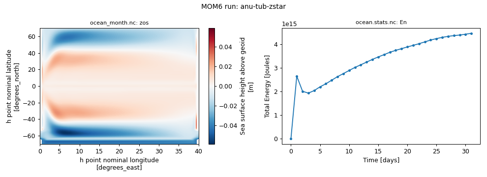
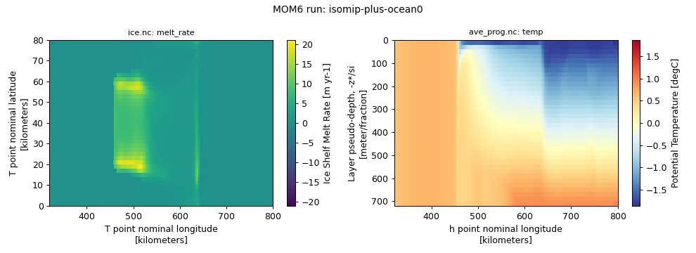

# Configurations

All configurations on this page run on NCI Gadi with the MOM6 ocean-only executable `mom6-solo`
that ships with the [ACCESS-OM3 release](https://github.com/ACCESS-NRI/ACCESS-OM3/releases)
(`module load access-om3/2026.05.004`). Each configuration has a single script that sets it
up and runs it with [payu](https://payu.readthedocs.io), and its page shows the result of
running that script.

## All configurations

Press a tag to show only the configurations that have it; press it again to show all.
**Community** = Australian community contributions, **GFDL** = GFDL's
[MOM6 examples](#mom6-examples-noaa-gfdl). Every configuration needs membership of the NCI
project `vk83` (for the ACCESS-OM3 and payu modules); the Prerequisites column lists
anything else.

--8<-- "tested-configs/results/configurations-table.md"

!!! note "Tested with Claude Code"
    The run scripts, test results and most of the text on this page were produced with
    [Claude Code](https://claude.com/claude-code) via the scripts in
    [`tested-configs/`](https://github.com/ACCESS-Community-Hub/mom6-idealised-configs/tree/main/tested-configs).
    Every page states exactly which versions were used.

## Australian community contributions

Configurations developed by the Australian MOM6 community. Each has its own page with the
tested run script, the run's provenance and known issues.

### ANU-TUB

A 1/4° sector, 40° of longitude wide, from about 70°S to 70°N. It is periodic east-west,
so zonal flow can pass through a narrow "Drake Passage" between about 65°S and 52°S.
It is forced by a steady zonal wind and by restoring to a latitude-dependent SST. It was
set up to explore MOM6's vertical-coordinate choices; the repository has set-ups for z*
(`zstar`, the default, and the one tested here), a hybrid coordinate (`hycom1`) and an
adaptive coordinate (`adapt`). Contributed by Andy Hogg and Angus Gibson.

{ width="600" }

**[ANU-TUB page: run script, results and provenance](anu-tub.md)**

### ISOMIP+ Ocean0

The ISOMIP+ Ocean0 experiment: an idealised ice-shelf cavity under warm ocean
conditions, run with a sigma-shelf z* vertical coordinate. Contributed by Claire Yung,
from branch `isomip-plus-ocean0-sigmashelfzstar`.

{ width="600" }

**[ISOMIP+ Ocean0 page: run script, results and provenance](isomip-plus.md)**

--8<-- "tested-configs/results/mom6examples-section.md"
