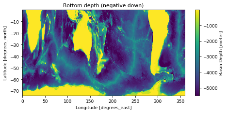
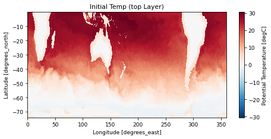
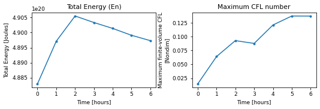

# MESO_025_63L

!!! success "Run status: :white_check_mark: ran successfully"
    Tested on 2026-11-04 with `access-om3/2026.05.004` (`mom6-solo`): 312 cores, walltime used 00:02:04, 21.49 SU. Details further down this page.


!!! abstract "Description (as on the Overview)"
    - **Grid:** 1440 x 450 points, 63 layers/levels (`GRID_CONFIG = mercator`)
    - **Vertical coordinate:** layer mode (no regridding)
    - **Topography:** `TOPO_CONFIG = file`
    - **Surface forcing:** `WIND_CONFIG = file`, `BUOY_CONFIG = MESO`
    - **Run length:** 0.25 days

    Read from this run's `MOM_parameter_doc.all`. Source: [upstream](https://github.com/NOAA-GFDL/MOM6-examples/tree/c1730b8efe16cf7f12fc8db588115cae50f3e802/ocean_only/MESO_025_63L).

Configuration files: [`ocean_only/MESO_025_63L`](https://github.com/NOAA-GFDL/MOM6-examples/tree/c1730b8efe16cf7f12fc8db588115cae50f3e802/ocean_only/MESO_025_63L) in NOAA-GFDL/MOM6-examples, at commit [`c1730b8e`](https://github.com/NOAA-GFDL/MOM6-examples/commit/c1730b8efe16cf7f12fc8db588115cae50f3e802): the version this run used. (The model itself is the `mom6-solo` listed under [Provenance](#provenance).)

GFDL excludes this example from its own automated test suite (`EXCLUDE` in [`ocean_only/Makefile`](https://github.com/NOAA-GFDL/MOM6-examples/blob/c1730b8efe16cf7f12fc8db588115cae50f3e802/ocean_only/Makefile)).

!!! warning "Known issue"
    Not a failure: the run is fine, but it lasts only 6 hours (`DAYMAX = 6` hours) while its `diag_table` writes output every 1 to 10 days, so the output files hold one record of fill values and only the energy time series can be plotted. Increase `DAYMAX` (or the output frequency) to see the flow.

## Run it yourself

From a Gadi **login node** (membership of NCI project `vk83` needed, and `ol01` for the input data):

```bash
PROJECT=<your-project> bash MESO_025_63L.sh
```

where `MESO_025_63L.sh` is the script below (click to expand; copy button top-right). It is exactly the script that produced the results on this page.

??? example "MESO_025_63L.sh"
    ```bash
    --8<-- "tested-configs/run_scripts/MESO_025_63L.sh"
    ```

## What we got

Last lines of `ocean.stats`:

```text
    18,       3.000,     0, En 5.9977452844194423E-01, CFL  0.08780, SL -3.4030E-03, M 8.17531E+20, S 34.6891, T  3.6987, Me  9.15E-09, Se  1.40E-07, Te  1.23E-05
    24,       4.000,     0, En 5.9953385836340756E-01, CFL  0.12116, SL -3.3932E-03, M 8.17531E+20, S 34.6891, T  3.6987, Me  7.18E-09, Se  5.95E-08, Te  1.19E-05
    30,       5.000,     0, En 5.9925520367687068E-01, CFL  0.13738, SL -3.3892E-03, M 8.17531E+20, S 34.6891, T  3.6987, Me  5.68E-09, Se -1.28E-09, Te  1.16E-05
    36,       6.000,     0, En 5.9903724838842987E-01, CFL  0.13724, SL -3.3884E-03, M 8.17531E+20, S 34.6891, T  3.6988, Me  4.83E-09, Se -1.58E-08, Te  1.14E-05
```

## Domain, forcing and output

Made by running the notebook [`explore_run.ipynb`](https://github.com/ACCESS-Community-Hub/access-idealised-configs/blob/main/tested-configs/notebooks/explore_run.ipynb) on this run's output folder; it only plots files MOM6 wrote during the run. **[See the notebook with its code](../notebooks/MESO_025_63L.md)**.

### Set-up


Values from this run's `MOM_parameter_doc.all`:

| Parameter | Value |
|---|---|
| `NIGLOBAL` | `1440` |
| `NJGLOBAL` | `450` |
| `NK` | `63` |
| `GRID_CONFIG` | `mercator` |
| `TOPO_CONFIG` | `file` |
| `REENTRANT_X` | `True` |
| `REENTRANT_Y` | `False` |
| `USE_REGRIDDING` | `False` |
| `ENABLE_THERMODYNAMICS` | `True` |
| `EQN_OF_STATE` | `WRIGHT` |
| `THICKNESS_CONFIG` | `file` |
| `TS_CONFIG` | `file` |
| `WIND_CONFIG` | `file` |
| `BUOY_CONFIG` | `MESO` |
| `ICE_SHELF` | `False` |
| `DT` | `600.0` |
| `DT_THERM` | `3600.0` |
| `DAYMAX` | `6.0` |


### Domain and bottom depth


Grid: 1440 x 450 points (`GRID_CONFIG = mercator`), x from 0.125 to 359.875 degrees_east, y from -73.9851 to -0.125 degrees_north. Bottom depth `D` from 7.5 to 5500 m (`TOPO_CONFIG = file`).


    

    


### Initial state


`Temp` from `MOM_IC.nc`, which MOM6 writes with the initial state.


    

    


### Surface forcing


No surface forcing is saved in this run's diagnostics. The forcing is set by `WIND_CONFIG = file` and `BUOY_CONFIG = MESO` (see the MOM6 documentation for these options).


### Energy and stability through the run


    

    


From `ocean.stats.nc`: 7 records; time axis in hours.


### Final state


No diagnostic output with a varying field was written for this run.

## Parameters compared with the reference

<span class="chip a">A</span> GFDL's file in MOM6-examples (`c1730b8e`): [`MOM_parameter_doc.all`](https://github.com/NOAA-GFDL/MOM6-examples/blob/c1730b8efe16cf7f12fc8db588115cae50f3e802/ocean_only/MESO_025_63L/MOM_parameter_doc.all)  
<span class="chip b">B</span> this run: `MOM_parameter_doc.all` in the run's output, `/scratch/<your-project>/$USER/mom6-examples/archive/MESO_025_63L/output000/MOM_parameter_doc.all` when you run the script

**2** parameter values differ; **62** parameters exist only in this run's MOM6 version and **22** only in the reference (new, removed or renamed parameters). Values are compared ignoring quotes, case and number formatting. Parameter names link to a search of the MOM6 source; reference values link to their line on GitHub.

<table class="diff"><thead><tr><th>Parameter</th><th>Units</th><th>A: reference</th><th>B: this run</th></tr></thead><tbody><tr class="mod"><td colspan="4">MOM</td></tr><tr class="param"><td><a href="https://github.com/mom-ocean/MOM6/search?q=USE_POROUS_BARRIER" target="_blank" rel="noopener">USE_POROUS_BARRIER</a></td><td class="units">Boolean</td><td class="val a" data-label="A: reference"><a href="https://github.com/NOAA-GFDL/MOM6-examples/blob/c1730b8efe16cf7f12fc8db588115cae50f3e802/ocean_only/MESO_025_63L/MOM_parameter_doc.all#L48" target="_blank" rel="noopener">True</a></td><td class="val b" data-label="B: this run">False<span class="ln"> line 47</span></td></tr><tr class="mod"><td colspan="4">MOM_diabatic_driver</td></tr><tr class="param"><td><a href="https://github.com/mom-ocean/MOM6/search?q=MLD_EN_VALS" target="_blank" rel="noopener">MLD_EN_VALS</a></td><td class="units">J/m2</td><td class="val a" data-label="A: reference"><a href="https://github.com/NOAA-GFDL/MOM6-examples/blob/c1730b8efe16cf7f12fc8db588115cae50f3e802/ocean_only/MESO_025_63L/MOM_parameter_doc.all#L1276" target="_blank" rel="noopener">3*0.0</a></td><td class="val b" data-label="B: this run">25.0, 2500.0, 2.5E+05<span class="ln"> line 1399</span></td></tr></tbody></table>

??? note "Parameters in only one of the two files (84)"
    <table class="diff"><thead><tr><th>Parameter</th><th>Units</th><th>A: reference</th><th>B: this run</th></tr></thead><tbody><tr class="mod"><td colspan="4">MOM</td></tr><tr class="param"><td><a href="https://github.com/mom-ocean/MOM6/search?q=DEFAULT_2018_ANSWERS" target="_blank" rel="noopener">DEFAULT_2018_ANSWERS</a></td><td class="units">Boolean</td><td class="val a" data-label="A: reference"><a href="https://github.com/NOAA-GFDL/MOM6-examples/blob/c1730b8efe16cf7f12fc8db588115cae50f3e802/ocean_only/MESO_025_63L/MOM_parameter_doc.all#L125" target="_blank" rel="noopener">False</a></td><td class="val b unset" data-label="B: this run">(not in this version)</td></tr><tr class="param"><td><a href="https://github.com/mom-ocean/MOM6/search?q=DT_TRACER_ADVECT" target="_blank" rel="noopener">DT_TRACER_ADVECT</a></td><td class="units">s</td><td class="val a unset" data-label="A: reference">(not in this version)</td><td class="val b" data-label="B: this run">3600.0<span class="ln"> line 76</span></td></tr><tr class="param"><td><a href="https://github.com/mom-ocean/MOM6/search?q=ENABLE_BUGS_BY_DEFAULT" target="_blank" rel="noopener">ENABLE_BUGS_BY_DEFAULT</a></td><td class="units">Boolean</td><td class="val a unset" data-label="A: reference">(not in this version)</td><td class="val b" data-label="B: this run">True<span class="ln"> line 54</span></td></tr><tr class="param"><td><a href="https://github.com/mom-ocean/MOM6/search?q=GEOM_FILE" target="_blank" rel="noopener">GEOM_FILE</a></td><td class="units"></td><td class="val a unset" data-label="A: reference">(not in this version)</td><td class="val b" data-label="B: this run">&quot;ocean_geometry&quot;<span class="ln"> line 166</span></td></tr><tr class="param"><td><a href="https://github.com/mom-ocean/MOM6/search?q=NONBLOCKING_P_SURF_BUG" target="_blank" rel="noopener">NONBLOCKING_P_SURF_BUG</a></td><td class="units">Boolean</td><td class="val a unset" data-label="A: reference">(not in this version)</td><td class="val b" data-label="B: this run">True<span class="ln"> line 130</span></td></tr><tr class="param"><td><a href="https://github.com/mom-ocean/MOM6/search?q=SPLIT_RK2B" target="_blank" rel="noopener">SPLIT_RK2B</a></td><td class="units">Boolean</td><td class="val a unset" data-label="A: reference">(not in this version)</td><td class="val b" data-label="B: this run">False<span class="ln"> line 6</span></td></tr><tr class="param"><td><a href="https://github.com/mom-ocean/MOM6/search?q=SURFACE_2018_ANSWERS" target="_blank" rel="noopener">SURFACE_2018_ANSWERS</a></td><td class="units">Boolean</td><td class="val a" data-label="A: reference"><a href="https://github.com/NOAA-GFDL/MOM6-examples/blob/c1730b8efe16cf7f12fc8db588115cae50f3e802/ocean_only/MESO_025_63L/MOM_parameter_doc.all#L127" target="_blank" rel="noopener">False</a></td><td class="val b unset" data-label="B: this run">(not in this version)</td></tr><tr class="param"><td><a href="https://github.com/mom-ocean/MOM6/search?q=TRADV_SPANS_COUPLING" target="_blank" rel="noopener">TRADV_SPANS_COUPLING</a></td><td class="units">Boolean</td><td class="val a unset" data-label="A: reference">(not in this version)</td><td class="val b" data-label="B: this run">False<span class="ln"> line 82</span></td></tr><tr class="param"><td><a href="https://github.com/mom-ocean/MOM6/search?q=USE_DIABATIC_TIME_BUG" target="_blank" rel="noopener">USE_DIABATIC_TIME_BUG</a></td><td class="units">Boolean</td><td class="val a" data-label="A: reference"><a href="https://github.com/NOAA-GFDL/MOM6-examples/blob/c1730b8efe16cf7f12fc8db588115cae50f3e802/ocean_only/MESO_025_63L/MOM_parameter_doc.all#L137" target="_blank" rel="noopener">False</a></td><td class="val b unset" data-label="B: this run">(not in this version)</td></tr><tr class="param"><td><a href="https://github.com/mom-ocean/MOM6/search?q=USE_UH_PARTICLES" target="_blank" rel="noopener">USE_UH_PARTICLES</a></td><td class="units">Boolean</td><td class="val a unset" data-label="A: reference">(not in this version)</td><td class="val b" data-label="B: this run">False<span class="ln"> line 175</span></td></tr><tr class="mod"><td colspan="4">MOM_barotropic</td></tr><tr class="param"><td><a href="https://github.com/mom-ocean/MOM6/search?q=BAROTROPIC_2018_ANSWERS" target="_blank" rel="noopener">BAROTROPIC_2018_ANSWERS</a></td><td class="units">Boolean</td><td class="val a" data-label="A: reference"><a href="https://github.com/NOAA-GFDL/MOM6-examples/blob/c1730b8efe16cf7f12fc8db588115cae50f3e802/ocean_only/MESO_025_63L/MOM_parameter_doc.all#L1122" target="_blank" rel="noopener">False</a></td><td class="val b unset" data-label="B: this run">(not in this version)</td></tr><tr class="param"><td><a href="https://github.com/mom-ocean/MOM6/search?q=BT_LINEAR_FREQ_DRAG" target="_blank" rel="noopener">BT_LINEAR_FREQ_DRAG</a></td><td class="units">Boolean</td><td class="val a unset" data-label="A: reference">(not in this version)</td><td class="val b" data-label="B: this run">False<span class="ln"> line 1264</span></td></tr><tr class="param"><td><a href="https://github.com/mom-ocean/MOM6/search?q=MASK_COASTAL_PRESSURE_FORCE" target="_blank" rel="noopener">MASK_COASTAL_PRESSURE_FORCE</a></td><td class="units">Boolean</td><td class="val a unset" data-label="A: reference">(not in this version)</td><td class="val b" data-label="B: this run">False<span class="ln"> line 1301</span></td></tr><tr class="param"><td><a href="https://github.com/mom-ocean/MOM6/search?q=TIDAL_SAL_FLATHER" target="_blank" rel="noopener">TIDAL_SAL_FLATHER</a></td><td class="units">Boolean</td><td class="val a unset" data-label="A: reference">(not in this version)</td><td class="val b" data-label="B: this run">False<span class="ln"> line 1233</span></td></tr><tr class="param"><td><a href="https://github.com/mom-ocean/MOM6/search?q=VISC_REM_BT_WEIGHT_BUG" target="_blank" rel="noopener">VISC_REM_BT_WEIGHT_BUG</a></td><td class="units">Boolean</td><td class="val a unset" data-label="A: reference">(not in this version)</td><td class="val b" data-label="B: this run">False<span class="ln"> line 1229</span></td></tr><tr class="mod"><td colspan="4">MOM_continuity</td></tr><tr class="param"><td><a href="https://github.com/mom-ocean/MOM6/search?q=CONTINUITY_SCHEME" target="_blank" rel="noopener">CONTINUITY_SCHEME</a></td><td class="units"></td><td class="val a" data-label="A: reference"><a href="https://github.com/NOAA-GFDL/MOM6-examples/blob/c1730b8efe16cf7f12fc8db588115cae50f3e802/ocean_only/MESO_025_63L/MOM_parameter_doc.all#L847" target="_blank" rel="noopener">&quot;PPM&quot;</a></td><td class="val b unset" data-label="B: this run">(not in this version)</td></tr><tr class="mod"><td colspan="4">MOM_diabatic_aux</td></tr><tr class="param"><td><a href="https://github.com/mom-ocean/MOM6/search?q=DO_BRINE_PLUME" target="_blank" rel="noopener">DO_BRINE_PLUME</a></td><td class="units">Boolean</td><td class="val a unset" data-label="A: reference">(not in this version)</td><td class="val b" data-label="B: this run">False<span class="ln"> line 1672</span></td></tr><tr class="mod"><td colspan="4">MOM_diabatic_driver</td></tr><tr class="param"><td><a href="https://github.com/mom-ocean/MOM6/search?q=BMLD_EN_VALS" target="_blank" rel="noopener">BMLD_EN_VALS</a></td><td class="units">J/m2</td><td class="val a unset" data-label="A: reference">(not in this version)</td><td class="val b" data-label="B: this run">25.0, 2500.0, 2.5E+05<span class="ln"> line 1402</span></td></tr><tr class="mod"><td colspan="4">MOM_diag_mediator</td></tr><tr class="param"><td><a href="https://github.com/mom-ocean/MOM6/search?q=DIAG_REMAPPING_USE_OM4_SUBCELLS" target="_blank" rel="noopener">DIAG_REMAPPING_USE_OM4_SUBCELLS</a></td><td class="units">Boolean</td><td class="val a unset" data-label="A: reference">(not in this version)</td><td class="val b" data-label="B: this run">True<span class="ln"> line 618</span></td></tr><tr class="param"><td><a href="https://github.com/mom-ocean/MOM6/search?q=REMAPPING_2018_ANSWERS" target="_blank" rel="noopener">REMAPPING_2018_ANSWERS</a></td><td class="units">Boolean</td><td class="val a" data-label="A: reference"><a href="https://github.com/NOAA-GFDL/MOM6-examples/blob/c1730b8efe16cf7f12fc8db588115cae50f3e802/ocean_only/MESO_025_63L/MOM_parameter_doc.all#L566" target="_blank" rel="noopener">False</a></td><td class="val b unset" data-label="B: this run">(not in this version)</td></tr><tr class="param"><td><a href="https://github.com/mom-ocean/MOM6/search?q=USE_GRID_SPACE_DIAGNOSTIC_AXES" target="_blank" rel="noopener">USE_GRID_SPACE_DIAGNOSTIC_AXES</a></td><td class="units">Boolean</td><td class="val a" data-label="A: reference"><a href="https://github.com/NOAA-GFDL/MOM6-examples/blob/c1730b8efe16cf7f12fc8db588115cae50f3e802/ocean_only/MESO_025_63L/MOM_parameter_doc.all#L577" target="_blank" rel="noopener">False</a></td><td class="val b unset" data-label="B: this run">(not in this version)</td></tr><tr class="param"><td><a href="https://github.com/mom-ocean/MOM6/search?q=USE_INDEX_DIAGNOSTIC_AXES" target="_blank" rel="noopener">USE_INDEX_DIAGNOSTIC_AXES</a></td><td class="units">Boolean</td><td class="val a unset" data-label="A: reference">(not in this version)</td><td class="val b" data-label="B: this run">False<span class="ln"> line 627</span></td></tr><tr class="mod"><td colspan="4">MOM_diagnostics</td></tr><tr class="param"><td><a href="https://github.com/mom-ocean/MOM6/search?q=INTWAVE_REMAPPING_USE_OM4_SUBCELLS" target="_blank" rel="noopener">INTWAVE_REMAPPING_USE_OM4_SUBCELLS</a></td><td class="units">Boolean</td><td class="val a unset" data-label="A: reference">(not in this version)</td><td class="val b" data-label="B: this run">True<span class="ln"> line 1346</span></td></tr><tr class="mod"><td colspan="4">MOM_dynamics_split_RK2</td></tr><tr class="param"><td><a href="https://github.com/mom-ocean/MOM6/search?q=BT_ADJ_CORR_MASS_SRC" target="_blank" rel="noopener">BT_ADJ_CORR_MASS_SRC</a></td><td class="units">Boolean</td><td class="val a unset" data-label="A: reference">(not in this version)</td><td class="val b" data-label="B: this run">True<span class="ln"> line 906</span></td></tr><tr class="param"><td><a href="https://github.com/mom-ocean/MOM6/search?q=CALCULATE_SAL" target="_blank" rel="noopener">CALCULATE_SAL</a></td><td class="units">Boolean</td><td class="val a unset" data-label="A: reference">(not in this version)</td><td class="val b" data-label="B: this run">False<span class="ln"> line 883</span></td></tr><tr class="param"><td><a href="https://github.com/mom-ocean/MOM6/search?q=FPMIX" target="_blank" rel="noopener">FPMIX</a></td><td class="units">Boolean</td><td class="val a unset" data-label="A: reference">(not in this version)</td><td class="val b" data-label="B: this run">False<span class="ln"> line 914</span></td></tr><tr class="param"><td><a href="https://github.com/mom-ocean/MOM6/search?q=SET_DTBT_USE_BT_CONT" target="_blank" rel="noopener">SET_DTBT_USE_BT_CONT</a></td><td class="units">Boolean</td><td class="val a unset" data-label="A: reference">(not in this version)</td><td class="val b" data-label="B: this run">False<span class="ln"> line 898</span></td></tr><tr class="param"><td><a href="https://github.com/mom-ocean/MOM6/search?q=USE_HA" target="_blank" rel="noopener">USE_HA</a></td><td class="units">Boolean</td><td class="val a unset" data-label="A: reference">(not in this version)</td><td class="val b" data-label="B: this run">False<span class="ln"> line 885</span></td></tr><tr class="param"><td><a href="https://github.com/mom-ocean/MOM6/search?q=VISC_REM_BUG" target="_blank" rel="noopener">VISC_REM_BUG</a></td><td class="units">Boolean</td><td class="val a unset" data-label="A: reference">(not in this version)</td><td class="val b" data-label="B: this run">False<span class="ln"> line 917</span></td></tr><tr class="param"><td><a href="https://github.com/mom-ocean/MOM6/search?q=VISC_REM_TIMESTEP_BUG" target="_blank" rel="noopener">VISC_REM_TIMESTEP_BUG</a></td><td class="units">Boolean</td><td class="val a unset" data-label="A: reference">(not in this version)</td><td class="val b" data-label="B: this run">False<span class="ln"> line 922</span></td></tr><tr class="mod"><td colspan="4">MOM_EOS</td></tr><tr class="param"><td><a href="https://github.com/mom-ocean/MOM6/search?q=TFREEZE_S_IS_PRACS" target="_blank" rel="noopener">TFREEZE_S_IS_PRACS</a></td><td class="units">Boolean</td><td class="val a unset" data-label="A: reference">(not in this version)</td><td class="val b" data-label="B: this run">True<span class="ln"> line 377</span></td></tr><tr class="param"><td><a href="https://github.com/mom-ocean/MOM6/search?q=TFREEZE_T_IS_POTT" target="_blank" rel="noopener">TFREEZE_T_IS_POTT</a></td><td class="units">Boolean</td><td class="val a unset" data-label="A: reference">(not in this version)</td><td class="val b" data-label="B: this run">True<span class="ln"> line 380</span></td></tr><tr class="param"><td><a href="https://github.com/mom-ocean/MOM6/search?q=USE_WRIGHT_2ND_DERIV_BUG" target="_blank" rel="noopener">USE_WRIGHT_2ND_DERIV_BUG</a></td><td class="units">Boolean</td><td class="val a unset" data-label="A: reference">(not in this version)</td><td class="val b" data-label="B: this run">False<span class="ln"> line 357</span></td></tr><tr class="mod"><td colspan="4">MOM_hor_bnd_diffusion</td></tr><tr class="param"><td><a href="https://github.com/mom-ocean/MOM6/search?q=USE_HORIZONTAL_BOUNDARY_DIFFUSION" target="_blank" rel="noopener">USE_HORIZONTAL_BOUNDARY_DIFFUSION</a></td><td class="units">Boolean</td><td class="val a unset" data-label="A: reference">(not in this version)</td><td class="val b" data-label="B: this run">False<span class="ln"> line 1855</span></td></tr><tr class="mod"><td colspan="4">MOM_hor_visc</td></tr><tr class="param"><td><a href="https://github.com/mom-ocean/MOM6/search?q=BETTER_BOUND_AH" target="_blank" rel="noopener">BETTER_BOUND_AH</a></td><td class="units">Boolean</td><td class="val a" data-label="A: reference"><a href="https://github.com/NOAA-GFDL/MOM6-examples/blob/c1730b8efe16cf7f12fc8db588115cae50f3e802/ocean_only/MESO_025_63L/MOM_parameter_doc.all#L990" target="_blank" rel="noopener">True</a></td><td class="val b unset" data-label="B: this run">(not in this version)</td></tr><tr class="param"><td><a href="https://github.com/mom-ocean/MOM6/search?q=FRICTWORK_BUG" target="_blank" rel="noopener">FRICTWORK_BUG</a></td><td class="units">Boolean</td><td class="val a unset" data-label="A: reference">(not in this version)</td><td class="val b" data-label="B: this run">False<span class="ln"> line 1122</span></td></tr><tr class="param"><td><a href="https://github.com/mom-ocean/MOM6/search?q=HOR_VISC_2018_ANSWERS" target="_blank" rel="noopener">HOR_VISC_2018_ANSWERS</a></td><td class="units">Boolean</td><td class="val a" data-label="A: reference"><a href="https://github.com/NOAA-GFDL/MOM6-examples/blob/c1730b8efe16cf7f12fc8db588115cae50f3e802/ocean_only/MESO_025_63L/MOM_parameter_doc.all#L959" target="_blank" rel="noopener">False</a></td><td class="val b unset" data-label="B: this run">(not in this version)</td></tr><tr class="param"><td><a href="https://github.com/mom-ocean/MOM6/search?q=HOR_VISC_ANSWER_DATE" target="_blank" rel="noopener">HOR_VISC_ANSWER_DATE</a></td><td class="units"></td><td class="val a" data-label="A: reference"><a href="https://github.com/NOAA-GFDL/MOM6-examples/blob/c1730b8efe16cf7f12fc8db588115cae50f3e802/ocean_only/MESO_025_63L/MOM_parameter_doc.all#L963" target="_blank" rel="noopener">99991231</a></td><td class="val b unset" data-label="B: this run">(not in this version)</td></tr><tr class="param"><td><a href="https://github.com/mom-ocean/MOM6/search?q=USE_CIRCULATION_IN_HORVISC" target="_blank" rel="noopener">USE_CIRCULATION_IN_HORVISC</a></td><td class="units">Boolean</td><td class="val a unset" data-label="A: reference">(not in this version)</td><td class="val b" data-label="B: this run">False<span class="ln"> line 1070</span></td></tr><tr class="param"><td><a href="https://github.com/mom-ocean/MOM6/search?q=USE_CONT_THICKNESS" target="_blank" rel="noopener">USE_CONT_THICKNESS</a></td><td class="units">Boolean</td><td class="val a unset" data-label="A: reference">(not in this version)</td><td class="val b" data-label="B: this run">False<span class="ln"> line 1073</span></td></tr><tr class="param"><td><a href="https://github.com/mom-ocean/MOM6/search?q=USE_LEITHY" target="_blank" rel="noopener">USE_LEITHY</a></td><td class="units">Boolean</td><td class="val a unset" data-label="A: reference">(not in this version)</td><td class="val b" data-label="B: this run">False<span class="ln"> line 1095</span></td></tr><tr class="mod"><td colspan="4">MOM_kappa_shear</td></tr><tr class="param"><td><a href="https://github.com/mom-ocean/MOM6/search?q=LZ_RESCALE" target="_blank" rel="noopener">LZ_RESCALE</a></td><td class="units">nondim</td><td class="val a unset" data-label="A: reference">(not in this version)</td><td class="val b" data-label="B: this run">1.0<span class="ln"> line 1601</span></td></tr><tr class="param"><td><a href="https://github.com/mom-ocean/MOM6/search?q=VERTEX_SHEAR_THICKNESS_MEAN" target="_blank" rel="noopener">VERTEX_SHEAR_THICKNESS_MEAN</a></td><td class="units">Boolean</td><td class="val a unset" data-label="A: reference">(not in this version)</td><td class="val b" data-label="B: this run">False<span class="ln"> line 1563</span></td></tr><tr class="mod"><td colspan="4">MOM_lateral_boundary_diffusion</td></tr><tr class="param"><td><a href="https://github.com/mom-ocean/MOM6/search?q=USE_LATERAL_BOUNDARY_DIFFUSION" target="_blank" rel="noopener">USE_LATERAL_BOUNDARY_DIFFUSION</a></td><td class="units">Boolean</td><td class="val a" data-label="A: reference"><a href="https://github.com/NOAA-GFDL/MOM6-examples/blob/c1730b8efe16cf7f12fc8db588115cae50f3e802/ocean_only/MESO_025_63L/MOM_parameter_doc.all#L1717" target="_blank" rel="noopener">False</a></td><td class="val b unset" data-label="B: this run">(not in this version)</td></tr><tr class="mod"><td colspan="4">MOM_lateral_mixing_coeffs</td></tr><tr class="param"><td><a href="https://github.com/mom-ocean/MOM6/search?q=BACKSCAT_EBT_POWER" target="_blank" rel="noopener">BACKSCAT_EBT_POWER</a></td><td class="units">nondim</td><td class="val a unset" data-label="A: reference">(not in this version)</td><td class="val b" data-label="B: this run">0.0<span class="ln"> line 704</span></td></tr><tr class="param"><td><a href="https://github.com/mom-ocean/MOM6/search?q=BS_USE_SQG_STRUCT" target="_blank" rel="noopener">BS_USE_SQG_STRUCT</a></td><td class="units">Boolean</td><td class="val a unset" data-label="A: reference">(not in this version)</td><td class="val b" data-label="B: this run">False<span class="ln"> line 707</span></td></tr><tr class="param"><td><a href="https://github.com/mom-ocean/MOM6/search?q=KD_GL90_USE_SQG_STRUCT" target="_blank" rel="noopener">KD_GL90_USE_SQG_STRUCT</a></td><td class="units">Boolean</td><td class="val a unset" data-label="A: reference">(not in this version)</td><td class="val b" data-label="B: this run">False<span class="ln"> line 725</span></td></tr><tr class="param"><td><a href="https://github.com/mom-ocean/MOM6/search?q=KHTH_USE_SQG_STRUCT" target="_blank" rel="noopener">KHTH_USE_SQG_STRUCT</a></td><td class="units">Boolean</td><td class="val a unset" data-label="A: reference">(not in this version)</td><td class="val b" data-label="B: this run">False<span class="ln"> line 713</span></td></tr><tr class="param"><td><a href="https://github.com/mom-ocean/MOM6/search?q=KHTR_USE_EBT_STRUCT" target="_blank" rel="noopener">KHTR_USE_EBT_STRUCT</a></td><td class="units">Boolean</td><td class="val a unset" data-label="A: reference">(not in this version)</td><td class="val b" data-label="B: this run">False<span class="ln"> line 716</span></td></tr><tr class="param"><td><a href="https://github.com/mom-ocean/MOM6/search?q=KHTR_USE_SQG_STRUCT" target="_blank" rel="noopener">KHTR_USE_SQG_STRUCT</a></td><td class="units">Boolean</td><td class="val a unset" data-label="A: reference">(not in this version)</td><td class="val b" data-label="B: this run">False<span class="ln"> line 719</span></td></tr><tr class="mod"><td colspan="4">MOM_mixed_layer</td></tr><tr class="param"><td><a href="https://github.com/mom-ocean/MOM6/search?q=BML_NONBOUSINESQ" target="_blank" rel="noopener">BML_NONBOUSINESQ</a></td><td class="units">Boolean</td><td class="val a unset" data-label="A: reference">(not in this version)</td><td class="val b" data-label="B: this run">False<span class="ln"> line 1746</span></td></tr><tr class="mod"><td colspan="4">MOM_opacity</td></tr><tr class="param"><td><a href="https://github.com/mom-ocean/MOM6/search?q=OPTICS_2018_ANSWERS" target="_blank" rel="noopener">OPTICS_2018_ANSWERS</a></td><td class="units">Boolean</td><td class="val a" data-label="A: reference"><a href="https://github.com/NOAA-GFDL/MOM6-examples/blob/c1730b8efe16cf7f12fc8db588115cae50f3e802/ocean_only/MESO_025_63L/MOM_parameter_doc.all#L1651" target="_blank" rel="noopener">False</a></td><td class="val b unset" data-label="B: this run">(not in this version)</td></tr><tr class="mod"><td colspan="4">MOM_porous_barriers</td></tr><tr class="param"><td><a href="https://github.com/mom-ocean/MOM6/search?q=PORBAR_ANSWER_DATE" target="_blank" rel="noopener">PORBAR_ANSWER_DATE</a></td><td class="units"></td><td class="val a" data-label="A: reference"><a href="https://github.com/NOAA-GFDL/MOM6-examples/blob/c1730b8efe16cf7f12fc8db588115cae50f3e802/ocean_only/MESO_025_63L/MOM_parameter_doc.all#L806" target="_blank" rel="noopener">99991231</a></td><td class="val b unset" data-label="B: this run">(not in this version)</td></tr><tr class="param"><td><a href="https://github.com/mom-ocean/MOM6/search?q=PORBAR_ETA_INTERP" target="_blank" rel="noopener">PORBAR_ETA_INTERP</a></td><td class="units"></td><td class="val a" data-label="A: reference"><a href="https://github.com/NOAA-GFDL/MOM6-examples/blob/c1730b8efe16cf7f12fc8db588115cae50f3e802/ocean_only/MESO_025_63L/MOM_parameter_doc.all#L814" target="_blank" rel="noopener">&quot;MAX&quot;</a></td><td class="val b unset" data-label="B: this run">(not in this version)</td></tr><tr class="param"><td><a href="https://github.com/mom-ocean/MOM6/search?q=PORBAR_MASKING_DEPTH" target="_blank" rel="noopener">PORBAR_MASKING_DEPTH</a></td><td class="units">m</td><td class="val a" data-label="A: reference"><a href="https://github.com/NOAA-GFDL/MOM6-examples/blob/c1730b8efe16cf7f12fc8db588115cae50f3e802/ocean_only/MESO_025_63L/MOM_parameter_doc.all#L810" target="_blank" rel="noopener">0.0</a></td><td class="val b unset" data-label="B: this run">(not in this version)</td></tr><tr class="mod"><td colspan="4">MOM_PressureForce_FV</td></tr><tr class="param"><td><a href="https://github.com/mom-ocean/MOM6/search?q=CORRECTION_INTXPA" target="_blank" rel="noopener">CORRECTION_INTXPA</a></td><td class="units">Boolean</td><td class="val a unset" data-label="A: reference">(not in this version)</td><td class="val b" data-label="B: this run">False<span class="ln"> line 1036</span></td></tr><tr class="param"><td><a href="https://github.com/mom-ocean/MOM6/search?q=MASS_WEIGHT_IN_PGF_VANISHED_ONLY" target="_blank" rel="noopener">MASS_WEIGHT_IN_PGF_VANISHED_ONLY</a></td><td class="units">Boolean</td><td class="val a unset" data-label="A: reference">(not in this version)</td><td class="val b" data-label="B: this run">False<span class="ln"> line 1033</span></td></tr><tr class="param"><td><a href="https://github.com/mom-ocean/MOM6/search?q=MASS_WEIGHT_IN_PRESSURE_GRADIENT_TOP" target="_blank" rel="noopener">MASS_WEIGHT_IN_PRESSURE_GRADIENT_TOP</a></td><td class="units">Boolean</td><td class="val a unset" data-label="A: reference">(not in this version)</td><td class="val b" data-label="B: this run">False<span class="ln"> line 1029</span></td></tr><tr class="param"><td><a href="https://github.com/mom-ocean/MOM6/search?q=RESET_INTXPA_INTEGRAL" target="_blank" rel="noopener">RESET_INTXPA_INTEGRAL</a></td><td class="units">Boolean</td><td class="val a unset" data-label="A: reference">(not in this version)</td><td class="val b" data-label="B: this run">False<span class="ln"> line 1038</span></td></tr><tr class="param"><td><a href="https://github.com/mom-ocean/MOM6/search?q=RESET_INTXPA_INTEGRAL_FLATTEST" target="_blank" rel="noopener">RESET_INTXPA_INTEGRAL_FLATTEST</a></td><td class="units">Boolean</td><td class="val a unset" data-label="A: reference">(not in this version)</td><td class="val b" data-label="B: this run">False<span class="ln"> line 1041</span></td></tr><tr class="param"><td><a href="https://github.com/mom-ocean/MOM6/search?q=RHO_PGF_REF" target="_blank" rel="noopener">RHO_PGF_REF</a></td><td class="units">kg m-3</td><td class="val a unset" data-label="A: reference">(not in this version)</td><td class="val b" data-label="B: this run">1035.0<span class="ln"> line 1012</span></td></tr><tr class="param"><td><a href="https://github.com/mom-ocean/MOM6/search?q=RHO_PGF_REF_BUG" target="_blank" rel="noopener">RHO_PGF_REF_BUG</a></td><td class="units">Boolean</td><td class="val a unset" data-label="A: reference">(not in this version)</td><td class="val b" data-label="B: this run">True<span class="ln"> line 1016</span></td></tr><tr class="param"><td><a href="https://github.com/mom-ocean/MOM6/search?q=SSH_IN_EOS_PRESSURE_FOR_PGF" target="_blank" rel="noopener">SSH_IN_EOS_PRESSURE_FOR_PGF</a></td><td class="units">Boolean</td><td class="val a unset" data-label="A: reference">(not in this version)</td><td class="val b" data-label="B: this run">False<span class="ln"> line 1021</span></td></tr><tr class="mod"><td colspan="4">MOM_restart</td></tr><tr class="param"><td><a href="https://github.com/mom-ocean/MOM6/search?q=RESTART_SYMMETRIC_CHECKSUMS" target="_blank" rel="noopener">RESTART_SYMMETRIC_CHECKSUMS</a></td><td class="units">Boolean</td><td class="val a unset" data-label="A: reference">(not in this version)</td><td class="val b" data-label="B: this run">False<span class="ln"> line 399</span></td></tr><tr class="param"><td><a href="https://github.com/mom-ocean/MOM6/search?q=RESTART_UNSIGNED_ZEROS" target="_blank" rel="noopener">RESTART_UNSIGNED_ZEROS</a></td><td class="units">Boolean</td><td class="val a unset" data-label="A: reference">(not in this version)</td><td class="val b" data-label="B: this run">False<span class="ln"> line 402</span></td></tr><tr class="param"><td><a href="https://github.com/mom-ocean/MOM6/search?q=USE_FILTER" target="_blank" rel="noopener">USE_FILTER</a></td><td class="units">Boolean</td><td class="val a unset" data-label="A: reference">(not in this version)</td><td class="val b" data-label="B: this run">False<span class="ln"> line 406</span></td></tr><tr class="mod"><td colspan="4">MOM_set_diffusivity</td></tr><tr class="param"><td><a href="https://github.com/mom-ocean/MOM6/search?q=SET_DIFF_2018_ANSWERS" target="_blank" rel="noopener">SET_DIFF_2018_ANSWERS</a></td><td class="units">Boolean</td><td class="val a" data-label="A: reference"><a href="https://github.com/NOAA-GFDL/MOM6-examples/blob/c1730b8efe16cf7f12fc8db588115cae50f3e802/ocean_only/MESO_025_63L/MOM_parameter_doc.all#L1316" target="_blank" rel="noopener">False</a></td><td class="val b unset" data-label="B: this run">(not in this version)</td></tr><tr class="mod"><td colspan="4">MOM_set_visc</td></tr><tr class="param"><td><a href="https://github.com/mom-ocean/MOM6/search?q=SET_VISC_2018_ANSWERS" target="_blank" rel="noopener">SET_VISC_2018_ANSWERS</a></td><td class="units">Boolean</td><td class="val a" data-label="A: reference"><a href="https://github.com/NOAA-GFDL/MOM6-examples/blob/c1730b8efe16cf7f12fc8db588115cae50f3e802/ocean_only/MESO_025_63L/MOM_parameter_doc.all#L663" target="_blank" rel="noopener">False</a></td><td class="val b unset" data-label="B: this run">(not in this version)</td></tr><tr class="mod"><td colspan="4">MOM_state_initialization</td></tr><tr class="param"><td><a href="https://github.com/mom-ocean/MOM6/search?q=CONVERT_THICKNESS_UNITS" target="_blank" rel="noopener">CONVERT_THICKNESS_UNITS</a></td><td class="units">Boolean</td><td class="val a" data-label="A: reference"><a href="https://github.com/NOAA-GFDL/MOM6-examples/blob/c1730b8efe16cf7f12fc8db588115cae50f3e802/ocean_only/MESO_025_63L/MOM_parameter_doc.all#L522" target="_blank" rel="noopener">False</a></td><td class="val b unset" data-label="B: this run">(not in this version)</td></tr><tr class="mod"><td colspan="4">MOM_sum_output</td></tr><tr class="param"><td><a href="https://github.com/mom-ocean/MOM6/search?q=ISO_DATE_STAMPED_STDOUT" target="_blank" rel="noopener">ISO_DATE_STAMPED_STDOUT</a></td><td class="units">Boolean</td><td class="val a unset" data-label="A: reference">(not in this version)</td><td class="val b" data-label="B: this run">False<span class="ln"> line 1883</span></td></tr><tr class="mod"><td colspan="4">MOM_surface_forcing</td></tr><tr class="param"><td><a href="https://github.com/mom-ocean/MOM6/search?q=FIX_USTAR_GUSTLESS_BUG" target="_blank" rel="noopener">FIX_USTAR_GUSTLESS_BUG</a></td><td class="units">Boolean</td><td class="val a" data-label="A: reference"><a href="https://github.com/NOAA-GFDL/MOM6-examples/blob/c1730b8efe16cf7f12fc8db588115cae50f3e802/ocean_only/MESO_025_63L/MOM_parameter_doc.all#L1816" target="_blank" rel="noopener">True</a></td><td class="val b unset" data-label="B: this run">(not in this version)</td></tr><tr class="param"><td><a href="https://github.com/mom-ocean/MOM6/search?q=RESTORE_FLUX_RHO" target="_blank" rel="noopener">RESTORE_FLUX_RHO</a></td><td class="units">kg m-3</td><td class="val a unset" data-label="A: reference">(not in this version)</td><td class="val b" data-label="B: this run">1035.0<span class="ln"> line 1962</span></td></tr><tr class="param"><td><a href="https://github.com/mom-ocean/MOM6/search?q=USTAR_GUSTLESS_BUG" target="_blank" rel="noopener">USTAR_GUSTLESS_BUG</a></td><td class="units">Boolean</td><td class="val a unset" data-label="A: reference">(not in this version)</td><td class="val b" data-label="B: this run">False<span class="ln"> line 1967</span></td></tr><tr class="param"><td><a href="https://github.com/mom-ocean/MOM6/search?q=WIND_FILE_DAYS_PER_RECORD" target="_blank" rel="noopener">WIND_FILE_DAYS_PER_RECORD</a></td><td class="units"></td><td class="val a unset" data-label="A: reference">(not in this version)</td><td class="val b" data-label="B: this run">0<span class="ln"> line 1942</span></td></tr><tr class="mod"><td colspan="4">MOM_thickness_diffuse</td></tr><tr class="param"><td><a href="https://github.com/mom-ocean/MOM6/search?q=USE_KH_IN_MEKE" target="_blank" rel="noopener">USE_KH_IN_MEKE</a></td><td class="units">Boolean</td><td class="val a" data-label="A: reference"><a href="https://github.com/NOAA-GFDL/MOM6-examples/blob/c1730b8efe16cf7f12fc8db588115cae50f3e802/ocean_only/MESO_025_63L/MOM_parameter_doc.all#L792" target="_blank" rel="noopener">False</a></td><td class="val b unset" data-label="B: this run">(not in this version)</td></tr><tr class="mod"><td colspan="4">MOM_tidal_mixing</td></tr><tr class="param"><td><a href="https://github.com/mom-ocean/MOM6/search?q=DRAG_DIFFUSIVITY_ANSWER_DATE" target="_blank" rel="noopener">DRAG_DIFFUSIVITY_ANSWER_DATE</a></td><td class="units"></td><td class="val a unset" data-label="A: reference">(not in this version)</td><td class="val b" data-label="B: this run">99991231<span class="ln"> line 1496</span></td></tr><tr class="param"><td><a href="https://github.com/mom-ocean/MOM6/search?q=DZ_BBL_AVG_MIN" target="_blank" rel="noopener">DZ_BBL_AVG_MIN</a></td><td class="units">m</td><td class="val a unset" data-label="A: reference">(not in this version)</td><td class="val b" data-label="B: this run">0.0<span class="ln"> line 1500</span></td></tr><tr class="mod"><td colspan="4">MOM_tracer_flow_control</td></tr><tr class="param"><td><a href="https://github.com/mom-ocean/MOM6/search?q=USE_FILE_DYES" target="_blank" rel="noopener">USE_FILE_DYES</a></td><td class="units">Boolean</td><td class="val a unset" data-label="A: reference">(not in this version)</td><td class="val b" data-label="B: this run">False<span class="ln"> line 425</span></td></tr><tr class="param"><td><a href="https://github.com/mom-ocean/MOM6/search?q=USE_MARBL_TRACERS" target="_blank" rel="noopener">USE_MARBL_TRACERS</a></td><td class="units">Boolean</td><td class="val a unset" data-label="A: reference">(not in this version)</td><td class="val b" data-label="B: this run">False<span class="ln"> line 421</span></td></tr><tr class="mod"><td colspan="4">MOM_vert_friction</td></tr><tr class="param"><td><a href="https://github.com/mom-ocean/MOM6/search?q=CFL_BASED_TRUNCATIONS" target="_blank" rel="noopener">CFL_BASED_TRUNCATIONS</a></td><td class="units">Boolean</td><td class="val a" data-label="A: reference"><a href="https://github.com/NOAA-GFDL/MOM6-examples/blob/c1730b8efe16cf7f12fc8db588115cae50f3e802/ocean_only/MESO_025_63L/MOM_parameter_doc.all#L1056" target="_blank" rel="noopener">True</a></td><td class="val b unset" data-label="B: this run">(not in this version)</td></tr><tr class="param"><td><a href="https://github.com/mom-ocean/MOM6/search?q=VERT_FRICTION_2018_ANSWERS" target="_blank" rel="noopener">VERT_FRICTION_2018_ANSWERS</a></td><td class="units">Boolean</td><td class="val a" data-label="A: reference"><a href="https://github.com/NOAA-GFDL/MOM6-examples/blob/c1730b8efe16cf7f12fc8db588115cae50f3e802/ocean_only/MESO_025_63L/MOM_parameter_doc.all#L1017" target="_blank" rel="noopener">False</a></td><td class="val b unset" data-label="B: this run">(not in this version)</td></tr><tr class="mod"><td colspan="4">MOM_verticalGrid</td></tr><tr class="param"><td><a href="https://github.com/mom-ocean/MOM6/search?q=ADVECTION_SCHEME_VARIANCE_UNDERFLOW" target="_blank" rel="noopener">ADVECTION_SCHEME_VARIANCE_UNDERFLOW</a></td><td class="units">Conc2 (tracer dependent)</td><td class="val a unset" data-label="A: reference">(not in this version)</td><td class="val b" data-label="B: this run">1.0E-23<span class="ln"> line 345</span></td></tr><tr class="mod"><td colspan="4">MOM_Zanna_Bolton</td></tr><tr class="param"><td><a href="https://github.com/mom-ocean/MOM6/search?q=USE_ZB2020" target="_blank" rel="noopener">USE_ZB2020</a></td><td class="units">Boolean</td><td class="val a unset" data-label="A: reference">(not in this version)</td><td class="val b" data-label="B: this run">False<span class="ln"> line 1065</span></td></tr><tr class="mod"><td colspan="4">ocean_stochastics_init</td></tr><tr class="param"><td><a href="https://github.com/mom-ocean/MOM6/search?q=DO_SKEB" target="_blank" rel="noopener">DO_SKEB</a></td><td class="units">Boolean</td><td class="val a unset" data-label="A: reference">(not in this version)</td><td class="val b" data-label="B: this run">False<span class="ln"> line 1905</span></td></tr></tbody></table>

## Provenance

| What | Value |
|---|---|
| MOM6-examples | [`c1730b8efe16cf7f12fc8db588115cae50f3e802`](https://github.com/NOAA-GFDL/MOM6-examples/commit/c1730b8efe16cf7f12fc8db588115cae50f3e802) |
| ACCESS-OM3 module | `access-om3/2026.05.004` |
| MOM6 source code | `ACCESS-NRI/MOM6 2026.05.003 d11a149ccba676d524312328f7eb62560a156dc3` |
| Executable | `/g/data/vk83/apps/spack/1.1/release/linux-x86_64_v4/access-mom6-2026.05.003-ld7hklzo5ajizx5u4yl74i4ijberrpv6/bin/mom6-solo` |
| Executable md5 | `4785d157c76c30d8d01baf7d0f69d218` |
| payu | `1.3.6_1` (module `payu/1.3.6_1`) |
| Date tested | 2026-11-04 |
| PBS Job Id | `183115259.gadi-pbs` |
| PBS Exit Status | `0` |
| PBS Service Units | `21.49` |
| PBS NCPUs Requested | `312` |
| PBS Walltime Used | `00:02:04` |
| PBS Memory Used | `126.29GB` |

??? info "Input files and md5 hashes (from payu `manifests/input.yaml`)"
    | File | md5 | Comes from |
    |---|---|---|
    | `INPUT/MESO_025_63L_IC.nc` | `fc72c9194e92ad30296cdbabda5c51ac` | `ol01` data: `MESO_025_63L/riga/INPUT/MESO_025_63L_IC.nc` |
    | `INPUT/MESO_025_63L_topog.nc` | `1bf6f7e051772d61830fd046a4540506` | `ol01` data: `MESO_025_63L/riga/INPUT/MESO_025_63L_topog.nc` |
    | `INPUT/MESO_Forcing_025.nc` | `79022f3334ce5798e30ec86aeb556d31` | `ol01` data: `MESO_025_63L/riga/INPUT/MESO_Forcing_025.nc` |
    | `INPUT/MESO_SfcTS_025.nc` | `cdcb10545e6f6ce306b93c47925c9fc1` | `ol01` data: `MESO_025_63L/riga/INPUT/MESO_SfcTS_025.nc` |
    | `INPUT/MESO_Solar_025.nc` | `f52248564e2bbd211c1cb058379c50eb` | `ol01` data: `MESO_025_63L/riga/INPUT/MESO_Solar_025.nc` |
    | `INPUT/MESO_Sponge_025mNG.nc` | `a77bfe583a977195944f1f383d3a56af` | `ol01` data: `MESO_025_63L/riga/INPUT/MESO_Sponge_025mNG.nc` |
    | `INPUT/MESO_str_025.nc` | `b2d577f5f8726ac245c55a3ac9799b06` | `ol01` data: `MESO_025_63L/riga/INPUT/MESO_str_025.nc` |
    | `INPUT/README` | `3e7c71c038605c9c9256708e0161132d` | `ol01` data: `MESO_025_63L/riga/INPUT/README` |

??? info "Run-time environment (selected variables from payu's `env.yaml`)"
    | Variable | Value |
    |---|---|
    | `LD_LIBRARY_PATH` | `/apps/openmpi/4.1.7/lib:/apps/openmpi/4.1.7/lib/profilers` |
    | `LOADEDMODULES` | `access3-share/2026.03.002-eale5gm:access-cice/CICE6.6.3-2-huasrvo:access-mocsy/2025.07.002-saj7rvh:access-generic-tracers/2026.09.000-e3zb3ez:access-mom6/2026.05.003-ld7hklz:access-ww3/2026.03.001-bjzidie:access3/2026.03.002-26wbxup:access-om3/2026.05.004:pbs:openmpi/4.1.7` |
    | `OMPI_MCA_orte_tmpdir_base` | `/jobfs/183115259.gadi-pbs` |
    | `PAYU_TELEMETRY_ENV_VERSION` | `1.3.6_1` |
    | `PBS_NCI_NCPUS_PER_NODE` | `104` |
    | `PBS_NCPUS` | `312` |
    | `PBS_QUEUE` | `normalsr-exec` |

??? info "payu config.yaml written by the script"
    ```yaml
    # payu configuration for MOM6-examples/ocean_only/MESO_025_63L (written by MESO_025_63L.sh)
    project: tm70
    queue: normalsr          # mom6-solo is compiled for Sapphire Rapids nodes
    ncpus: 288
    walltime: 01:00:00
    jobname: MESO_025_63L
    experiment: MESO_025_63L
    laboratory: /g/data/tm70/cyb561/repos/claude/mom6-idealised-configs/runs/lab

    model: mom6
    exe: mom6-solo           # found on PATH once the module below is loaded
    input: /g/data/tm70/cyb561/repos/claude/mom6-idealised-configs/runs/MOM6-examples/ocean_only/MESO_025_63L/INPUT

    modules:
      use:
        - /g/data/vk83/modules
      load:
        - access-om3/2026.05.004

    storage:                 # vk83: executable, ol01: input data
      gdata:
        - vk83
        - ol01

    collate: false           # mom6 writes un-split netCDF files when IO_LAYOUT = 1,1
    runlog: false            # don't commit run logs into the MOM6-examples clone
    metadata:
      enable: false
    ```

??? info "Output files"
    | File | Size | What it is |
    |---|---|---|
    | `MOM_IC.nc` | 3959.27 MB | Initial state written by MOM6 at the start of the run |
    | `MOM_IC_1.nc` | 663.59 MB |  |
    | `Vertical_coordinate.nc` | 0.00 MB | The vertical coordinate: target values of the layers or levels |
    | `ave_prog.nc` | 819.60 MB | Diagnostics set in `diag_table`: time averages of `u`, `v`, `h`, `e`, every 10 days |
    | `forcing.nc` | 15.61 MB | Diagnostics set in `diag_table`: time averages of `taux`, `tauy`, `ustar`, `PRCmE`, `SW`, `LwLatSens`, every 10 days |
    | `ocean.stats.nc` | 0.02 MB | Domain totals at each energy-save time (energy, mass, heat, salt, maximum CFL); the netCDF form of `ocean.stats` |
    | `ocean_geometry.nc` | 98.68 MB | Static grid: coordinates, cell sizes and areas, bottom depth `D`, Coriolis parameter, land mask |
    | `ocean_static.nc` | 38.98 MB | Diagnostics set in `diag_table`: snapshots of `geolon`, `geolat`, `geolon_c`, `geolat_c`, `geolon_u`, `geolat_u`, `geolon_v`, `geolat_v` and 7 more, written once (static) |
    | `prog.nc` | 2.62 MB | Diagnostics set in `diag_table`: snapshots of `SSH`, every 1 days |

