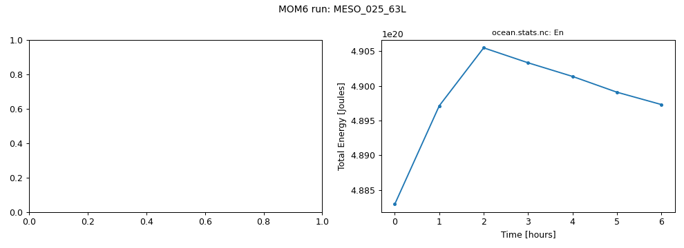

# MESO_025_63L

Near-global 1/4° "MESO" configuration with 63 layers.

Upstream configuration: [`ocean_only/MESO_025_63L`](https://github.com/NOAA-GFDL/MOM6-examples/tree/c1730b8efe16cf7f12fc8db588115cae50f3e802/ocean_only/MESO_025_63L) (MOM6-examples commit [`c1730b8e`](https://github.com/NOAA-GFDL/MOM6-examples/commit/c1730b8efe16cf7f12fc8db588115cae50f3e802)).

GFDL excludes this example from its own automated test suite (`EXCLUDE` in [`ocean_only/Makefile`](https://github.com/NOAA-GFDL/MOM6-examples/blob/c1730b8efe16cf7f12fc8db588115cae50f3e802/ocean_only/Makefile)).

!!! success "Tested: this example runs"
    Ran on Gadi on 2026-11-04 with `access-om3/2026.05.004` (`mom6-solo`) and `payu/1.3.6_1` on 288 Sapphire Rapids core(s); walltime used 00:02:04, 21.49 SU.

!!! note "Generated with Claude Code"
    This page, the script and the figure were generated automatically by [`tested-configs/regenerate_all.sh`](https://github.com/ACCESS-Community-Hub/mom6-idealised-configs/tree/main/tested-configs) (written with Claude Code). See [How these pages were made](../mom6examples.md#how-these-pages-were-made).

## Run it yourself

From a Gadi **login node** (membership of NCI project `vk83` needed, and `ol01` for the input data):

```bash
PROJECT=<your-project> bash MESO_025_63L.sh
```

where `MESO_025_63L.sh` is the script below (click to expand; copy button top-right). It is exactly the script that produced the results on this page.

??? example "MESO_025_63L.sh"
    ```bash
    --8<-- "tested-configs/run_scripts/MESO_025_63L.sh"
    ```

## What we got



*Left: no suitable diagnostic; right: total energy (`En`) from `ocean.stats.nc`.*

Last lines of `ocean.stats`:

```text
    18,       3.000,     0, En 5.9977452844194423E-01, CFL  0.08780, SL -3.4030E-03, M 8.17531E+20, S 34.6891, T  3.6987, Me  9.15E-09, Se  1.40E-07, Te  1.23E-05
    24,       4.000,     0, En 5.9953385836340756E-01, CFL  0.12116, SL -3.3932E-03, M 8.17531E+20, S 34.6891, T  3.6987, Me  7.18E-09, Se  5.95E-08, Te  1.19E-05
    30,       5.000,     0, En 5.9925520367687068E-01, CFL  0.13738, SL -3.3892E-03, M 8.17531E+20, S 34.6891, T  3.6987, Me  5.68E-09, Se -1.28E-09, Te  1.16E-05
    36,       6.000,     0, En 5.9903724838842987E-01, CFL  0.13724, SL -3.3884E-03, M 8.17531E+20, S 34.6891, T  3.6988, Me  4.83E-09, Se -1.58E-08, Te  1.14E-05
```

Key parameters of this run (from `MOM_parameter_doc.all`):

| Parameter | Value |
|---|---|
| `NIGLOBAL` | `1440` |
| `NJGLOBAL` | `450` |
| `NK` | `63` |
| `GRID_CONFIG` | `"mercator"` |
| `TOPO_CONFIG` | `"file"` |
| `REENTRANT_X` | `True` |
| `REENTRANT_Y` | `False` |
| `USE_REGRIDDING` | `False` |
| `BOUSSINESQ` | `True` |
| `ENABLE_THERMODYNAMICS` | `True` |
| `EQN_OF_STATE` | `"WRIGHT"` |
| `THICKNESS_CONFIG` | `"file"` |
| `TS_CONFIG` | `"file"` |
| `WIND_CONFIG` | `"file"` |
| `BUOY_CONFIG` | `"MESO"` |
| `ICE_SHELF` | `False` |
| `DT` | `600.0` |
| `DT_THERM` | `3600.0` |
| `DAYMAX` | `6.0` |
| `TIMEUNIT` | `3600.0` |

## Provenance

| What | Value |
|---|---|
| MOM6-examples | [`c1730b8efe16cf7f12fc8db588115cae50f3e802`](https://github.com/NOAA-GFDL/MOM6-examples/commit/c1730b8efe16cf7f12fc8db588115cae50f3e802) |
| ACCESS-OM3 module | `access-om3/2026.05.004` |
| MOM6 source code | `ACCESS-NRI/MOM6 2026.05.003 d11a149ccba676d524312328f7eb62560a156dc3` |
| Executable | `/g/data/vk83/apps/spack/1.1/release/linux-x86_64_v4/access-mom6-2026.05.003-ld7hklzo5ajizx5u4yl74i4ijberrpv6/bin/mom6-solo` |
| Executable md5 | `4785d157c76c30d8d01baf7d0f69d218` |
| payu | `1.3.6_1` (module `payu/1.3.6_1`) |
| Date tested | 2026-11-04 |
| PBS Job Id | `183115259.gadi-pbs` |
| PBS Exit Status | `0` |
| PBS Service Units | `21.49` |
| PBS NCPUs Requested | `312` |
| PBS Walltime Used | `00:02:04` |
| PBS Memory Used | `126.29GB` |

??? info "Input files and md5 hashes (from payu `manifests/input.yaml`)"
    | File | md5 | Path |
    |---|---|---|
    | `INPUT/MESO_025_63L_IC.nc` | `fc72c9194e92ad30296cdbabda5c51ac` | `/g/data/tm70/cyb561/repos/claude/mom6-idealised-configs/runs/MOM6-examples/ocean_only/MESO_025_63L/INPUT/MESO_025_63L_IC.nc` |
    | `INPUT/MESO_025_63L_topog.nc` | `1bf6f7e051772d61830fd046a4540506` | `/g/data/tm70/cyb561/repos/claude/mom6-idealised-configs/runs/MOM6-examples/ocean_only/MESO_025_63L/INPUT/MESO_025_63L_topog.nc` |
    | `INPUT/MESO_Forcing_025.nc` | `79022f3334ce5798e30ec86aeb556d31` | `/g/data/tm70/cyb561/repos/claude/mom6-idealised-configs/runs/MOM6-examples/ocean_only/MESO_025_63L/INPUT/MESO_Forcing_025.nc` |
    | `INPUT/MESO_SfcTS_025.nc` | `cdcb10545e6f6ce306b93c47925c9fc1` | `/g/data/tm70/cyb561/repos/claude/mom6-idealised-configs/runs/MOM6-examples/ocean_only/MESO_025_63L/INPUT/MESO_SfcTS_025.nc` |
    | `INPUT/MESO_Solar_025.nc` | `f52248564e2bbd211c1cb058379c50eb` | `/g/data/tm70/cyb561/repos/claude/mom6-idealised-configs/runs/MOM6-examples/ocean_only/MESO_025_63L/INPUT/MESO_Solar_025.nc` |
    | `INPUT/MESO_Sponge_025mNG.nc` | `a77bfe583a977195944f1f383d3a56af` | `/g/data/tm70/cyb561/repos/claude/mom6-idealised-configs/runs/MOM6-examples/ocean_only/MESO_025_63L/INPUT/MESO_Sponge_025mNG.nc` |
    | `INPUT/MESO_str_025.nc` | `b2d577f5f8726ac245c55a3ac9799b06` | `/g/data/tm70/cyb561/repos/claude/mom6-idealised-configs/runs/MOM6-examples/ocean_only/MESO_025_63L/INPUT/MESO_str_025.nc` |
    | `INPUT/README` | `3e7c71c038605c9c9256708e0161132d` | `/g/data/tm70/cyb561/repos/claude/mom6-idealised-configs/runs/MOM6-examples/ocean_only/MESO_025_63L/INPUT/README` |

??? info "Parameters differing from the upstream MOM_parameter_doc.all (86)"
    Comparison of this run's `MOM_parameter_doc.all` with the upstream MOM_parameter_doc.all.
    Differences show where the ACCESS-OM3 MOM6 version adds, drops or changes default parameters.

    | Parameter | reference | this run |
    |---|---|---|
    | `MLD_EN_VALS` | `3*0.0` | `25.0, 2500.0, 2.5E+05` |
    | `USE_POROUS_BARRIER` | `True` | `False` |

    New in this run: `ADVECTION_SCHEME_VARIANCE_UNDERFLOW`, `BACKSCAT_EBT_POWER`, `BMLD_EN_VALS`, `BML_NONBOUSINESQ`, `BS_USE_SQG_STRUCT`, `BT_ADJ_CORR_MASS_SRC`, `BT_LINEAR_FREQ_DRAG`, `CALCULATE_SAL`, `CORRECTION_INTXPA`, `DIAG_REMAPPING_USE_OM4_SUBCELLS`, `DO_BRINE_PLUME`, `DO_SKEB`, `DRAG_DIFFUSIVITY_ANSWER_DATE`, `DT_TRACER_ADVECT`, `DZ_BBL_AVG_MIN`, `ENABLE_BUGS_BY_DEFAULT`, `FPMIX`, `FRICTWORK_BUG`, `GEOM_FILE`, `INTWAVE_REMAPPING_USE_OM4_SUBCELLS`, `ISO_DATE_STAMPED_STDOUT`, `KD_GL90_USE_SQG_STRUCT`, `KHTH_USE_SQG_STRUCT`, `KHTR_USE_EBT_STRUCT`, `KHTR_USE_SQG_STRUCT`, `LZ_RESCALE`, `MASK_COASTAL_PRESSURE_FORCE`, `MASS_WEIGHT_IN_PGF_VANISHED_ONLY`, `MASS_WEIGHT_IN_PRESSURE_GRADIENT_TOP`, `NONBLOCKING_P_SURF_BUG`, `RESET_INTXPA_INTEGRAL`, `RESET_INTXPA_INTEGRAL_FLATTEST`, `RESTART_SYMMETRIC_CHECKSUMS`, `RESTART_UNSIGNED_ZEROS`, `RESTORE_FLUX_RHO`, `RHO_PGF_REF`, `RHO_PGF_REF_BUG`, `SET_DTBT_USE_BT_CONT`, `SPLIT_RK2B`, `SSH_IN_EOS_PRESSURE_FOR_PGF`, `TFREEZE_S_IS_PRACS`, `TFREEZE_T_IS_POTT`, `TIDAL_SAL_FLATHER`, `TRADV_SPANS_COUPLING`, `USE_CIRCULATION_IN_HORVISC`, `USE_CONT_THICKNESS`, `USE_FILE_DYES`, `USE_FILTER`, `USE_HA`, `USE_HORIZONTAL_BOUNDARY_DIFFUSION`, `USE_INDEX_DIAGNOSTIC_AXES`, `USE_LEITHY`, `USE_MARBL_TRACERS`, `USE_UH_PARTICLES`, `USE_WRIGHT_2ND_DERIV_BUG`, `USE_ZB2020`, `USTAR_GUSTLESS_BUG`, `VERTEX_SHEAR_THICKNESS_MEAN`, `VISC_REM_BT_WEIGHT_BUG`, `VISC_REM_BUG`, `VISC_REM_TIMESTEP_BUG`, `WIND_FILE_DAYS_PER_RECORD`

    Only upstream: `BAROTROPIC_2018_ANSWERS`, `BETTER_BOUND_AH`, `CFL_BASED_TRUNCATIONS`, `CONTINUITY_SCHEME`, `CONVERT_THICKNESS_UNITS`, `DEFAULT_2018_ANSWERS`, `FIX_USTAR_GUSTLESS_BUG`, `HOR_VISC_2018_ANSWERS`, `HOR_VISC_ANSWER_DATE`, `OPTICS_2018_ANSWERS`, `PORBAR_ANSWER_DATE`, `PORBAR_ETA_INTERP`, `PORBAR_MASKING_DEPTH`, `REMAPPING_2018_ANSWERS`, `SET_DIFF_2018_ANSWERS`, `SET_VISC_2018_ANSWERS`, `SURFACE_2018_ANSWERS`, `USE_DIABATIC_TIME_BUG`, `USE_GRID_SPACE_DIAGNOSTIC_AXES`, `USE_KH_IN_MEKE`, `USE_LATERAL_BOUNDARY_DIFFUSION`, `VERT_FRICTION_2018_ANSWERS`

??? info "Run-time environment (selected variables from payu's `env.yaml`)"
    | Variable | Value |
    |---|---|
    | `LD_LIBRARY_PATH` | `/apps/openmpi/4.1.7/lib:/apps/openmpi/4.1.7/lib/profilers` |
    | `LOADEDMODULES` | `access3-share/2026.03.002-eale5gm:access-cice/CICE6.6.3-2-huasrvo:access-mocsy/2025.07.002-saj7rvh:access-generic-tracers/2026.09.000-e3zb3ez:access-mom6/2026.05.003-ld7hklz:access-ww3/2026.03.001-bjzidie:access3/2026.03.002-26wbxup:access-om3/2026.05.004:pbs:openmpi/4.1.7` |
    | `OMPI_MCA_orte_tmpdir_base` | `/jobfs/183115259.gadi-pbs` |
    | `PAYU_TELEMETRY_ENV_VERSION` | `1.3.6_1` |
    | `PBS_NCI_NCPUS_PER_NODE` | `104` |
    | `PBS_NCPUS` | `312` |
    | `PBS_QUEUE` | `normalsr-exec` |

??? info "payu config.yaml written by the script"
    ```yaml
    # payu configuration for MOM6-examples/ocean_only/MESO_025_63L (written by MESO_025_63L.sh)
    project: tm70
    queue: normalsr          # mom6-solo is compiled for Sapphire Rapids nodes
    ncpus: 288
    walltime: 01:00:00
    jobname: MESO_025_63L
    experiment: MESO_025_63L
    laboratory: /g/data/tm70/cyb561/repos/claude/mom6-idealised-configs/runs/lab

    model: mom6
    exe: mom6-solo           # found on PATH once the module below is loaded
    input: /g/data/tm70/cyb561/repos/claude/mom6-idealised-configs/runs/MOM6-examples/ocean_only/MESO_025_63L/INPUT

    modules:
      use:
        - /g/data/vk83/modules
      load:
        - access-om3/2026.05.004

    storage:                 # vk83: executable, ol01: input data
      gdata:
        - vk83
        - ol01

    collate: false           # mom6 writes un-split netCDF files when IO_LAYOUT = 1,1
    runlog: false            # don't commit run logs into the MOM6-examples clone
    metadata:
      enable: false
    ```

??? info "Output files"
    | File | Size |
    |---|---|
    | `MOM_IC.nc` | 3959.27 MB |
    | `MOM_IC_1.nc` | 663.59 MB |
    | `Vertical_coordinate.nc` | 0.00 MB |
    | `ave_prog.nc` | 819.60 MB |
    | `forcing.nc` | 15.61 MB |
    | `ocean.stats.nc` | 0.02 MB |
    | `ocean_geometry.nc` | 98.68 MB |
    | `ocean_static.nc` | 38.98 MB |
    | `prog.nc` | 2.62 MB |

