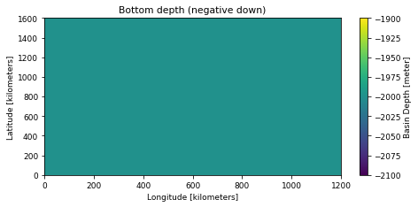
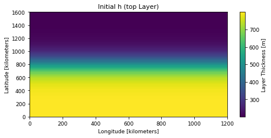
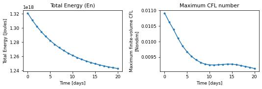
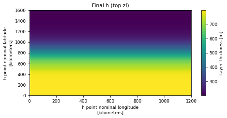

# Phillips_2layer

!!! success "Run status: :white_check_mark: ran successfully"
    Tested on 2026-11-04 with `access-om3/2026.05.004` (`mom6-solo`): 64 cores, walltime used 00:00:25, 0.89 SU. Details further down this page.


!!! abstract "Description (as on the Overview)"
    - **Grid:** 60 x 80 points, 2 layers/levels (`GRID_CONFIG = cartesian`)
    - **Vertical coordinate:** layer mode (no regridding)
    - **Topography:** `TOPO_CONFIG = flat`
    - **Surface forcing:** `WIND_CONFIG = zero`, `BUOY_CONFIG = zero`
    - **Run length:** 20 days

    Read from this run's `MOM_parameter_doc.all`. Source: [upstream](https://github.com/NOAA-GFDL/MOM6-examples/tree/c1730b8efe16cf7f12fc8db588115cae50f3e802/ocean_only/Phillips_2layer).

Configuration files: [`ocean_only/Phillips_2layer`](https://github.com/NOAA-GFDL/MOM6-examples/tree/c1730b8efe16cf7f12fc8db588115cae50f3e802/ocean_only/Phillips_2layer) in NOAA-GFDL/MOM6-examples, at commit [`c1730b8e`](https://github.com/NOAA-GFDL/MOM6-examples/commit/c1730b8efe16cf7f12fc8db588115cae50f3e802): the version this run used. (The model itself is the `mom6-solo` listed under [Provenance](#provenance).)

## Run it yourself

From a Gadi **login node** (membership of NCI project `vk83` needed):

```bash
PROJECT=<your-project> bash Phillips_2layer.sh
```

where `Phillips_2layer.sh` is the script below (click to expand; copy button top-right). It is exactly the script that produced the results on this page.

??? example "Phillips_2layer.sh"
    ```bash
    --8<-- "tested-configs/run_scripts/Phillips_2layer.sh"
    ```

## What we got

Last lines of `ocean.stats`:

```text
  2448,      17.000,     0, En 3.1485289947597250E-01, CFL  0.00922, SL  0.0000E+00, Mass 3.95904E+18, Me -3.35E-18
  2592,      18.000,     0, En 3.1452720788041305E-01, CFL  0.00919, SL  0.0000E+00, Mass 3.95904E+18, Me -9.62E-18
  2736,      19.000,     0, En 3.1422725734019025E-01, CFL  0.00917, SL  0.0000E+00, Mass 3.95904E+18, Me  4.74E-18
  2880,      20.000,     0, En 3.1393739104963225E-01, CFL  0.00913, SL  2.2737E-13, Mass 3.95904E+18, Me -6.78E-18
```

## Domain, forcing and output

Made by running the notebook [`explore_run.ipynb`](https://github.com/ACCESS-Community-Hub/access-idealised-configs/blob/main/tested-configs/notebooks/explore_run.ipynb) on this run's output folder; it only plots files MOM6 wrote during the run. **[See the notebook with its code](../notebooks/Phillips_2layer.md)**.

### Set-up


Values from this run's `MOM_parameter_doc.all`:

| Parameter | Value |
|---|---|
| `NIGLOBAL` | `60` |
| `NJGLOBAL` | `80` |
| `NK` | `2` |
| `GRID_CONFIG` | `cartesian` |
| `TOPO_CONFIG` | `flat` |
| `REENTRANT_X` | `True` |
| `REENTRANT_Y` | `False` |
| `USE_REGRIDDING` | `False` |
| `ENABLE_THERMODYNAMICS` | `False` |
| `THICKNESS_CONFIG` | `phillips` |
| `WIND_CONFIG` | `zero` |
| `BUOY_CONFIG` | `zero` |
| `ICE_SHELF` | `False` |
| `DT` | `600.0` |
| `DT_THERM` | `1800.0` |
| `DAYMAX` | `20.0` |


### Domain and bottom depth


Grid: 60 x 80 points (`GRID_CONFIG = cartesian`), x from 10 to 1190 kilometers, y from 10 to 1590 kilometers. Bottom depth `D` from 2000 to 2000 m (`TOPO_CONFIG = flat`).


    

    


### Initial state


`h` from `MOM_IC.nc`, which MOM6 writes with the initial state.


    

    


### Surface forcing


No surface forcing is saved in this run's diagnostics. The forcing is set by `WIND_CONFIG = zero` and `BUOY_CONFIG = zero` (see the MOM6 documentation for these options).


### Energy and stability through the run


    

    


From `ocean.stats.nc`: 21 records; time axis in days.


### Final state


`h` at the last record of `prog.nc` (snapshot).


    


## Parameters compared with the reference

<span class="chip a">A</span> GFDL's file in MOM6-examples (`c1730b8e`): [`MOM_parameter_doc.all`](https://github.com/NOAA-GFDL/MOM6-examples/blob/c1730b8efe16cf7f12fc8db588115cae50f3e802/ocean_only/Phillips_2layer/MOM_parameter_doc.all)  
<span class="chip b">B</span> this run: [`MOM_parameter_doc.all`](../parameters/Phillips_2layer.md) in the run's output, `/scratch/<your-project>/$USER/mom6-examples/archive/Phillips_2layer/output000/MOM_parameter_doc.all` when you run the script

**1** parameter values differ; **3** parameters exist only in this run's MOM6 version and **9** only in the reference (new, removed or renamed parameters). Values are compared ignoring quotes, case and number formatting. Parameter names link to a search of the MOM6 source; reference values link to their line on GitHub and this run's line numbers to its file.

<table class="diff" markdown="1"><thead><tr><th>Parameter</th><th>Units</th><th>A: reference</th><th>B: this run</th></tr></thead><tbody markdown="1"><tr class="mod"><td colspan="4">MOM_set_visc</td></tr><tr class="param" markdown="1"><td><a href="https://github.com/mom-ocean/MOM6/search?q=SET_VISC_ANSWER_DATE" target="_blank" rel="noopener">SET_VISC_ANSWER_DATE</a></td><td class="units"></td><td class="val a" data-label="A: reference"><a href="https://github.com/NOAA-GFDL/MOM6-examples/blob/c1730b8efe16cf7f12fc8db588115cae50f3e802/ocean_only/Phillips_2layer/MOM_parameter_doc.all#L669" target="_blank" rel="noopener">20260703</a></td><td class="val b" data-label="B: this run" markdown="span">99991231 [line 662](../parameters/Phillips_2layer.md#L662){.ln}</td></tr></tbody></table>

??? note "Parameters in only one of the two files (12)"
    <table class="diff" markdown="1"><thead><tr><th>Parameter</th><th>Units</th><th>A: reference</th><th>B: this run</th></tr></thead><tbody markdown="1"><tr class="mod"><td colspan="4">MOM</td></tr><tr class="param" markdown="1"><td><a href="https://github.com/mom-ocean/MOM6/search?q=USE_UH_PARTICLES" target="_blank" rel="noopener">USE_UH_PARTICLES</a></td><td class="units">Boolean</td><td class="val a unset" data-label="A: reference">(not in this version)</td><td class="val b" data-label="B: this run" markdown="span">False [line 150](../parameters/Phillips_2layer.md#L150){.ln}</td></tr><tr class="mod"><td colspan="4">MOM_barotropic</td></tr><tr class="param" markdown="1"><td><a href="https://github.com/mom-ocean/MOM6/search?q=DTBT_RESTART_BUG" target="_blank" rel="noopener">DTBT_RESTART_BUG</a></td><td class="units">Boolean</td><td class="val a" data-label="A: reference"><a href="https://github.com/NOAA-GFDL/MOM6-examples/blob/c1730b8efe16cf7f12fc8db588115cae50f3e802/ocean_only/Phillips_2layer/MOM_parameter_doc.all#L1170" target="_blank" rel="noopener">True</a></td><td class="val b unset" data-label="B: this run">(not in this version)</td></tr><tr class="mod"><td colspan="4">MOM_continuity_PPM</td></tr><tr class="param" markdown="1"><td><a href="https://github.com/mom-ocean/MOM6/search?q=CONT_USE_H_MARG_MIN" target="_blank" rel="noopener">CONT_USE_H_MARG_MIN</a></td><td class="units">Boolean</td><td class="val a" data-label="A: reference"><a href="https://github.com/NOAA-GFDL/MOM6-examples/blob/c1730b8efe16cf7f12fc8db588115cae50f3e802/ocean_only/Phillips_2layer/MOM_parameter_doc.all#L875" target="_blank" rel="noopener">False</a></td><td class="val b unset" data-label="B: this run">(not in this version)</td></tr><tr class="mod"><td colspan="4">MOM_diag_mediator</td></tr><tr class="param" markdown="1"><td><a href="https://github.com/mom-ocean/MOM6/search?q=NUM_DIAG_DOWNSAMP_LEV" target="_blank" rel="noopener">NUM_DIAG_DOWNSAMP_LEV</a></td><td class="units"></td><td class="val a" data-label="A: reference"><a href="https://github.com/NOAA-GFDL/MOM6-examples/blob/c1730b8efe16cf7f12fc8db588115cae50f3e802/ocean_only/Phillips_2layer/MOM_parameter_doc.all#L517" target="_blank" rel="noopener">0</a></td><td class="val b unset" data-label="B: this run">(not in this version)</td></tr><tr class="param" markdown="1"><td><a href="https://github.com/mom-ocean/MOM6/search?q=SYMMETRIC_DOWNSAMPLE_SUMS" target="_blank" rel="noopener">SYMMETRIC_DOWNSAMPLE_SUMS</a></td><td class="units">Boolean</td><td class="val a" data-label="A: reference"><a href="https://github.com/NOAA-GFDL/MOM6-examples/blob/c1730b8efe16cf7f12fc8db588115cae50f3e802/ocean_only/Phillips_2layer/MOM_parameter_doc.all#L506" target="_blank" rel="noopener">False</a></td><td class="val b unset" data-label="B: this run">(not in this version)</td></tr><tr class="mod"><td colspan="4">MOM_grid_init</td></tr><tr class="param" markdown="1"><td><a href="https://github.com/mom-ocean/MOM6/search?q=READ_MEAN_SEA_LEVEL" target="_blank" rel="noopener">READ_MEAN_SEA_LEVEL</a></td><td class="units">Boolean</td><td class="val a" data-label="A: reference"><a href="https://github.com/NOAA-GFDL/MOM6-examples/blob/c1730b8efe16cf7f12fc8db588115cae50f3e802/ocean_only/Phillips_2layer/MOM_parameter_doc.all#L214" target="_blank" rel="noopener">False</a></td><td class="val b unset" data-label="B: this run">(not in this version)</td></tr><tr class="mod"><td colspan="4">MOM_restart</td></tr><tr class="param" markdown="1"><td><a href="https://github.com/mom-ocean/MOM6/search?q=ENSEMBLE_APPENDIX_PREFIX" target="_blank" rel="noopener">ENSEMBLE_APPENDIX_PREFIX</a></td><td class="units"></td><td class="val a" data-label="A: reference"><a href="https://github.com/NOAA-GFDL/MOM6-examples/blob/c1730b8efe16cf7f12fc8db588115cae50f3e802/ocean_only/Phillips_2layer/MOM_parameter_doc.all#L322" target="_blank" rel="noopener">&quot;&quot;</a></td><td class="val b unset" data-label="B: this run">(not in this version)</td></tr><tr class="mod"><td colspan="4">MOM_set_visc</td></tr><tr class="param" markdown="1"><td><a href="https://github.com/mom-ocean/MOM6/search?q=CDRAG_MAP" target="_blank" rel="noopener">CDRAG_MAP</a></td><td class="units">Boolean</td><td class="val a" data-label="A: reference"><a href="https://github.com/NOAA-GFDL/MOM6-examples/blob/c1730b8efe16cf7f12fc8db588115cae50f3e802/ocean_only/Phillips_2layer/MOM_parameter_doc.all#L703" target="_blank" rel="noopener">False</a></td><td class="val b unset" data-label="B: this run">(not in this version)</td></tr><tr class="mod"><td colspan="4">MOM_thickness_diffuse</td></tr><tr class="param" markdown="1"><td><a href="https://github.com/mom-ocean/MOM6/search?q=USE_THICKNESS_DIFFUSE_ANN" target="_blank" rel="noopener">USE_THICKNESS_DIFFUSE_ANN</a></td><td class="units">Boolean</td><td class="val a" data-label="A: reference"><a href="https://github.com/NOAA-GFDL/MOM6-examples/blob/c1730b8efe16cf7f12fc8db588115cae50f3e802/ocean_only/Phillips_2layer/MOM_parameter_doc.all#L738" target="_blank" rel="noopener">False</a></td><td class="val b unset" data-label="B: this run">(not in this version)</td></tr><tr class="mod"><td colspan="4">MOM_tracer_flow_control</td></tr><tr class="param" markdown="1"><td><a href="https://github.com/mom-ocean/MOM6/search?q=USE_FILE_DYES" target="_blank" rel="noopener">USE_FILE_DYES</a></td><td class="units">Boolean</td><td class="val a unset" data-label="A: reference">(not in this version)</td><td class="val b" data-label="B: this run" markdown="span">False [line 351](../parameters/Phillips_2layer.md#L351){.ln}</td></tr><tr class="mod"><td colspan="4">MOM_verticalGrid</td></tr><tr class="param" markdown="1"><td><a href="https://github.com/mom-ocean/MOM6/search?q=ADVECTION_SCHEME_VARIANCE_UNDERFLOW" target="_blank" rel="noopener">ADVECTION_SCHEME_VARIANCE_UNDERFLOW</a></td><td class="units">Conc2 (tracer dependent)</td><td class="val a unset" data-label="A: reference">(not in this version)</td><td class="val b" data-label="B: this run" markdown="span">1.0E-23 [line 305](../parameters/Phillips_2layer.md#L305){.ln}</td></tr><tr class="mod"><td colspan="4">ocean_stochastics_init</td></tr><tr class="param" markdown="1"><td><a href="https://github.com/mom-ocean/MOM6/search?q=STOCHASTICS_ANSWER_DATE" target="_blank" rel="noopener">STOCHASTICS_ANSWER_DATE</a></td><td class="units"></td><td class="val a" data-label="A: reference"><a href="https://github.com/NOAA-GFDL/MOM6-examples/blob/c1730b8efe16cf7f12fc8db588115cae50f3e802/ocean_only/Phillips_2layer/MOM_parameter_doc.all#L1521" target="_blank" rel="noopener">20250101</a></td><td class="val b unset" data-label="B: this run">(not in this version)</td></tr></tbody></table>

## Provenance

| What | Value |
|---|---|
| MOM6-examples | [`c1730b8efe16cf7f12fc8db588115cae50f3e802`](https://github.com/NOAA-GFDL/MOM6-examples/commit/c1730b8efe16cf7f12fc8db588115cae50f3e802) |
| ACCESS-OM3 module | `access-om3/2026.05.004` |
| MOM6 source code | `ACCESS-NRI/MOM6 2026.05.003 d11a149ccba676d524312328f7eb62560a156dc3` |
| Executable | `/g/data/vk83/apps/spack/1.1/release/linux-x86_64_v4/access-mom6-2026.05.003-ld7hklzo5ajizx5u4yl74i4ijberrpv6/bin/mom6-solo` |
| Executable md5 | `4785d157c76c30d8d01baf7d0f69d218` |
| payu | `1.3.6_1` (module `payu/1.3.6_1`) |
| Date tested | 2026-11-04 |
| PBS Job Id | `183114891.gadi-pbs` |
| PBS Exit Status | `0` |
| PBS Service Units | `0.89` |
| PBS NCPUs Requested | `64` |
| PBS Walltime Used | `00:00:25` |
| PBS Memory Used | `12.8GB` |

This example needs no input files: grid, bathymetry, initial state and forcing are all set analytically in `MOM_input`.

??? info "Run-time environment (selected variables from payu's `env.yaml`)"
    | Variable | Value |
    |---|---|
    | `LD_LIBRARY_PATH` | `/apps/openmpi/4.1.7/lib:/apps/openmpi/4.1.7/lib/profilers` |
    | `LOADEDMODULES` | `access3-share/2026.03.002-eale5gm:access-cice/CICE6.6.3-2-huasrvo:access-mocsy/2025.07.002-saj7rvh:access-generic-tracers/2026.09.000-e3zb3ez:access-mom6/2026.05.003-ld7hklz:access-ww3/2026.03.001-bjzidie:access3/2026.03.002-26wbxup:access-om3/2026.05.004:pbs:openmpi/4.1.7` |
    | `OMPI_MCA_orte_tmpdir_base` | `/jobfs/183114891.gadi-pbs` |
    | `PAYU_TELEMETRY_ENV_VERSION` | `1.3.6_1` |
    | `PBS_NCI_NCPUS_PER_NODE` | `104` |
    | `PBS_NCPUS` | `64` |
    | `PBS_QUEUE` | `normalsr-exec` |

??? info "payu config.yaml written by the script"
    ```yaml
    # payu configuration for MOM6-examples/ocean_only/Phillips_2layer (written by Phillips_2layer.sh)
    project: tm70
    queue: normalsr          # mom6-solo is compiled for Sapphire Rapids nodes
    ncpus: 64
    walltime: 00:30:00
    jobname: Phillips_2layer
    experiment: Phillips_2layer
    laboratory: /g/data/tm70/cyb561/repos/claude/mom6-idealised-configs/runs/lab

    model: mom6
    exe: mom6-solo           # found on PATH once the module below is loaded

    modules:
      use:
        - /g/data/vk83/modules
      load:
        - access-om3/2026.05.004

    storage:                 # vk83: executable, ol01: input data
      gdata:
        - vk83
        - ol01

    collate: false           # mom6 writes un-split netCDF files when IO_LAYOUT = 1,1
    runlog: false            # don't commit run logs into the MOM6-examples clone
    metadata:
      enable: false
    ```

??? info "Output files"
    | File | Size | What it is |
    |---|---|---|
    | `MOM_IC.nc` | 0.99 MB | Initial state written by MOM6 at the start of the run |
    | `Vertical_coordinate.nc` | 0.00 MB | The vertical coordinate: target values of the layers or levels |
    | `ave_prog.nc` | 0.91 MB | Diagnostics set in `diag_table`: time averages of `u`, `v`, `h`, `e`, `w_sponge`, `Rd1`, `KHTH_u`, `KHTH_v` and 2 more, every 10 days |
    | `cont.nc` | 0.45 MB | Diagnostics set in `diag_table`: time averages of `uh`, `vh`, `uhGM`, `vhGM`, `w_sponge`, every 10 days |
    | `ocean.stats.nc` | 0.00 MB | Domain totals at each energy-save time (energy, mass, heat, salt, maximum CFL); the netCDF form of `ocean.stats` |
    | `ocean_geometry.nc` | 0.76 MB | Static grid: coordinates, cell sizes and areas, bottom depth `D`, Coriolis parameter, land mask |
    | `prog.nc` | 0.96 MB | Diagnostics set in `diag_table`: snapshots of `u`, `v`, `h`, `e`, `Ahh`, `Ahq`, `KHTH_u1`, `KHTH_v1` and 5 more, every 10 days |

