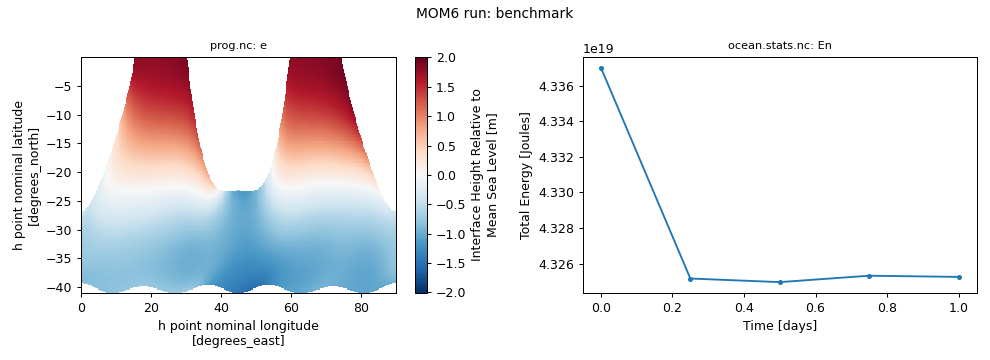

# benchmark

The MOM6 benchmark case: a 360 x 180 Mercator basin (41°S-41°N, 22 layers) with analytic "benchmark" bathymetry and stratification, gyre winds and linear buoyancy forcing.

Upstream configuration: [`ocean_only/benchmark`](https://github.com/NOAA-GFDL/MOM6-examples/tree/c1730b8efe16cf7f12fc8db588115cae50f3e802/ocean_only/benchmark) (MOM6-examples commit [`c1730b8e`](https://github.com/NOAA-GFDL/MOM6-examples/commit/c1730b8efe16cf7f12fc8db588115cae50f3e802)).

!!! success "Tested: this example runs"
    Ran on Gadi on 2026-11-04 with `access-om3/2026.05.004` (`mom6-solo`) and `payu/1.3.6_1` on 72 Sapphire Rapids core(s); walltime used 00:00:29, 1.16 SU.

!!! note "Generated with Claude Code"
    This page, the script and the figure were generated automatically by [`tested-configs/regenerate_all.sh`](https://github.com/ACCESS-Community-Hub/mom6-idealised-configs/tree/main/tested-configs) (written with Claude Code). See [How these pages were made](../Overview.md#how-these-pages-were-made).

## Run it yourself

From a Gadi **login node** (membership of NCI project `vk83` needed):

```bash
PROJECT=<your-project> bash benchmark.sh
```

where `benchmark.sh` is the script below (click to expand; copy button top-right). It is exactly the script that produced the results on this page.

??? example "benchmark.sh"
    ```bash
    --8<-- "tested-configs/run_scripts/benchmark.sh"
    ```

## What we got



*Left: sea-surface height (`e`, top interface) at the last output time; right: total energy (`En`) from `ocean.stats.nc`.*

Last lines of `ocean.stats`:

```text
    24,       0.250,     0, En 5.4681542548014106E-01, CFL  0.01994, SL -1.1410E-08, M 7.90973E+19, S 35.0000, T  5.0639, Me  1.94E-16, Se  6.54E-15, Te  3.38E-15
    48,       0.500,     0, En 5.4678981688685913E-01, CFL  0.01635, SL -8.5730E-08, M 7.90973E+19, S 35.0000, T  5.0639, Me  4.50E-16, Se  1.56E-14, Te  8.01E-15
    72,       0.750,     0, En 5.4683535821996410E-01, CFL  0.01765, SL -1.9158E-07, M 7.90973E+19, S 35.0000, T  5.0640, Me  5.63E-16, Se  1.97E-14, Te  9.83E-15
    96,       1.000,     0, En 5.4682695888234778E-01, CFL  0.01838, SL -2.8966E-07, M 7.90973E+19, S 35.0000, T  5.0640, Me  5.76E-16, Se  2.01E-14, Te  1.02E-14
```

Key parameters of this run (from `MOM_parameter_doc.all`):

| Parameter | Value |
|---|---|
| `NIGLOBAL` | `360` |
| `NJGLOBAL` | `180` |
| `NK` | `22` |
| `GRID_CONFIG` | `"mercator"` |
| `TOPO_CONFIG` | `"benchmark"` |
| `REENTRANT_X` | `True` |
| `REENTRANT_Y` | `False` |
| `USE_REGRIDDING` | `False` |
| `BOUSSINESQ` | `True` |
| `ENABLE_THERMODYNAMICS` | `True` |
| `EQN_OF_STATE` | `"WRIGHT"` |
| `THICKNESS_CONFIG` | `"benchmark"` |
| `TS_CONFIG` | `"benchmark"` |
| `WIND_CONFIG` | `"gyres"` |
| `BUOY_CONFIG` | `"linear"` |
| `ICE_SHELF` | `False` |
| `DT` | `900.0` |
| `DT_THERM` | `3600.0` |
| `DAYMAX` | `1.0` |
| `TIMEUNIT` | `8.64E+04` |

## Provenance

| What | Value |
|---|---|
| MOM6-examples | [`c1730b8efe16cf7f12fc8db588115cae50f3e802`](https://github.com/NOAA-GFDL/MOM6-examples/commit/c1730b8efe16cf7f12fc8db588115cae50f3e802) |
| ACCESS-OM3 module | `access-om3/2026.05.004` |
| MOM6 source code | `ACCESS-NRI/MOM6 2026.05.003 d11a149ccba676d524312328f7eb62560a156dc3` |
| Executable | `/g/data/vk83/apps/spack/1.1/release/linux-x86_64_v4/access-mom6-2026.05.003-ld7hklzo5ajizx5u4yl74i4ijberrpv6/bin/mom6-solo` |
| Executable md5 | `4785d157c76c30d8d01baf7d0f69d218` |
| payu | `1.3.6_1` (module `payu/1.3.6_1`) |
| Date tested | 2026-11-04 |
| PBS Job Id | `183114899.gadi-pbs` |
| PBS Exit Status | `0` |
| PBS Service Units | `1.16` |
| PBS NCPUs Requested | `72` |
| PBS Walltime Used | `00:00:29` |
| PBS Memory Used | `17.32GB` |

This example needs no input files: grid, bathymetry, initial state and forcing are all set analytically in `MOM_input`.

??? info "Parameters differing from the upstream MOM_parameter_doc.all (15)"
    Comparison of this run's `MOM_parameter_doc.all` with the upstream MOM_parameter_doc.all.
    Differences show where the ACCESS-OM3 MOM6 version adds, drops or changes default parameters.

    | Parameter | reference | this run |
    |---|---|---|
    | `SET_VISC_ANSWER_DATE` | `20260703` | `99991231` |

    New in this run: `ADVECTION_SCHEME_VARIANCE_UNDERFLOW`, `NONBLOCKING_P_SURF_BUG`, `RHO_PGF_REF_BUG`, `USE_FILE_DYES`, `USE_UH_PARTICLES`

    Only upstream: `CDRAG_MAP`, `CONT_USE_H_MARG_MIN`, `DTBT_RESTART_BUG`, `ENSEMBLE_APPENDIX_PREFIX`, `NUM_DIAG_DOWNSAMP_LEV`, `READ_MEAN_SEA_LEVEL`, `STOCHASTICS_ANSWER_DATE`, `SYMMETRIC_DOWNSAMPLE_SUMS`, `USE_THICKNESS_DIFFUSE_ANN`

??? info "Run-time environment (selected variables from payu's `env.yaml`)"
    | Variable | Value |
    |---|---|
    | `LD_LIBRARY_PATH` | `/apps/openmpi/4.1.7/lib:/apps/openmpi/4.1.7/lib/profilers` |
    | `LOADEDMODULES` | `access3-share/2026.03.002-eale5gm:access-cice/CICE6.6.3-2-huasrvo:access-mocsy/2025.07.002-saj7rvh:access-generic-tracers/2026.09.000-e3zb3ez:access-mom6/2026.05.003-ld7hklz:access-ww3/2026.03.001-bjzidie:access3/2026.03.002-26wbxup:access-om3/2026.05.004:pbs:openmpi/4.1.7` |
    | `OMPI_MCA_orte_tmpdir_base` | `/jobfs/183114899.gadi-pbs` |
    | `PAYU_TELEMETRY_ENV_VERSION` | `1.3.6_1` |
    | `PBS_NCI_NCPUS_PER_NODE` | `104` |
    | `PBS_NCPUS` | `72` |
    | `PBS_QUEUE` | `normalsr-exec` |

??? info "payu config.yaml written by the script"
    ```yaml
    # payu configuration for MOM6-examples/ocean_only/benchmark (written by benchmark.sh)
    project: tm70
    queue: normalsr          # mom6-solo is compiled for Sapphire Rapids nodes
    ncpus: 72
    walltime: 00:30:00
    jobname: benchmark
    experiment: benchmark
    laboratory: /g/data/tm70/cyb561/repos/claude/mom6-idealised-configs/runs/lab

    model: mom6
    exe: mom6-solo           # found on PATH once the module below is loaded

    modules:
      use:
        - /g/data/vk83/modules
      load:
        - access-om3/2026.05.004

    storage:                 # vk83: executable, ol01: input data
      gdata:
        - vk83
        - ol01

    collate: false           # mom6 writes un-split netCDF files when IO_LAYOUT = 1,1
    runlog: false            # don't commit run logs into the MOM6-examples clone
    metadata:
      enable: false
    ```

??? info "Output files"
    | File | Size |
    |---|---|
    | `GOLD_IC.nc` | 176.15 MB |
    | `Vertical_coordinate.nc` | 0.00 MB |
    | `ocean.stats.nc` | 0.01 MB |
    | `ocean_geometry.nc` | 9.92 MB |
    | `prog.nc` | 34.55 MB |

