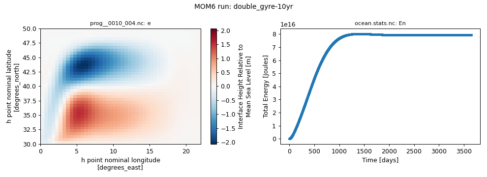
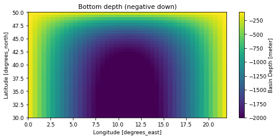
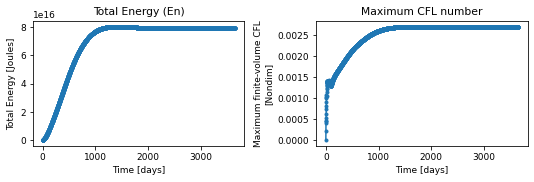
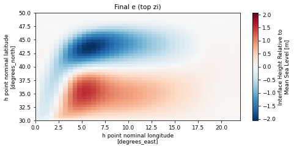

# double_gyre / 10yr

!!! success ":white_check_mark: This configuration ran successfully"
    Tested on 2026-11-04 with `access-om3/2026.05.004` (`mom6-solo`): 8 cores, walltime used 00:03:17, 0.88 SU. Details further down this page.


Variant of `double_gyre` with `DAYMAX=3650.0`. 44 x 40 x 2 spherical grid, layer mode (no regridding), topography `spoon`, wind `2gyre`, buoyancy `zero`, 3650 days ([upstream](https://github.com/NOAA-GFDL/MOM6-examples/tree/c1730b8efe16cf7f12fc8db588115cae50f3e802/ocean_only/double_gyre))

This is a copy of [double_gyre](double_gyre.md) with these lines added to `MOM_override`, e.g. to run long enough to see a spun-up state:

```text
#override DAYMAX = 3650.0
```

Configuration files: [`ocean_only/double_gyre`](https://github.com/NOAA-GFDL/MOM6-examples/tree/c1730b8efe16cf7f12fc8db588115cae50f3e802/ocean_only/double_gyre) in NOAA-GFDL/MOM6-examples, at commit [`c1730b8e`](https://github.com/NOAA-GFDL/MOM6-examples/commit/c1730b8efe16cf7f12fc8db588115cae50f3e802): the version this run used. (The model itself is the `mom6-solo` listed under Provenance.)

## Run it yourself

From a Gadi **login node** (membership of NCI project `vk83` needed):

```bash
PROJECT=<your-project> bash double_gyre-10yr.sh
```

where `double_gyre-10yr.sh` is the script below (click to expand; copy button top-right). It is exactly the script that produced the results on this page.

??? example "double_gyre-10yr.sh"
    ```bash
    --8<-- "tested-configs/run_scripts/double_gyre-10yr.sh"
    ```

## What we got



*Left: sea-surface height (`e`, top interface) at the last output time; right: total energy (`En`) from `ocean.stats.nc`.*

Last lines of `ocean.stats`:

```text
262584,    3647.000,     0, En 1.4994784574602250E-02, CFL  0.00269, SL  3.3111E-12, Mass 5.28818E+18, Me -1.82E-18
262656,    3648.000,     0, En 1.4994782453774285E-02, CFL  0.00269, SL  3.3111E-12, Mass 5.28818E+18, Me  9.18E-18
262728,    3649.000,     0, En 1.4994780316799525E-02, CFL  0.00269, SL  3.3111E-12, Mass 5.28818E+18, Me -3.66E-18
262800,    3650.000,     0, En 1.4994778134068116E-02, CFL  0.00269, SL  3.3111E-12, Mass 5.28818E+18, Me -1.19E-17
```

## Domain, forcing and output

Made by running the notebook [`explore_run.ipynb`](https://github.com/ACCESS-Community-Hub/mom6-idealised-configs/blob/main/tested-configs/notebooks/explore_run.ipynb) on this run's output folder (code hidden here). It only plots files MOM6 wrote during the run.

### Set-up


Values from this run's `MOM_parameter_doc.all`:

| Parameter | Value |
|---|---|
| `NIGLOBAL` | `44` |
| `NJGLOBAL` | `40` |
| `NK` | `2` |
| `GRID_CONFIG` | `spherical` |
| `TOPO_CONFIG` | `spoon` |
| `REENTRANT_X` | `False` |
| `REENTRANT_Y` | `False` |
| `USE_REGRIDDING` | `False` |
| `ENABLE_THERMODYNAMICS` | `False` |
| `THICKNESS_CONFIG` | `uniform` |
| `WIND_CONFIG` | `2gyre` |
| `BUOY_CONFIG` | `zero` |
| `ICE_SHELF` | `False` |
| `DT` | `1200.0` |
| `DT_THERM` | `2400.0` |
| `DAYMAX` | `3650.0` |


### Domain and bottom depth


Grid: 44 x 40 points (`GRID_CONFIG = spherical`), x from 0.25 to 21.75 degrees_east, y from 30.25 to 49.75 degrees_north. Bottom depth `D` from 105.179 to 2000 m (`TOPO_CONFIG = spoon`).


    

    


### Initial state


MOM6 did not write an initial-state file for this run (it does when `SAVE_INITIAL_CONDS = True`), so the initial state is not shown here; see the run's `MOM_parameter_doc.all` (`THICKNESS_CONFIG = uniform`, `TS_CONFIG = n/a`).


### Surface forcing


No surface forcing is saved in this run's diagnostics. The forcing is set by `WIND_CONFIG = 2gyre` and `BUOY_CONFIG = zero` (see the MOM6 documentation for these options).


### Energy and stability through the run


    

    


From `ocean.stats.nc`: 3651 records; time axis in days.


### Final state


`e` at the last record of `prog__0010_004.nc` (snapshot).


    


## Provenance

| What | Value |
|---|---|
| MOM6-examples | [`c1730b8efe16cf7f12fc8db588115cae50f3e802`](https://github.com/NOAA-GFDL/MOM6-examples/commit/c1730b8efe16cf7f12fc8db588115cae50f3e802) |
| ACCESS-OM3 module | `access-om3/2026.05.004` |
| MOM6 source code | `ACCESS-NRI/MOM6 2026.05.003 d11a149ccba676d524312328f7eb62560a156dc3` |
| Executable | `/g/data/vk83/apps/spack/1.1/release/linux-x86_64_v4/access-mom6-2026.05.003-ld7hklzo5ajizx5u4yl74i4ijberrpv6/bin/mom6-solo` |
| Executable md5 | `4785d157c76c30d8d01baf7d0f69d218` |
| payu | `1.3.6_1` (module `payu/1.3.6_1`) |
| Date tested | 2026-11-04 |
| PBS Job Id | `183114530.gadi-pbs` |
| PBS Exit Status | `0` |
| PBS Service Units | `0.88` |
| PBS NCPUs Requested | `8` |
| PBS Walltime Used | `00:03:17` |
| PBS Memory Used | `1.89GB` |

This example needs no input files: grid, bathymetry, initial state and forcing are all set analytically in `MOM_input`.

??? info "Parameters differing from the upstream MOM_parameter_doc.all (15)"
    Comparison of this run's `MOM_parameter_doc.all` with the upstream MOM_parameter_doc.all.
    Differences show where the ACCESS-OM3 MOM6 version adds, drops or changes default parameters.

    | Parameter | reference | this run |
    |---|---|---|
    | `DAYMAX` | `10.0` | `3650.0` |
    | `SET_VISC_ANSWER_DATE` | `20260703` | `99991231` |

    New in this run: `ADVECTION_SCHEME_VARIANCE_UNDERFLOW`, `RHO_PGF_REF_BUG`, `USE_FILE_DYES`, `USE_UH_PARTICLES`

    Only upstream: `CDRAG_MAP`, `CONT_USE_H_MARG_MIN`, `DTBT_RESTART_BUG`, `ENSEMBLE_APPENDIX_PREFIX`, `NUM_DIAG_DOWNSAMP_LEV`, `READ_MEAN_SEA_LEVEL`, `STOCHASTICS_ANSWER_DATE`, `SYMMETRIC_DOWNSAMPLE_SUMS`, `USE_THICKNESS_DIFFUSE_ANN`

??? info "Run-time environment (selected variables from payu's `env.yaml`)"
    | Variable | Value |
    |---|---|
    | `LD_LIBRARY_PATH` | `/apps/openmpi/4.1.7/lib:/apps/openmpi/4.1.7/lib/profilers` |
    | `LOADEDMODULES` | `access3-share/2026.03.002-eale5gm:access-cice/CICE6.6.3-2-huasrvo:access-mocsy/2025.07.002-saj7rvh:access-generic-tracers/2026.09.000-e3zb3ez:access-mom6/2026.05.003-ld7hklz:access-ww3/2026.03.001-bjzidie:access3/2026.03.002-26wbxup:access-om3/2026.05.004:pbs:openmpi/4.1.7` |
    | `OMPI_MCA_orte_tmpdir_base` | `/jobfs/183114530.gadi-pbs` |
    | `PAYU_TELEMETRY_ENV_VERSION` | `1.3.6_1` |
    | `PBS_NCI_NCPUS_PER_NODE` | `104` |
    | `PBS_NCPUS` | `8` |
    | `PBS_QUEUE` | `normalsr-exec` |

??? info "payu config.yaml written by the script"
    ```yaml
    # payu configuration for MOM6-examples/ocean_only/double_gyre_10yr (written by double_gyre-10yr.sh)
    project: tm70
    queue: normalsr          # mom6-solo is compiled for Sapphire Rapids nodes
    ncpus: 8
    walltime: 02:00:00
    jobname: double_gyre-10yr
    experiment: double_gyre-10yr
    laboratory: /g/data/tm70/cyb561/repos/claude/mom6-idealised-configs/runs/lab

    model: mom6
    exe: mom6-solo           # found on PATH once the module below is loaded

    modules:
      use:
        - /g/data/vk83/modules
      load:
        - access-om3/2026.05.004

    storage:                 # vk83: executable, ol01: input data
      gdata:
        - vk83
        - ol01

    collate: false           # mom6 writes un-split netCDF files when IO_LAYOUT = 1,1
    runlog: false            # don't commit run logs into the MOM6-examples clone
    metadata:
      enable: false
    ```

??? info "Output files"
    | File | Size |
    |---|---|
    | `Depth_list.nc` | 0.02 MB |
    | `Vertical_coordinate.nc` | 0.00 MB |
    | `ave_prog__0001_003.nc` | 5.73 MB |
    | `ave_prog__0002_003.nc` | 5.73 MB |
    | `ave_prog__0003_003.nc` | 5.73 MB |
    | `ave_prog__0004_003.nc` | 5.73 MB |
    | `ave_prog__0005_002.nc` | 5.73 MB |
    | `ave_prog__0006_002.nc` | 5.73 MB |
    | `ave_prog__0007_002.nc` | 5.73 MB |
    | `ave_prog__0008_002.nc` | 5.73 MB |
    | `ave_prog__0009_001.nc` | 5.73 MB |
    | `ave_prog__0010_001.nc` | 5.73 MB |
    | `cont__0001_003.nc` | 2.13 MB |
    | `cont__0002_003.nc` | 2.13 MB |
    | `cont__0003_003.nc` | 2.13 MB |
    | `cont__0004_003.nc` | 2.13 MB |
    | `cont__0005_002.nc` | 2.13 MB |
    | `cont__0006_002.nc` | 2.13 MB |
    | `cont__0007_002.nc` | 2.13 MB |
    | `cont__0008_002.nc` | 2.13 MB |
    | `cont__0009_001.nc` | 2.13 MB |
    | `cont__0010_001.nc` | 2.13 MB |
    | `ocean.stats.nc` | 0.53 MB |
    | `ocean_geometry.nc` | 0.29 MB |
    | `prog__0001_006.nc` | 5.72 MB |
    | `prog__0002_006.nc` | 5.72 MB |
    | `prog__0003_006.nc` | 5.72 MB |
    | `prog__0004_006.nc` | 5.72 MB |
    | `prog__0005_005.nc` | 5.72 MB |
    | `prog__0006_005.nc` | 5.72 MB |
    | `prog__0007_005.nc` | 5.72 MB |
    | `prog__0008_005.nc` | 5.72 MB |
    | `prog__0009_004.nc` | 5.72 MB |
    | `prog__0010_004.nc` | 5.72 MB |

