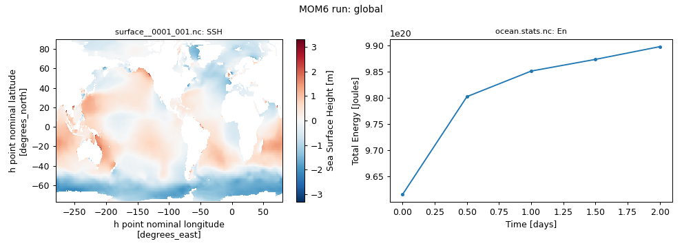

# global

360 x 210 x 63 mosaic grid, layer mode (no regridding), topography `file`, wind `file`, buoyancy `file`, 2 days ([upstream](https://github.com/NOAA-GFDL/MOM6-examples/tree/c1730b8efe16cf7f12fc8db588115cae50f3e802/ocean_only/global))

Upstream configuration: [`ocean_only/global`](https://github.com/NOAA-GFDL/MOM6-examples/tree/c1730b8efe16cf7f12fc8db588115cae50f3e802/ocean_only/global) (MOM6-examples commit [`c1730b8e`](https://github.com/NOAA-GFDL/MOM6-examples/commit/c1730b8efe16cf7f12fc8db588115cae50f3e802)).

GFDL excludes this example from its own automated test suite (`EXCLUDE` in [`ocean_only/Makefile`](https://github.com/NOAA-GFDL/MOM6-examples/blob/c1730b8efe16cf7f12fc8db588115cae50f3e802/ocean_only/Makefile)).

!!! success "Tested: this example runs"
    Ran on Gadi on 2026-11-04 with `access-om3/2026.05.004` (`mom6-solo`) and `payu/1.3.6_1` on 64 Sapphire Rapids core(s); walltime used 00:00:42, 1.49 SU.

!!! note "Generated with Claude Code"
    This page, the script and the figure were generated automatically by [`tested-configs/regenerate_all.sh`](https://github.com/ACCESS-Community-Hub/mom6-idealised-configs/tree/main/tested-configs) (written with Claude Code). See [How these pages were made](../mom6examples.md#how-these-pages-were-made).

## Run it yourself

From a Gadi **login node** (membership of NCI project `vk83` needed, and `ol01` for the input data):

```bash
PROJECT=<your-project> bash global.sh
```

where `global.sh` is the script below (click to expand; copy button top-right). It is exactly the script that produced the results on this page.

??? example "global.sh"
    ```bash
    --8<-- "tested-configs/run_scripts/global.sh"
    ```

## What we got



*Left: `SSH` at the last output time; right: total energy (`En`) from `ocean.stats.nc`.*

Last lines of `ocean.stats`:

```text
    12,       0.500,     0, En 7.1054787548986675E-01, CFL  0.14162, SL -5.6093E-05, M 1.37953E+21, S 34.7200, T  3.6133, Me  4.18E-16, Se  1.46E-14, Te  4.59E-15
    24,       1.000,     0, En 7.1408759518068854E-01, CFL  0.16462, SL -8.2274E-05, M 1.37953E+21, S 34.7200, T  3.6133, Me  6.80E-16, Se  2.33E-14, Te  4.65E-15
    36,       1.500,     0, En 7.1570414410585603E-01, CFL  0.12427, SL -3.3532E-04, M 1.37953E+21, S 34.7200, T  3.6133, Me  1.02E-15, Se  3.51E-14, Te  7.00E-15
    48,       2.000,     0, En 7.1746297370424228E-01, CFL  0.09670, SL -5.4077E-04, M 1.37953E+21, S 34.7200, T  3.6133, Me  1.32E-15, Se  4.54E-14, Te  9.38E-15
```

Key parameters of this run (from `MOM_parameter_doc.all`):

| Parameter | Value |
|---|---|
| `NIGLOBAL` | `360` |
| `NJGLOBAL` | `210` |
| `NK` | `63` |
| `GRID_CONFIG` | `"mosaic"` |
| `TOPO_CONFIG` | `"file"` |
| `REENTRANT_X` | `True` |
| `REENTRANT_Y` | `False` |
| `USE_REGRIDDING` | `False` |
| `BOUSSINESQ` | `True` |
| `ENABLE_THERMODYNAMICS` | `True` |
| `EQN_OF_STATE` | `"WRIGHT"` |
| `THICKNESS_CONFIG` | `"file"` |
| `TS_CONFIG` | `"file"` |
| `WIND_CONFIG` | `"file"` |
| `BUOY_CONFIG` | `"file"` |
| `ICE_SHELF` | `False` |
| `DT` | `3600.0` |
| `DT_THERM` | `7200.0` |
| `DAYMAX` | `2.0` |
| `TIMEUNIT` | `8.64E+04` |

## Provenance

| What | Value |
|---|---|
| MOM6-examples | [`c1730b8efe16cf7f12fc8db588115cae50f3e802`](https://github.com/NOAA-GFDL/MOM6-examples/commit/c1730b8efe16cf7f12fc8db588115cae50f3e802) |
| ACCESS-OM3 module | `access-om3/2026.05.004` |
| MOM6 source code | `ACCESS-NRI/MOM6 2026.05.003 d11a149ccba676d524312328f7eb62560a156dc3` |
| Executable | `/g/data/vk83/apps/spack/1.1/release/linux-x86_64_v4/access-mom6-2026.05.003-ld7hklzo5ajizx5u4yl74i4ijberrpv6/bin/mom6-solo` |
| Executable md5 | `4785d157c76c30d8d01baf7d0f69d218` |
| payu | `1.3.6_1` (module `payu/1.3.6_1`) |
| Date tested | 2026-11-04 |
| PBS Job Id | `183115238.gadi-pbs` |
| PBS Exit Status | `0` |
| PBS Service Units | `1.49` |
| PBS NCPUs Requested | `64` |
| PBS Walltime Used | `00:00:42` |
| PBS Memory Used | `23.38GB` |

??? info "Input files and md5 hashes (from payu `manifests/input.yaml`)"
    | File | md5 | Path |
    |---|---|---|
    | `INPUT/31Layer_zgrid.nc` | `2d1b8673dc763a835081ab6d0e13d6d2` | `/g/data/tm70/cyb561/repos/claude/mom6-idealised-configs/runs/MOM6-examples/ocean_only/global/INPUT/31Layer_zgrid.nc` |
    | `INPUT/GOLD_IC.2010.11.15.nc` | `bf6ba441e98ff5c1b04b635b0ad84dac` | `/g/data/tm70/cyb561/repos/claude/mom6-idealised-configs/runs/MOM6-examples/ocean_only/global/INPUT/GOLD_IC.2010.11.15.nc` |
    | `INPUT/OM3_zgrid.nc` | `0830d67f80834fe2796b219a84b3ba8d` | `/g/data/tm70/cyb561/repos/claude/mom6-idealised-configs/runs/MOM6-examples/ocean_only/global/INPUT/OM3_zgrid.nc` |
    | `INPUT/README` | `da6049145ac9dd6aa8c4fd19da61a98f` | `/g/data/tm70/cyb561/repos/claude/mom6-idealised-configs/runs/MOM6-examples/ocean_only/global/INPUT/README` |
    | `INPUT/atmos_hgrid.nc` | `a4d8a2cc7554b265f53da1f91a48fee1` | `/g/data/tm70/cyb561/repos/claude/mom6-idealised-configs/runs/MOM6-examples/ocean_only/global/INPUT/atmos_hgrid.nc` |
    | `INPUT/atmos_mosaic.nc` | `ed209f7d19cc856ec1a257c0ca63af90` | `/g/data/tm70/cyb561/repos/claude/mom6-idealised-configs/runs/MOM6-examples/ocean_only/global/INPUT/atmos_mosaic.nc` |
    | `INPUT/atmos_mosaic_tile1Xland_mosaic_tile1.nc` | `6025fff17ee89d0ef6f4ac530c4a833b` | `/g/data/tm70/cyb561/repos/claude/mom6-idealised-configs/runs/MOM6-examples/ocean_only/global/INPUT/atmos_mosaic_tile1Xland_mosaic_tile1.nc` |
    | `INPUT/atmos_mosaic_tile1Xocean_mosaic_tile1.nc` | `c4ee9d91f1b2146d8e0c60827670fee6` | `/g/data/tm70/cyb561/repos/claude/mom6-idealised-configs/runs/MOM6-examples/ocean_only/global/INPUT/atmos_mosaic_tile1Xocean_mosaic_tile1.nc` |
    | `INPUT/geothermal_heating_cm2g.nc` | `2604459298a435e292be908e6059a89f` | `/g/data/tm70/cyb561/repos/claude/mom6-idealised-configs/runs/MOM6-examples/ocean_only/global/INPUT/geothermal_heating_cm2g.nc` |
    | `INPUT/grid_spec.nc` | `a2d3b842655c6ee2e0213db46154dc22` | `/g/data/tm70/cyb561/repos/claude/mom6-idealised-configs/runs/MOM6-examples/ocean_only/global/INPUT/grid_spec.nc` |
    | `INPUT/gustiness_qscat.nc` | `2fbcc31e266329ddb4dd1cd8c8d221f7` | `/g/data/tm70/cyb561/repos/claude/mom6-idealised-configs/runs/MOM6-examples/ocean_only/global/INPUT/gustiness_qscat.nc` |
    | `INPUT/land_hgrid.nc` | `a4d8a2cc7554b265f53da1f91a48fee1` | `/g/data/tm70/cyb561/repos/claude/mom6-idealised-configs/runs/MOM6-examples/ocean_only/global/INPUT/land_hgrid.nc` |
    | `INPUT/land_mask.nc` | `d5caa6ffe6379a31e692f10ec65af033` | `/g/data/tm70/cyb561/repos/claude/mom6-idealised-configs/runs/MOM6-examples/ocean_only/global/INPUT/land_mask.nc` |
    | `INPUT/land_mosaic.nc` | `5aeb9c82ad3a1c2ecc3d7988aa641ad2` | `/g/data/tm70/cyb561/repos/claude/mom6-idealised-configs/runs/MOM6-examples/ocean_only/global/INPUT/land_mosaic.nc` |
    | `INPUT/land_mosaic_tile1Xocean_mosaic_tile1.nc` | `56c455a11d61a23e19f056bf6c99cb7c` | `/g/data/tm70/cyb561/repos/claude/mom6-idealised-configs/runs/MOM6-examples/ocean_only/global/INPUT/land_mosaic_tile1Xocean_mosaic_tile1.nc` |
    | `INPUT/mosaic.nc` | `a2d3b842655c6ee2e0213db46154dc22` | `/g/data/tm70/cyb561/repos/claude/mom6-idealised-configs/runs/MOM6-examples/ocean_only/global/INPUT/mosaic.nc` |
    | `INPUT/ocean_forcing_daily.nc` | `7065687a13038c404173d8c19525794b` | `/g/data/tm70/cyb561/repos/claude/mom6-idealised-configs/runs/MOM6-examples/ocean_only/global/INPUT/ocean_forcing_daily.nc` |
    | `INPUT/ocean_forcing_monthly.nc` | `b26fd7fb52928bbfea285f87479c15f0` | `/g/data/tm70/cyb561/repos/claude/mom6-idealised-configs/runs/MOM6-examples/ocean_only/global/INPUT/ocean_forcing_monthly.nc` |
    | `INPUT/ocean_hgrid.nc` | `c4782f49333b46f9ea53322ac1eff53a` | `/g/data/tm70/cyb561/repos/claude/mom6-idealised-configs/runs/MOM6-examples/ocean_only/global/INPUT/ocean_hgrid.nc` |
    | `INPUT/ocean_mask.nc` | `b49dce31f5a9cd53a8ebbb47518e238c` | `/g/data/tm70/cyb561/repos/claude/mom6-idealised-configs/runs/MOM6-examples/ocean_only/global/INPUT/ocean_mask.nc` |
    | `INPUT/ocean_mosaic.nc` | `1263df68b94e7a256be52283df611e94` | `/g/data/tm70/cyb561/repos/claude/mom6-idealised-configs/runs/MOM6-examples/ocean_only/global/INPUT/ocean_mosaic.nc` |
    | `INPUT/ocean_precip_monthly.nc` | `12031a11fbcd3ca1a0534d7feb9193fc` | `/g/data/tm70/cyb561/repos/claude/mom6-idealised-configs/runs/MOM6-examples/ocean_only/global/INPUT/ocean_precip_monthly.nc` |
    | `INPUT/ocean_vgrid.nc` | `34d06772f261d0ef502b4e3998109c28` | `/g/data/tm70/cyb561/repos/claude/mom6-idealised-configs/runs/MOM6-examples/ocean_only/global/INPUT/ocean_vgrid.nc` |
    | `INPUT/seawifs_1998-2006_GOLD_smoothed_2X.nc` | `7217a6bb87ebdf4570bbf8940e8b3c72` | `/g/data/tm70/cyb561/repos/claude/mom6-idealised-configs/runs/MOM6-examples/ocean_only/global/INPUT/seawifs_1998-2006_GOLD_smoothed_2X.nc` |
    | `INPUT/sgs_h2.nc` | `5f3897a97a4366edba744f35cea97d7d` | `/g/data/tm70/cyb561/repos/claude/mom6-idealised-configs/runs/MOM6-examples/ocean_only/global/INPUT/sgs_h2.nc` |
    | `INPUT/tideamp.nc` | `8136b3e8b8f587734fc5b0abcb338702` | `/g/data/tm70/cyb561/repos/claude/mom6-idealised-configs/runs/MOM6-examples/ocean_only/global/INPUT/tideamp.nc` |
    | `INPUT/topog.nc` | `bd19baefec0f42e89e90870fbee5a7e3` | `/g/data/tm70/cyb561/repos/claude/mom6-idealised-configs/runs/MOM6-examples/ocean_only/global/INPUT/topog.nc` |

??? info "Parameters differing from the upstream MOM_parameter_doc.all (124)"
    Comparison of this run's `MOM_parameter_doc.all` with the upstream MOM_parameter_doc.all.
    Differences show where the ACCESS-OM3 MOM6 version adds, drops or changes default parameters.

    | Parameter | reference | this run |
    |---|---|---|
    | `MLD_EN_VALS` | `3*0.0` | `25.0, 2500.0, 2.5E+05` |
    | `USE_POROUS_BARRIER` | `True` | `False` |

    New in this run: `ADVECTION_SCHEME_VARIANCE_UNDERFLOW`, `BACKSCATTER_UNDERBOUND`, `BACKSCAT_EBT_POWER`, `BMLD_EN_VALS`, `BML_NONBOUSINESQ`, `BOUSSINESQ_SAL_TIDES`, `BS_USE_SQG_STRUCT`, `BT_ADJ_CORR_MASS_SRC`, `BT_LINEAR_FREQ_DRAG`, `CALCULATE_SAL`, `CHOROPHYLL_POWER_MANIZZA`, `CORRECTION_INTXPA`, `DIAG_REMAPPING_USE_OM4_SUBCELLS`, `DO_BL_RESIDENCE`, `DO_BRINE_PLUME`, `DO_SKEB`, `DRAG_DIFFUSIVITY_ANSWER_DATE`, `DT_TRACER_ADVECT`, `DZ_BBL_AVG_MIN`, `EBT_REMAPPING_USE_OM4_SUBCELLS`, `ENABLE_BUGS_BY_DEFAULT`, `EVAPORATION_FILE_DAYS_PER_RECORD`, `EY24_EBT_BS`, `FPMIX`, `FRICTWORK_BUG`, `FULL_DEPTH_EADY_GROWTH_RATE`, `FULL_DEPTH_KHTR_MIN`, `GEOM_FILE`, `HENYEY_MAX_LAT`, `HOR_DIFF_ANSWER_DATE`, `HOR_DIFF_LIMIT_BUG`, `INTWAVE_REMAPPING_USE_OM4_SUBCELLS`, `ISO_DATE_STAMPED_STDOUT`, `KD_GL90_USE_SQG_STRUCT`, `KHTH_USE_SQG_STRUCT`, `KHTR_USE_EBT_STRUCT`, `KHTR_USE_SQG_STRUCT`, `LATENTHEAT_FILE_DAYS_PER_RECORD`, `LONGWAVE_FILE_DAYS_PER_RECORD`, `LZ_RESCALE`, `MASK_COASTAL_PRESSURE_FORCE`, `MASS_WEIGHT_IN_PGF_VANISHED_ONLY`, `MASS_WEIGHT_IN_PRESSURE_GRADIENT_TOP`, `MEKE_BHFRCOEFF`, `MEKE_POSITIVE`, `NONBLOCKING_P_SURF_BUG`, `OPACITY_BAND_WAVELENGTHS`, `OPACITY_VALUES_MANIZZA`, `RAIN_FILE_DAYS_PER_RECORD`, `RESET_INTXPA_INTEGRAL`, `RESET_INTXPA_INTEGRAL_FLATTEST`, `RESTART_SYMMETRIC_CHECKSUMS`, `RESTART_UNSIGNED_ZEROS`, `RESTORE_FLUX_RHO`, `RHO_PGF_REF`, `RHO_PGF_REF_BUG`, `RUNOFF_FILE_DAYS_PER_RECORD`, `SALINITYRESTORE_FILE_DAYS_PER_RECORD`, `SAL_HARMONICS`, `SAL_SCALAR_APPROX`, `SAL_SCALAR_VALUE`, `SAL_USE_BPA`, `SENSIBLEHEAT_FILE_DAYS_PER_RECORD`, `SET_DTBT_USE_BT_CONT`, `SHORTWAVE_FILE_DAYS_PER_RECORD`, `SPLIT_RK2B`, `SQG_USE_MEKE`, `SSH_IN_EOS_PRESSURE_FOR_PGF`, `SSTRESTORE_FILE_DAYS_PER_RECORD`, `TFREEZE_S_IS_PRACS`, `TFREEZE_T_IS_POTT`, `TIDAL_SAL_FLATHER`, `TIDES_ANSWER_DATE`, `TIDE_ADD_NODAL`, `TIDE_NODAL_REF_DATE`, `TRADV_SPANS_COUPLING`, `TRIG_CHANNEL_DRAG_WIDTHS`, `USE_CIRCULATION_IN_HORVISC`, `USE_CONT_THICKNESS`, `USE_FILE_DYES`, `USE_FILTER`, `USE_HA`, `USE_HORIZONTAL_BOUNDARY_DIFFUSION`, `USE_INDEX_DIAGNOSTIC_AXES`, `USE_LEITHY`, `USE_MARBL_TRACERS`, `USE_REAL_BL_DEPTH`, `USE_UH_PARTICLES`, `USE_WRIGHT_2ND_DERIV_BUG`, `USE_ZB2020`, `USTAR_GUSTLESS_BUG`, `VERTEX_SHEAR_THICKNESS_MEAN`, `VISC_REM_BT_WEIGHT_BUG`, `VISC_REM_BUG`, `VISC_REM_TIMESTEP_BUG`, `WIND_FILE_DAYS_PER_RECORD`

    Only upstream: `BAROTROPIC_2018_ANSWERS`, `BETTER_BOUND_AH`, `BETTER_BOUND_KH`, `CFL_BASED_TRUNCATIONS`, `CONTINUITY_SCHEME`, `CONVERT_THICKNESS_UNITS`, `DEFAULT_2018_ANSWERS`, `FIX_USTAR_GUSTLESS_BUG`, `HOR_VISC_2018_ANSWERS`, `HOR_VISC_ANSWER_DATE`, `OPTICS_2018_ANSWERS`, `PORBAR_ANSWER_DATE`, `PORBAR_ETA_INTERP`, `PORBAR_MASKING_DEPTH`, `REMAPPING_2018_ANSWERS`, `SET_DIFF_2018_ANSWERS`, `SET_VISC_2018_ANSWERS`, `SURFACE_2018_ANSWERS`, `TIDAL_MIXING_2018_ANSWERS`, `TIDAL_SAL_SHT`, `TIDE_SAL_SCALAR_VALUE`, `TIDE_USE_SAL_SCALAR`, `USE_DIABATIC_TIME_BUG`, `USE_GRID_SPACE_DIAGNOSTIC_AXES`, `USE_LATERAL_BOUNDARY_DIFFUSION`, `VERT_FRICTION_2018_ANSWERS`

??? info "Run-time environment (selected variables from payu's `env.yaml`)"
    | Variable | Value |
    |---|---|
    | `LD_LIBRARY_PATH` | `/apps/openmpi/4.1.7/lib:/apps/openmpi/4.1.7/lib/profilers` |
    | `LOADEDMODULES` | `access3-share/2026.03.002-eale5gm:access-cice/CICE6.6.3-2-huasrvo:access-mocsy/2025.07.002-saj7rvh:access-generic-tracers/2026.09.000-e3zb3ez:access-mom6/2026.05.003-ld7hklz:access-ww3/2026.03.001-bjzidie:access3/2026.03.002-26wbxup:access-om3/2026.05.004:pbs:openmpi/4.1.7` |
    | `OMPI_MCA_orte_tmpdir_base` | `/jobfs/183115238.gadi-pbs` |
    | `PAYU_TELEMETRY_ENV_VERSION` | `1.3.6_1` |
    | `PBS_NCI_NCPUS_PER_NODE` | `104` |
    | `PBS_NCPUS` | `64` |
    | `PBS_QUEUE` | `normalsr-exec` |

??? info "payu config.yaml written by the script"
    ```yaml
    # payu configuration for MOM6-examples/ocean_only/global (written by global.sh)
    project: tm70
    queue: normalsr          # mom6-solo is compiled for Sapphire Rapids nodes
    ncpus: 64
    walltime: 01:00:00
    jobname: global
    experiment: global
    laboratory: /g/data/tm70/cyb561/repos/claude/mom6-idealised-configs/runs/lab

    model: mom6
    exe: mom6-solo           # found on PATH once the module below is loaded
    input: /g/data/tm70/cyb561/repos/claude/mom6-idealised-configs/runs/MOM6-examples/ocean_only/global/INPUT
    modules:
      use:
        - /g/data/vk83/modules
      load:
        - access-om3/2026.05.004

    storage:                 # vk83: executable, ol01: input data
      gdata:
        - vk83
        - ol01

    collate: false           # mom6 writes un-split netCDF files when IO_LAYOUT = 1,1
    runlog: false            # don't commit run logs into the MOM6-examples clone
    metadata:
      enable: false
    ```

??? info "Output files"
    | File | Size |
    |---|---|
    | `GOLD_IC.nc` | 579.37 MB |
    | `Vertical_coordinate.nc` | 0.00 MB |
    | `ave_prog__0001_003.nc` | 95.73 MB |
    | `cont__0001_003.nc` | 153.17 MB |
    | `meke__0001_003.nc` | 2.75 MB |
    | `ocean.stats.nc` | 0.01 MB |
    | `ocean_geometry.nc` | 11.56 MB |
    | `ocean_static.nc` | 4.58 MB |
    | `prog__0001_003.nc` | 152.89 MB |
    | `sfc_ave__0001_001.nc` | 7.30 MB |
    | `surface__0001_001.nc` | 7.30 MB |

