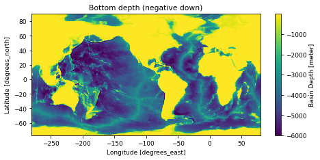
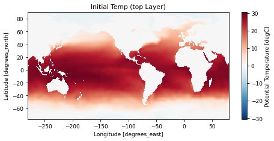
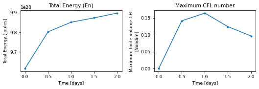
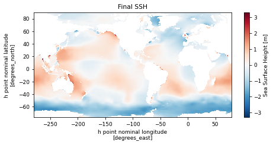

# global

!!! success "Run status: :white_check_mark: ran successfully"
    Tested on 2026-11-04 with `access-om3/2026.05.004` (`mom6-solo`): 64 cores, walltime used 00:00:42, 1.49 SU. Details further down this page.


!!! abstract "Description (as on the Overview)"
    - **Grid:** 360 x 210 points, 63 layers/levels (`GRID_CONFIG = mosaic`)
    - **Vertical coordinate:** layer mode (no regridding)
    - **Topography:** `TOPO_CONFIG = file`
    - **Surface forcing:** `WIND_CONFIG = file`, `BUOY_CONFIG = file`
    - **Run length:** 2 days

    Read from this run's `MOM_parameter_doc.all`. Source: [upstream](https://github.com/NOAA-GFDL/MOM6-examples/tree/c1730b8efe16cf7f12fc8db588115cae50f3e802/ocean_only/global).

Configuration files: [`ocean_only/global`](https://github.com/NOAA-GFDL/MOM6-examples/tree/c1730b8efe16cf7f12fc8db588115cae50f3e802/ocean_only/global) in NOAA-GFDL/MOM6-examples, at commit [`c1730b8e`](https://github.com/NOAA-GFDL/MOM6-examples/commit/c1730b8efe16cf7f12fc8db588115cae50f3e802): the version this run used. (The model itself is the `mom6-solo` listed under Provenance.)

GFDL excludes this example from its own automated test suite (`EXCLUDE` in [`ocean_only/Makefile`](https://github.com/NOAA-GFDL/MOM6-examples/blob/c1730b8efe16cf7f12fc8db588115cae50f3e802/ocean_only/Makefile)).

## Run it yourself

From a Gadi **login node** (membership of NCI project `vk83` needed, and `ol01` for the input data):

```bash
PROJECT=<your-project> bash global.sh
```

where `global.sh` is the script below (click to expand; copy button top-right). It is exactly the script that produced the results on this page.

??? example "global.sh"
    ```bash
    --8<-- "tested-configs/run_scripts/global.sh"
    ```

## What we got


*Left: `SSH` at the last output time; right: total energy (`En`) from `ocean.stats.nc`.*

Last lines of `ocean.stats`:

```text
    12,       0.500,     0, En 7.1054787548986675E-01, CFL  0.14162, SL -5.6093E-05, M 1.37953E+21, S 34.7200, T  3.6133, Me  4.18E-16, Se  1.46E-14, Te  4.59E-15
    24,       1.000,     0, En 7.1408759518068854E-01, CFL  0.16462, SL -8.2274E-05, M 1.37953E+21, S 34.7200, T  3.6133, Me  6.80E-16, Se  2.33E-14, Te  4.65E-15
    36,       1.500,     0, En 7.1570414410585603E-01, CFL  0.12427, SL -3.3532E-04, M 1.37953E+21, S 34.7200, T  3.6133, Me  1.02E-15, Se  3.51E-14, Te  7.00E-15
    48,       2.000,     0, En 7.1746297370424228E-01, CFL  0.09670, SL -5.4077E-04, M 1.37953E+21, S 34.7200, T  3.6133, Me  1.32E-15, Se  4.54E-14, Te  9.38E-15
```

## Domain, forcing and output

Made by running the notebook [`explore_run.ipynb`](https://github.com/ACCESS-Community-Hub/mom6-idealised-configs/blob/main/tested-configs/notebooks/explore_run.ipynb) on this run's output folder; it only plots files MOM6 wrote during the run. **[See the notebook with its code](../notebooks/global.md)**.

### Set-up


Values from this run's `MOM_parameter_doc.all`:

| Parameter | Value |
|---|---|
| `NIGLOBAL` | `360` |
| `NJGLOBAL` | `210` |
| `NK` | `63` |
| `GRID_CONFIG` | `mosaic` |
| `TOPO_CONFIG` | `file` |
| `REENTRANT_X` | `True` |
| `REENTRANT_Y` | `False` |
| `USE_REGRIDDING` | `False` |
| `ENABLE_THERMODYNAMICS` | `True` |
| `EQN_OF_STATE` | `WRIGHT` |
| `THICKNESS_CONFIG` | `file` |
| `TS_CONFIG` | `file` |
| `WIND_CONFIG` | `file` |
| `BUOY_CONFIG` | `file` |
| `ICE_SHELF` | `False` |
| `DT` | `3600.0` |
| `DT_THERM` | `7200.0` |
| `DAYMAX` | `2.0` |


### Domain and bottom depth


Grid: 360 x 210 points (`GRID_CONFIG = mosaic`), x from -279.5 to 79.5 degrees_east, y from -76.75 to 89.75 degrees_north. Bottom depth `D` from 0.25 to 6000 m (`TOPO_CONFIG = file`).


    

    


### Initial state


`Temp` from `GOLD_IC.nc`, which MOM6 writes with the initial state.


    

    


### Surface forcing


No surface forcing is saved in this run's diagnostics. The forcing is set by `WIND_CONFIG = file` and `BUOY_CONFIG = file` (see the MOM6 documentation for these options).


### Energy and stability through the run


    

    


From `ocean.stats.nc`: 5 records; time axis in days.


### Final state


`SSH` at the last record of `surface__0001_001.nc` (snapshot).


    


## Parameters compared with the reference

<span class="chip a">A</span> GFDL's file in MOM6-examples (`c1730b8e`): [`MOM_parameter_doc.all`](https://github.com/NOAA-GFDL/MOM6-examples/blob/c1730b8efe16cf7f12fc8db588115cae50f3e802/ocean_only/global/MOM_parameter_doc.all)  
<span class="chip b">B</span> this run: `MOM_parameter_doc.all` in the run's output, `/scratch/<your-project>/$USER/mom6-examples/archive/global/output000/MOM_parameter_doc.all` when you run the script

**2** parameter values differ; **96** parameters exist only in this run's MOM6 version and **26** only in the reference (new, removed or renamed parameters). Values are compared ignoring quotes, case and number formatting. Parameter names link to a search of the MOM6 source; reference values link to their line on GitHub.

<table class="diff"><thead><tr><th>Parameter</th><th>Units</th><th>A: reference</th><th>B: this run</th></tr></thead><tbody><tr class="mod"><td colspan="4">MOM</td></tr><tr class="param"><td><a href="https://github.com/mom-ocean/MOM6/search?q=USE_POROUS_BARRIER" target="_blank" rel="noopener">USE_POROUS_BARRIER</a></td><td class="units">Boolean</td><td class="val a" data-label="A: reference"><a href="https://github.com/NOAA-GFDL/MOM6-examples/blob/c1730b8efe16cf7f12fc8db588115cae50f3e802/ocean_only/global/MOM_parameter_doc.all#L51" target="_blank" rel="noopener">True</a></td><td class="val b" data-label="B: this run">False<span class="ln"> line 47</span></td></tr><tr class="mod"><td colspan="4">MOM_diabatic_driver</td></tr><tr class="param"><td><a href="https://github.com/mom-ocean/MOM6/search?q=MLD_EN_VALS" target="_blank" rel="noopener">MLD_EN_VALS</a></td><td class="units">J/m2</td><td class="val a" data-label="A: reference"><a href="https://github.com/NOAA-GFDL/MOM6-examples/blob/c1730b8efe16cf7f12fc8db588115cae50f3e802/ocean_only/global/MOM_parameter_doc.all#L1521" target="_blank" rel="noopener">3*0.0</a></td><td class="val b" data-label="B: this run">25.0, 2500.0, 2.5E+05<span class="ln"> line 1705</span></td></tr></tbody></table>

??? note "Parameters in only one of the two files (122)"
    <table class="diff"><thead><tr><th>Parameter</th><th>Units</th><th>A: reference</th><th>B: this run</th></tr></thead><tbody><tr class="mod"><td colspan="4">ideal_age_example</td></tr><tr class="param"><td><a href="https://github.com/mom-ocean/MOM6/search?q=DO_BL_RESIDENCE" target="_blank" rel="noopener">DO_BL_RESIDENCE</a></td><td class="units">Boolean</td><td class="val a unset" data-label="A: reference">(not in this version)</td><td class="val b" data-label="B: this run">False<span class="ln"> line 446</span></td></tr><tr class="param"><td><a href="https://github.com/mom-ocean/MOM6/search?q=USE_REAL_BL_DEPTH" target="_blank" rel="noopener">USE_REAL_BL_DEPTH</a></td><td class="units">Boolean</td><td class="val a unset" data-label="A: reference">(not in this version)</td><td class="val b" data-label="B: this run">False<span class="ln"> line 449</span></td></tr><tr class="mod"><td colspan="4">MOM</td></tr><tr class="param"><td><a href="https://github.com/mom-ocean/MOM6/search?q=DEFAULT_2018_ANSWERS" target="_blank" rel="noopener">DEFAULT_2018_ANSWERS</a></td><td class="units">Boolean</td><td class="val a" data-label="A: reference"><a href="https://github.com/NOAA-GFDL/MOM6-examples/blob/c1730b8efe16cf7f12fc8db588115cae50f3e802/ocean_only/global/MOM_parameter_doc.all#L130" target="_blank" rel="noopener">False</a></td><td class="val b unset" data-label="B: this run">(not in this version)</td></tr><tr class="param"><td><a href="https://github.com/mom-ocean/MOM6/search?q=DT_TRACER_ADVECT" target="_blank" rel="noopener">DT_TRACER_ADVECT</a></td><td class="units">s</td><td class="val a unset" data-label="A: reference">(not in this version)</td><td class="val b" data-label="B: this run">7200.0<span class="ln"> line 76</span></td></tr><tr class="param"><td><a href="https://github.com/mom-ocean/MOM6/search?q=ENABLE_BUGS_BY_DEFAULT" target="_blank" rel="noopener">ENABLE_BUGS_BY_DEFAULT</a></td><td class="units">Boolean</td><td class="val a unset" data-label="A: reference">(not in this version)</td><td class="val b" data-label="B: this run">True<span class="ln"> line 54</span></td></tr><tr class="param"><td><a href="https://github.com/mom-ocean/MOM6/search?q=GEOM_FILE" target="_blank" rel="noopener">GEOM_FILE</a></td><td class="units"></td><td class="val a unset" data-label="A: reference">(not in this version)</td><td class="val b" data-label="B: this run">&quot;ocean_geometry&quot;<span class="ln"> line 171</span></td></tr><tr class="param"><td><a href="https://github.com/mom-ocean/MOM6/search?q=NONBLOCKING_P_SURF_BUG" target="_blank" rel="noopener">NONBLOCKING_P_SURF_BUG</a></td><td class="units">Boolean</td><td class="val a unset" data-label="A: reference">(not in this version)</td><td class="val b" data-label="B: this run">True<span class="ln"> line 135</span></td></tr><tr class="param"><td><a href="https://github.com/mom-ocean/MOM6/search?q=SPLIT_RK2B" target="_blank" rel="noopener">SPLIT_RK2B</a></td><td class="units">Boolean</td><td class="val a unset" data-label="A: reference">(not in this version)</td><td class="val b" data-label="B: this run">False<span class="ln"> line 6</span></td></tr><tr class="param"><td><a href="https://github.com/mom-ocean/MOM6/search?q=SURFACE_2018_ANSWERS" target="_blank" rel="noopener">SURFACE_2018_ANSWERS</a></td><td class="units">Boolean</td><td class="val a" data-label="A: reference"><a href="https://github.com/NOAA-GFDL/MOM6-examples/blob/c1730b8efe16cf7f12fc8db588115cae50f3e802/ocean_only/global/MOM_parameter_doc.all#L132" target="_blank" rel="noopener">False</a></td><td class="val b unset" data-label="B: this run">(not in this version)</td></tr><tr class="param"><td><a href="https://github.com/mom-ocean/MOM6/search?q=TRADV_SPANS_COUPLING" target="_blank" rel="noopener">TRADV_SPANS_COUPLING</a></td><td class="units">Boolean</td><td class="val a unset" data-label="A: reference">(not in this version)</td><td class="val b" data-label="B: this run">False<span class="ln"> line 82</span></td></tr><tr class="param"><td><a href="https://github.com/mom-ocean/MOM6/search?q=USE_DIABATIC_TIME_BUG" target="_blank" rel="noopener">USE_DIABATIC_TIME_BUG</a></td><td class="units">Boolean</td><td class="val a" data-label="A: reference"><a href="https://github.com/NOAA-GFDL/MOM6-examples/blob/c1730b8efe16cf7f12fc8db588115cae50f3e802/ocean_only/global/MOM_parameter_doc.all#L142" target="_blank" rel="noopener">False</a></td><td class="val b unset" data-label="B: this run">(not in this version)</td></tr><tr class="param"><td><a href="https://github.com/mom-ocean/MOM6/search?q=USE_UH_PARTICLES" target="_blank" rel="noopener">USE_UH_PARTICLES</a></td><td class="units">Boolean</td><td class="val a unset" data-label="A: reference">(not in this version)</td><td class="val b" data-label="B: this run">False<span class="ln"> line 180</span></td></tr><tr class="mod"><td colspan="4">MOM_barotropic</td></tr><tr class="param"><td><a href="https://github.com/mom-ocean/MOM6/search?q=BAROTROPIC_2018_ANSWERS" target="_blank" rel="noopener">BAROTROPIC_2018_ANSWERS</a></td><td class="units">Boolean</td><td class="val a" data-label="A: reference"><a href="https://github.com/NOAA-GFDL/MOM6-examples/blob/c1730b8efe16cf7f12fc8db588115cae50f3e802/ocean_only/global/MOM_parameter_doc.all#L1370" target="_blank" rel="noopener">False</a></td><td class="val b unset" data-label="B: this run">(not in this version)</td></tr><tr class="param"><td><a href="https://github.com/mom-ocean/MOM6/search?q=BT_LINEAR_FREQ_DRAG" target="_blank" rel="noopener">BT_LINEAR_FREQ_DRAG</a></td><td class="units">Boolean</td><td class="val a unset" data-label="A: reference">(not in this version)</td><td class="val b" data-label="B: this run">False<span class="ln"> line 1577</span></td></tr><tr class="param"><td><a href="https://github.com/mom-ocean/MOM6/search?q=MASK_COASTAL_PRESSURE_FORCE" target="_blank" rel="noopener">MASK_COASTAL_PRESSURE_FORCE</a></td><td class="units">Boolean</td><td class="val a unset" data-label="A: reference">(not in this version)</td><td class="val b" data-label="B: this run">False<span class="ln"> line 1614</span></td></tr><tr class="param"><td><a href="https://github.com/mom-ocean/MOM6/search?q=TIDAL_SAL_FLATHER" target="_blank" rel="noopener">TIDAL_SAL_FLATHER</a></td><td class="units">Boolean</td><td class="val a unset" data-label="A: reference">(not in this version)</td><td class="val b" data-label="B: this run">False<span class="ln"> line 1546</span></td></tr><tr class="param"><td><a href="https://github.com/mom-ocean/MOM6/search?q=VISC_REM_BT_WEIGHT_BUG" target="_blank" rel="noopener">VISC_REM_BT_WEIGHT_BUG</a></td><td class="units">Boolean</td><td class="val a unset" data-label="A: reference">(not in this version)</td><td class="val b" data-label="B: this run">False<span class="ln"> line 1538</span></td></tr><tr class="mod"><td colspan="4">MOM_bkgnd_mixing</td></tr><tr class="param"><td><a href="https://github.com/mom-ocean/MOM6/search?q=HENYEY_MAX_LAT" target="_blank" rel="noopener">HENYEY_MAX_LAT</a></td><td class="units">degN</td><td class="val a unset" data-label="A: reference">(not in this version)</td><td class="val b" data-label="B: this run">95.0<span class="ln"> line 1910</span></td></tr><tr class="mod"><td colspan="4">MOM_continuity</td></tr><tr class="param"><td><a href="https://github.com/mom-ocean/MOM6/search?q=CONTINUITY_SCHEME" target="_blank" rel="noopener">CONTINUITY_SCHEME</a></td><td class="units"></td><td class="val a" data-label="A: reference"><a href="https://github.com/NOAA-GFDL/MOM6-examples/blob/c1730b8efe16cf7f12fc8db588115cae50f3e802/ocean_only/global/MOM_parameter_doc.all#L1001" target="_blank" rel="noopener">&quot;PPM&quot;</a></td><td class="val b unset" data-label="B: this run">(not in this version)</td></tr><tr class="mod"><td colspan="4">MOM_diabatic_aux</td></tr><tr class="param"><td><a href="https://github.com/mom-ocean/MOM6/search?q=DO_BRINE_PLUME" target="_blank" rel="noopener">DO_BRINE_PLUME</a></td><td class="units">Boolean</td><td class="val a unset" data-label="A: reference">(not in this version)</td><td class="val b" data-label="B: this run">False<span class="ln"> line 2058</span></td></tr><tr class="mod"><td colspan="4">MOM_diabatic_driver</td></tr><tr class="param"><td><a href="https://github.com/mom-ocean/MOM6/search?q=BMLD_EN_VALS" target="_blank" rel="noopener">BMLD_EN_VALS</a></td><td class="units">J/m2</td><td class="val a unset" data-label="A: reference">(not in this version)</td><td class="val b" data-label="B: this run">25.0, 2500.0, 2.5E+05<span class="ln"> line 1708</span></td></tr><tr class="mod"><td colspan="4">MOM_diag_mediator</td></tr><tr class="param"><td><a href="https://github.com/mom-ocean/MOM6/search?q=DIAG_REMAPPING_USE_OM4_SUBCELLS" target="_blank" rel="noopener">DIAG_REMAPPING_USE_OM4_SUBCELLS</a></td><td class="units">Boolean</td><td class="val a unset" data-label="A: reference">(not in this version)</td><td class="val b" data-label="B: this run">True<span class="ln"> line 597</span></td></tr><tr class="param"><td><a href="https://github.com/mom-ocean/MOM6/search?q=REMAPPING_2018_ANSWERS" target="_blank" rel="noopener">REMAPPING_2018_ANSWERS</a></td><td class="units">Boolean</td><td class="val a" data-label="A: reference"><a href="https://github.com/NOAA-GFDL/MOM6-examples/blob/c1730b8efe16cf7f12fc8db588115cae50f3e802/ocean_only/global/MOM_parameter_doc.all#L539" target="_blank" rel="noopener">False</a></td><td class="val b unset" data-label="B: this run">(not in this version)</td></tr><tr class="param"><td><a href="https://github.com/mom-ocean/MOM6/search?q=USE_GRID_SPACE_DIAGNOSTIC_AXES" target="_blank" rel="noopener">USE_GRID_SPACE_DIAGNOSTIC_AXES</a></td><td class="units">Boolean</td><td class="val a" data-label="A: reference"><a href="https://github.com/NOAA-GFDL/MOM6-examples/blob/c1730b8efe16cf7f12fc8db588115cae50f3e802/ocean_only/global/MOM_parameter_doc.all#L550" target="_blank" rel="noopener">False</a></td><td class="val b unset" data-label="B: this run">(not in this version)</td></tr><tr class="param"><td><a href="https://github.com/mom-ocean/MOM6/search?q=USE_INDEX_DIAGNOSTIC_AXES" target="_blank" rel="noopener">USE_INDEX_DIAGNOSTIC_AXES</a></td><td class="units">Boolean</td><td class="val a unset" data-label="A: reference">(not in this version)</td><td class="val b" data-label="B: this run">False<span class="ln"> line 606</span></td></tr><tr class="mod"><td colspan="4">MOM_diagnostics</td></tr><tr class="param"><td><a href="https://github.com/mom-ocean/MOM6/search?q=INTWAVE_REMAPPING_USE_OM4_SUBCELLS" target="_blank" rel="noopener">INTWAVE_REMAPPING_USE_OM4_SUBCELLS</a></td><td class="units">Boolean</td><td class="val a unset" data-label="A: reference">(not in this version)</td><td class="val b" data-label="B: this run">True<span class="ln"> line 1652</span></td></tr><tr class="mod"><td colspan="4">MOM_dynamics_split_RK2</td></tr><tr class="param"><td><a href="https://github.com/mom-ocean/MOM6/search?q=BT_ADJ_CORR_MASS_SRC" target="_blank" rel="noopener">BT_ADJ_CORR_MASS_SRC</a></td><td class="units">Boolean</td><td class="val a unset" data-label="A: reference">(not in this version)</td><td class="val b" data-label="B: this run">True<span class="ln"> line 1089</span></td></tr><tr class="param"><td><a href="https://github.com/mom-ocean/MOM6/search?q=CALCULATE_SAL" target="_blank" rel="noopener">CALCULATE_SAL</a></td><td class="units">Boolean</td><td class="val a unset" data-label="A: reference">(not in this version)</td><td class="val b" data-label="B: this run">True<span class="ln"> line 1066</span></td></tr><tr class="param"><td><a href="https://github.com/mom-ocean/MOM6/search?q=FPMIX" target="_blank" rel="noopener">FPMIX</a></td><td class="units">Boolean</td><td class="val a unset" data-label="A: reference">(not in this version)</td><td class="val b" data-label="B: this run">False<span class="ln"> line 1097</span></td></tr><tr class="param"><td><a href="https://github.com/mom-ocean/MOM6/search?q=SET_DTBT_USE_BT_CONT" target="_blank" rel="noopener">SET_DTBT_USE_BT_CONT</a></td><td class="units">Boolean</td><td class="val a unset" data-label="A: reference">(not in this version)</td><td class="val b" data-label="B: this run">False<span class="ln"> line 1081</span></td></tr><tr class="param"><td><a href="https://github.com/mom-ocean/MOM6/search?q=USE_HA" target="_blank" rel="noopener">USE_HA</a></td><td class="units">Boolean</td><td class="val a unset" data-label="A: reference">(not in this version)</td><td class="val b" data-label="B: this run">False<span class="ln"> line 1068</span></td></tr><tr class="param"><td><a href="https://github.com/mom-ocean/MOM6/search?q=VISC_REM_BUG" target="_blank" rel="noopener">VISC_REM_BUG</a></td><td class="units">Boolean</td><td class="val a unset" data-label="A: reference">(not in this version)</td><td class="val b" data-label="B: this run">False<span class="ln"> line 1100</span></td></tr><tr class="param"><td><a href="https://github.com/mom-ocean/MOM6/search?q=VISC_REM_TIMESTEP_BUG" target="_blank" rel="noopener">VISC_REM_TIMESTEP_BUG</a></td><td class="units">Boolean</td><td class="val a unset" data-label="A: reference">(not in this version)</td><td class="val b" data-label="B: this run">False<span class="ln"> line 1105</span></td></tr><tr class="mod"><td colspan="4">MOM_EOS</td></tr><tr class="param"><td><a href="https://github.com/mom-ocean/MOM6/search?q=TFREEZE_S_IS_PRACS" target="_blank" rel="noopener">TFREEZE_S_IS_PRACS</a></td><td class="units">Boolean</td><td class="val a unset" data-label="A: reference">(not in this version)</td><td class="val b" data-label="B: this run">True<span class="ln"> line 364</span></td></tr><tr class="param"><td><a href="https://github.com/mom-ocean/MOM6/search?q=TFREEZE_T_IS_POTT" target="_blank" rel="noopener">TFREEZE_T_IS_POTT</a></td><td class="units">Boolean</td><td class="val a unset" data-label="A: reference">(not in this version)</td><td class="val b" data-label="B: this run">True<span class="ln"> line 367</span></td></tr><tr class="param"><td><a href="https://github.com/mom-ocean/MOM6/search?q=USE_WRIGHT_2ND_DERIV_BUG" target="_blank" rel="noopener">USE_WRIGHT_2ND_DERIV_BUG</a></td><td class="units">Boolean</td><td class="val a unset" data-label="A: reference">(not in this version)</td><td class="val b" data-label="B: this run">False<span class="ln"> line 344</span></td></tr><tr class="mod"><td colspan="4">MOM_hor_bnd_diffusion</td></tr><tr class="param"><td><a href="https://github.com/mom-ocean/MOM6/search?q=USE_HORIZONTAL_BOUNDARY_DIFFUSION" target="_blank" rel="noopener">USE_HORIZONTAL_BOUNDARY_DIFFUSION</a></td><td class="units">Boolean</td><td class="val a unset" data-label="A: reference">(not in this version)</td><td class="val b" data-label="B: this run">False<span class="ln"> line 2276</span></td></tr><tr class="mod"><td colspan="4">MOM_hor_visc</td></tr><tr class="param"><td><a href="https://github.com/mom-ocean/MOM6/search?q=BACKSCATTER_UNDERBOUND" target="_blank" rel="noopener">BACKSCATTER_UNDERBOUND</a></td><td class="units">Boolean</td><td class="val a unset" data-label="A: reference">(not in this version)</td><td class="val b" data-label="B: this run">False<span class="ln"> line 1402</span></td></tr><tr class="param"><td><a href="https://github.com/mom-ocean/MOM6/search?q=BETTER_BOUND_AH" target="_blank" rel="noopener">BETTER_BOUND_AH</a></td><td class="units">Boolean</td><td class="val a" data-label="A: reference"><a href="https://github.com/NOAA-GFDL/MOM6-examples/blob/c1730b8efe16cf7f12fc8db588115cae50f3e802/ocean_only/global/MOM_parameter_doc.all#L1235" target="_blank" rel="noopener">True</a></td><td class="val b unset" data-label="B: this run">(not in this version)</td></tr><tr class="param"><td><a href="https://github.com/mom-ocean/MOM6/search?q=BETTER_BOUND_KH" target="_blank" rel="noopener">BETTER_BOUND_KH</a></td><td class="units">Boolean</td><td class="val a" data-label="A: reference"><a href="https://github.com/NOAA-GFDL/MOM6-examples/blob/c1730b8efe16cf7f12fc8db588115cae50f3e802/ocean_only/global/MOM_parameter_doc.all#L1208" target="_blank" rel="noopener">True</a></td><td class="val b unset" data-label="B: this run">(not in this version)</td></tr><tr class="param"><td><a href="https://github.com/mom-ocean/MOM6/search?q=EY24_EBT_BS" target="_blank" rel="noopener">EY24_EBT_BS</a></td><td class="units">Boolean</td><td class="val a unset" data-label="A: reference">(not in this version)</td><td class="val b" data-label="B: this run">False<span class="ln"> line 1369</span></td></tr><tr class="param"><td><a href="https://github.com/mom-ocean/MOM6/search?q=FRICTWORK_BUG" target="_blank" rel="noopener">FRICTWORK_BUG</a></td><td class="units">Boolean</td><td class="val a unset" data-label="A: reference">(not in this version)</td><td class="val b" data-label="B: this run">False<span class="ln"> line 1431</span></td></tr><tr class="param"><td><a href="https://github.com/mom-ocean/MOM6/search?q=HOR_VISC_2018_ANSWERS" target="_blank" rel="noopener">HOR_VISC_2018_ANSWERS</a></td><td class="units">Boolean</td><td class="val a" data-label="A: reference"><a href="https://github.com/NOAA-GFDL/MOM6-examples/blob/c1730b8efe16cf7f12fc8db588115cae50f3e802/ocean_only/global/MOM_parameter_doc.all#L1176" target="_blank" rel="noopener">False</a></td><td class="val b unset" data-label="B: this run">(not in this version)</td></tr><tr class="param"><td><a href="https://github.com/mom-ocean/MOM6/search?q=HOR_VISC_ANSWER_DATE" target="_blank" rel="noopener">HOR_VISC_ANSWER_DATE</a></td><td class="units"></td><td class="val a" data-label="A: reference"><a href="https://github.com/NOAA-GFDL/MOM6-examples/blob/c1730b8efe16cf7f12fc8db588115cae50f3e802/ocean_only/global/MOM_parameter_doc.all#L1180" target="_blank" rel="noopener">99991231</a></td><td class="val b unset" data-label="B: this run">(not in this version)</td></tr><tr class="param"><td><a href="https://github.com/mom-ocean/MOM6/search?q=USE_CIRCULATION_IN_HORVISC" target="_blank" rel="noopener">USE_CIRCULATION_IN_HORVISC</a></td><td class="units">Boolean</td><td class="val a unset" data-label="A: reference">(not in this version)</td><td class="val b" data-label="B: this run">False<span class="ln"> line 1341</span></td></tr><tr class="param"><td><a href="https://github.com/mom-ocean/MOM6/search?q=USE_CONT_THICKNESS" target="_blank" rel="noopener">USE_CONT_THICKNESS</a></td><td class="units">Boolean</td><td class="val a unset" data-label="A: reference">(not in this version)</td><td class="val b" data-label="B: this run">False<span class="ln"> line 1344</span></td></tr><tr class="param"><td><a href="https://github.com/mom-ocean/MOM6/search?q=USE_LEITHY" target="_blank" rel="noopener">USE_LEITHY</a></td><td class="units">Boolean</td><td class="val a unset" data-label="A: reference">(not in this version)</td><td class="val b" data-label="B: this run">False<span class="ln"> line 1394</span></td></tr><tr class="mod"><td colspan="4">MOM_kappa_shear</td></tr><tr class="param"><td><a href="https://github.com/mom-ocean/MOM6/search?q=LZ_RESCALE" target="_blank" rel="noopener">LZ_RESCALE</a></td><td class="units">nondim</td><td class="val a unset" data-label="A: reference">(not in this version)</td><td class="val b" data-label="B: this run">1.0<span class="ln"> line 1987</span></td></tr><tr class="param"><td><a href="https://github.com/mom-ocean/MOM6/search?q=VERTEX_SHEAR_THICKNESS_MEAN" target="_blank" rel="noopener">VERTEX_SHEAR_THICKNESS_MEAN</a></td><td class="units">Boolean</td><td class="val a unset" data-label="A: reference">(not in this version)</td><td class="val b" data-label="B: this run">False<span class="ln"> line 1949</span></td></tr><tr class="mod"><td colspan="4">MOM_lateral_boundary_diffusion</td></tr><tr class="param"><td><a href="https://github.com/mom-ocean/MOM6/search?q=USE_LATERAL_BOUNDARY_DIFFUSION" target="_blank" rel="noopener">USE_LATERAL_BOUNDARY_DIFFUSION</a></td><td class="units">Boolean</td><td class="val a" data-label="A: reference"><a href="https://github.com/NOAA-GFDL/MOM6-examples/blob/c1730b8efe16cf7f12fc8db588115cae50f3e802/ocean_only/global/MOM_parameter_doc.all#L2054" target="_blank" rel="noopener">False</a></td><td class="val b unset" data-label="B: this run">(not in this version)</td></tr><tr class="mod"><td colspan="4">MOM_lateral_mixing_coeffs</td></tr><tr class="param"><td><a href="https://github.com/mom-ocean/MOM6/search?q=BACKSCAT_EBT_POWER" target="_blank" rel="noopener">BACKSCAT_EBT_POWER</a></td><td class="units">nondim</td><td class="val a unset" data-label="A: reference">(not in this version)</td><td class="val b" data-label="B: this run">0.0<span class="ln"> line 827</span></td></tr><tr class="param"><td><a href="https://github.com/mom-ocean/MOM6/search?q=BS_USE_SQG_STRUCT" target="_blank" rel="noopener">BS_USE_SQG_STRUCT</a></td><td class="units">Boolean</td><td class="val a unset" data-label="A: reference">(not in this version)</td><td class="val b" data-label="B: this run">False<span class="ln"> line 830</span></td></tr><tr class="param"><td><a href="https://github.com/mom-ocean/MOM6/search?q=EBT_REMAPPING_USE_OM4_SUBCELLS" target="_blank" rel="noopener">EBT_REMAPPING_USE_OM4_SUBCELLS</a></td><td class="units">Boolean</td><td class="val a unset" data-label="A: reference">(not in this version)</td><td class="val b" data-label="B: this run">True<span class="ln"> line 920</span></td></tr><tr class="param"><td><a href="https://github.com/mom-ocean/MOM6/search?q=FULL_DEPTH_EADY_GROWTH_RATE" target="_blank" rel="noopener">FULL_DEPTH_EADY_GROWTH_RATE</a></td><td class="units">Boolean</td><td class="val a unset" data-label="A: reference">(not in this version)</td><td class="val b" data-label="B: this run">False<span class="ln"> line 879</span></td></tr><tr class="param"><td><a href="https://github.com/mom-ocean/MOM6/search?q=KD_GL90_USE_SQG_STRUCT" target="_blank" rel="noopener">KD_GL90_USE_SQG_STRUCT</a></td><td class="units">Boolean</td><td class="val a unset" data-label="A: reference">(not in this version)</td><td class="val b" data-label="B: this run">False<span class="ln"> line 848</span></td></tr><tr class="param"><td><a href="https://github.com/mom-ocean/MOM6/search?q=KHTH_USE_SQG_STRUCT" target="_blank" rel="noopener">KHTH_USE_SQG_STRUCT</a></td><td class="units">Boolean</td><td class="val a unset" data-label="A: reference">(not in this version)</td><td class="val b" data-label="B: this run">False<span class="ln"> line 836</span></td></tr><tr class="param"><td><a href="https://github.com/mom-ocean/MOM6/search?q=KHTR_USE_EBT_STRUCT" target="_blank" rel="noopener">KHTR_USE_EBT_STRUCT</a></td><td class="units">Boolean</td><td class="val a unset" data-label="A: reference">(not in this version)</td><td class="val b" data-label="B: this run">False<span class="ln"> line 839</span></td></tr><tr class="param"><td><a href="https://github.com/mom-ocean/MOM6/search?q=KHTR_USE_SQG_STRUCT" target="_blank" rel="noopener">KHTR_USE_SQG_STRUCT</a></td><td class="units">Boolean</td><td class="val a unset" data-label="A: reference">(not in this version)</td><td class="val b" data-label="B: this run">False<span class="ln"> line 842</span></td></tr><tr class="mod"><td colspan="4">MOM_MEKE</td></tr><tr class="param"><td><a href="https://github.com/mom-ocean/MOM6/search?q=MEKE_BHFRCOEFF" target="_blank" rel="noopener">MEKE_BHFRCOEFF</a></td><td class="units">nondim</td><td class="val a unset" data-label="A: reference">(not in this version)</td><td class="val b" data-label="B: this run">-1.0<span class="ln"> line 697</span></td></tr><tr class="param"><td><a href="https://github.com/mom-ocean/MOM6/search?q=MEKE_POSITIVE" target="_blank" rel="noopener">MEKE_POSITIVE</a></td><td class="units">Boolean</td><td class="val a unset" data-label="A: reference">(not in this version)</td><td class="val b" data-label="B: this run">False<span class="ln"> line 714</span></td></tr><tr class="param"><td><a href="https://github.com/mom-ocean/MOM6/search?q=SQG_USE_MEKE" target="_blank" rel="noopener">SQG_USE_MEKE</a></td><td class="units">Boolean</td><td class="val a unset" data-label="A: reference">(not in this version)</td><td class="val b" data-label="B: this run">False<span class="ln"> line 792</span></td></tr><tr class="mod"><td colspan="4">MOM_mixed_layer</td></tr><tr class="param"><td><a href="https://github.com/mom-ocean/MOM6/search?q=BML_NONBOUSINESQ" target="_blank" rel="noopener">BML_NONBOUSINESQ</a></td><td class="units">Boolean</td><td class="val a unset" data-label="A: reference">(not in this version)</td><td class="val b" data-label="B: this run">False<span class="ln"> line 2139</span></td></tr><tr class="mod"><td colspan="4">MOM_opacity</td></tr><tr class="param"><td><a href="https://github.com/mom-ocean/MOM6/search?q=CHOROPHYLL_POWER_MANIZZA" target="_blank" rel="noopener">CHOROPHYLL_POWER_MANIZZA</a></td><td class="units">nondim</td><td class="val a unset" data-label="A: reference">(not in this version)</td><td class="val b" data-label="B: this run">0.674, 0.629, 0.0<span class="ln"> line 2205</span></td></tr><tr class="param"><td><a href="https://github.com/mom-ocean/MOM6/search?q=OPACITY_BAND_WAVELENGTHS" target="_blank" rel="noopener">OPACITY_BAND_WAVELENGTHS</a></td><td class="units">nm</td><td class="val a unset" data-label="A: reference">(not in this version)</td><td class="val b" data-label="B: this run">0.0, 550.0, 700.0, 2800.0<span class="ln"> line 2208</span></td></tr><tr class="param"><td><a href="https://github.com/mom-ocean/MOM6/search?q=OPACITY_VALUES_MANIZZA" target="_blank" rel="noopener">OPACITY_VALUES_MANIZZA</a></td><td class="units">m-1</td><td class="val a unset" data-label="A: reference">(not in this version)</td><td class="val b" data-label="B: this run">0.0232, 0.074, 0.225, 0.037, 2.86, 0.0<span class="ln"> line 2199</span></td></tr><tr class="param"><td><a href="https://github.com/mom-ocean/MOM6/search?q=OPTICS_2018_ANSWERS" target="_blank" rel="noopener">OPTICS_2018_ANSWERS</a></td><td class="units">Boolean</td><td class="val a" data-label="A: reference"><a href="https://github.com/NOAA-GFDL/MOM6-examples/blob/c1730b8efe16cf7f12fc8db588115cae50f3e802/ocean_only/global/MOM_parameter_doc.all#L1985" target="_blank" rel="noopener">False</a></td><td class="val b unset" data-label="B: this run">(not in this version)</td></tr><tr class="mod"><td colspan="4">MOM_porous_barriers</td></tr><tr class="param"><td><a href="https://github.com/mom-ocean/MOM6/search?q=PORBAR_ANSWER_DATE" target="_blank" rel="noopener">PORBAR_ANSWER_DATE</a></td><td class="units"></td><td class="val a" data-label="A: reference"><a href="https://github.com/NOAA-GFDL/MOM6-examples/blob/c1730b8efe16cf7f12fc8db588115cae50f3e802/ocean_only/global/MOM_parameter_doc.all#L960" target="_blank" rel="noopener">99991231</a></td><td class="val b unset" data-label="B: this run">(not in this version)</td></tr><tr class="param"><td><a href="https://github.com/mom-ocean/MOM6/search?q=PORBAR_ETA_INTERP" target="_blank" rel="noopener">PORBAR_ETA_INTERP</a></td><td class="units"></td><td class="val a" data-label="A: reference"><a href="https://github.com/NOAA-GFDL/MOM6-examples/blob/c1730b8efe16cf7f12fc8db588115cae50f3e802/ocean_only/global/MOM_parameter_doc.all#L968" target="_blank" rel="noopener">&quot;MAX&quot;</a></td><td class="val b unset" data-label="B: this run">(not in this version)</td></tr><tr class="param"><td><a href="https://github.com/mom-ocean/MOM6/search?q=PORBAR_MASKING_DEPTH" target="_blank" rel="noopener">PORBAR_MASKING_DEPTH</a></td><td class="units">m</td><td class="val a" data-label="A: reference"><a href="https://github.com/NOAA-GFDL/MOM6-examples/blob/c1730b8efe16cf7f12fc8db588115cae50f3e802/ocean_only/global/MOM_parameter_doc.all#L964" target="_blank" rel="noopener">0.0</a></td><td class="val b unset" data-label="B: this run">(not in this version)</td></tr><tr class="mod"><td colspan="4">MOM_PressureForce_FV</td></tr><tr class="param"><td><a href="https://github.com/mom-ocean/MOM6/search?q=BOUSSINESQ_SAL_TIDES" target="_blank" rel="noopener">BOUSSINESQ_SAL_TIDES</a></td><td class="units">Boolean</td><td class="val a unset" data-label="A: reference">(not in this version)</td><td class="val b" data-label="B: this run">False<span class="ln"> line 1285</span></td></tr><tr class="param"><td><a href="https://github.com/mom-ocean/MOM6/search?q=CORRECTION_INTXPA" target="_blank" rel="noopener">CORRECTION_INTXPA</a></td><td class="units">Boolean</td><td class="val a unset" data-label="A: reference">(not in this version)</td><td class="val b" data-label="B: this run">False<span class="ln"> line 1307</span></td></tr><tr class="param"><td><a href="https://github.com/mom-ocean/MOM6/search?q=MASS_WEIGHT_IN_PGF_VANISHED_ONLY" target="_blank" rel="noopener">MASS_WEIGHT_IN_PGF_VANISHED_ONLY</a></td><td class="units">Boolean</td><td class="val a unset" data-label="A: reference">(not in this version)</td><td class="val b" data-label="B: this run">False<span class="ln"> line 1304</span></td></tr><tr class="param"><td><a href="https://github.com/mom-ocean/MOM6/search?q=MASS_WEIGHT_IN_PRESSURE_GRADIENT_TOP" target="_blank" rel="noopener">MASS_WEIGHT_IN_PRESSURE_GRADIENT_TOP</a></td><td class="units">Boolean</td><td class="val a unset" data-label="A: reference">(not in this version)</td><td class="val b" data-label="B: this run">False<span class="ln"> line 1300</span></td></tr><tr class="param"><td><a href="https://github.com/mom-ocean/MOM6/search?q=RESET_INTXPA_INTEGRAL" target="_blank" rel="noopener">RESET_INTXPA_INTEGRAL</a></td><td class="units">Boolean</td><td class="val a unset" data-label="A: reference">(not in this version)</td><td class="val b" data-label="B: this run">False<span class="ln"> line 1309</span></td></tr><tr class="param"><td><a href="https://github.com/mom-ocean/MOM6/search?q=RESET_INTXPA_INTEGRAL_FLATTEST" target="_blank" rel="noopener">RESET_INTXPA_INTEGRAL_FLATTEST</a></td><td class="units">Boolean</td><td class="val a unset" data-label="A: reference">(not in this version)</td><td class="val b" data-label="B: this run">False<span class="ln"> line 1312</span></td></tr><tr class="param"><td><a href="https://github.com/mom-ocean/MOM6/search?q=RHO_PGF_REF" target="_blank" rel="noopener">RHO_PGF_REF</a></td><td class="units">kg m-3</td><td class="val a unset" data-label="A: reference">(not in this version)</td><td class="val b" data-label="B: this run">1035.0<span class="ln"> line 1269</span></td></tr><tr class="param"><td><a href="https://github.com/mom-ocean/MOM6/search?q=RHO_PGF_REF_BUG" target="_blank" rel="noopener">RHO_PGF_REF_BUG</a></td><td class="units">Boolean</td><td class="val a unset" data-label="A: reference">(not in this version)</td><td class="val b" data-label="B: this run">True<span class="ln"> line 1273</span></td></tr><tr class="param"><td><a href="https://github.com/mom-ocean/MOM6/search?q=SSH_IN_EOS_PRESSURE_FOR_PGF" target="_blank" rel="noopener">SSH_IN_EOS_PRESSURE_FOR_PGF</a></td><td class="units">Boolean</td><td class="val a unset" data-label="A: reference">(not in this version)</td><td class="val b" data-label="B: this run">False<span class="ln"> line 1292</span></td></tr><tr class="param"><td><a href="https://github.com/mom-ocean/MOM6/search?q=TIDES_ANSWER_DATE" target="_blank" rel="noopener">TIDES_ANSWER_DATE</a></td><td class="units"></td><td class="val a unset" data-label="A: reference">(not in this version)</td><td class="val b" data-label="B: this run">20230630<span class="ln"> line 1278</span></td></tr><tr class="mod"><td colspan="4">MOM_restart</td></tr><tr class="param"><td><a href="https://github.com/mom-ocean/MOM6/search?q=RESTART_SYMMETRIC_CHECKSUMS" target="_blank" rel="noopener">RESTART_SYMMETRIC_CHECKSUMS</a></td><td class="units">Boolean</td><td class="val a unset" data-label="A: reference">(not in this version)</td><td class="val b" data-label="B: this run">False<span class="ln"> line 386</span></td></tr><tr class="param"><td><a href="https://github.com/mom-ocean/MOM6/search?q=RESTART_UNSIGNED_ZEROS" target="_blank" rel="noopener">RESTART_UNSIGNED_ZEROS</a></td><td class="units">Boolean</td><td class="val a unset" data-label="A: reference">(not in this version)</td><td class="val b" data-label="B: this run">False<span class="ln"> line 389</span></td></tr><tr class="param"><td><a href="https://github.com/mom-ocean/MOM6/search?q=USE_FILTER" target="_blank" rel="noopener">USE_FILTER</a></td><td class="units">Boolean</td><td class="val a unset" data-label="A: reference">(not in this version)</td><td class="val b" data-label="B: this run">False<span class="ln"> line 393</span></td></tr><tr class="mod"><td colspan="4">MOM_self_attr_load</td></tr><tr class="param"><td><a href="https://github.com/mom-ocean/MOM6/search?q=SAL_HARMONICS" target="_blank" rel="noopener">SAL_HARMONICS</a></td><td class="units">Boolean</td><td class="val a unset" data-label="A: reference">(not in this version)</td><td class="val b" data-label="B: this run">False<span class="ln"> line 1199</span></td></tr><tr class="param"><td><a href="https://github.com/mom-ocean/MOM6/search?q=SAL_SCALAR_APPROX" target="_blank" rel="noopener">SAL_SCALAR_APPROX</a></td><td class="units">Boolean</td><td class="val a unset" data-label="A: reference">(not in this version)</td><td class="val b" data-label="B: this run">True<span class="ln"> line 1192</span></td></tr><tr class="param"><td><a href="https://github.com/mom-ocean/MOM6/search?q=SAL_SCALAR_VALUE" target="_blank" rel="noopener">SAL_SCALAR_VALUE</a></td><td class="units">m m-1</td><td class="val a unset" data-label="A: reference">(not in this version)</td><td class="val b" data-label="B: this run">0.094<span class="ln"> line 1195</span></td></tr><tr class="param"><td><a href="https://github.com/mom-ocean/MOM6/search?q=SAL_USE_BPA" target="_blank" rel="noopener">SAL_USE_BPA</a></td><td class="units">Boolean</td><td class="val a unset" data-label="A: reference">(not in this version)</td><td class="val b" data-label="B: this run">False<span class="ln"> line 1188</span></td></tr><tr class="mod"><td colspan="4">MOM_set_diffusivity</td></tr><tr class="param"><td><a href="https://github.com/mom-ocean/MOM6/search?q=SET_DIFF_2018_ANSWERS" target="_blank" rel="noopener">SET_DIFF_2018_ANSWERS</a></td><td class="units">Boolean</td><td class="val a" data-label="A: reference"><a href="https://github.com/NOAA-GFDL/MOM6-examples/blob/c1730b8efe16cf7f12fc8db588115cae50f3e802/ocean_only/global/MOM_parameter_doc.all#L1576" target="_blank" rel="noopener">False</a></td><td class="val b unset" data-label="B: this run">(not in this version)</td></tr><tr class="mod"><td colspan="4">MOM_set_visc</td></tr><tr class="param"><td><a href="https://github.com/mom-ocean/MOM6/search?q=SET_VISC_2018_ANSWERS" target="_blank" rel="noopener">SET_VISC_2018_ANSWERS</a></td><td class="units">Boolean</td><td class="val a" data-label="A: reference"><a href="https://github.com/NOAA-GFDL/MOM6-examples/blob/c1730b8efe16cf7f12fc8db588115cae50f3e802/ocean_only/global/MOM_parameter_doc.all#L816" target="_blank" rel="noopener">False</a></td><td class="val b unset" data-label="B: this run">(not in this version)</td></tr><tr class="param"><td><a href="https://github.com/mom-ocean/MOM6/search?q=TRIG_CHANNEL_DRAG_WIDTHS" target="_blank" rel="noopener">TRIG_CHANNEL_DRAG_WIDTHS</a></td><td class="units">Boolean</td><td class="val a unset" data-label="A: reference">(not in this version)</td><td class="val b" data-label="B: this run">True<span class="ln"> line 1006</span></td></tr><tr class="mod"><td colspan="4">MOM_state_initialization</td></tr><tr class="param"><td><a href="https://github.com/mom-ocean/MOM6/search?q=CONVERT_THICKNESS_UNITS" target="_blank" rel="noopener">CONVERT_THICKNESS_UNITS</a></td><td class="units">Boolean</td><td class="val a" data-label="A: reference"><a href="https://github.com/NOAA-GFDL/MOM6-examples/blob/c1730b8efe16cf7f12fc8db588115cae50f3e802/ocean_only/global/MOM_parameter_doc.all#L525" target="_blank" rel="noopener">False</a></td><td class="val b unset" data-label="B: this run">(not in this version)</td></tr><tr class="mod"><td colspan="4">MOM_sum_output</td></tr><tr class="param"><td><a href="https://github.com/mom-ocean/MOM6/search?q=ISO_DATE_STAMPED_STDOUT" target="_blank" rel="noopener">ISO_DATE_STAMPED_STDOUT</a></td><td class="units">Boolean</td><td class="val a unset" data-label="A: reference">(not in this version)</td><td class="val b" data-label="B: this run">False<span class="ln"> line 2304</span></td></tr><tr class="mod"><td colspan="4">MOM_surface_forcing</td></tr><tr class="param"><td><a href="https://github.com/mom-ocean/MOM6/search?q=EVAPORATION_FILE_DAYS_PER_RECORD" target="_blank" rel="noopener">EVAPORATION_FILE_DAYS_PER_RECORD</a></td><td class="units"></td><td class="val a unset" data-label="A: reference">(not in this version)</td><td class="val b" data-label="B: this run">0<span class="ln"> line 2373</span></td></tr><tr class="param"><td><a href="https://github.com/mom-ocean/MOM6/search?q=FIX_USTAR_GUSTLESS_BUG" target="_blank" rel="noopener">FIX_USTAR_GUSTLESS_BUG</a></td><td class="units">Boolean</td><td class="val a" data-label="A: reference"><a href="https://github.com/NOAA-GFDL/MOM6-examples/blob/c1730b8efe16cf7f12fc8db588115cae50f3e802/ocean_only/global/MOM_parameter_doc.all#L2209" target="_blank" rel="noopener">True</a></td><td class="val b unset" data-label="B: this run">(not in this version)</td></tr><tr class="param"><td><a href="https://github.com/mom-ocean/MOM6/search?q=LATENTHEAT_FILE_DAYS_PER_RECORD" target="_blank" rel="noopener">LATENTHEAT_FILE_DAYS_PER_RECORD</a></td><td class="units"></td><td class="val a unset" data-label="A: reference">(not in this version)</td><td class="val b" data-label="B: this run">0<span class="ln"> line 2383</span></td></tr><tr class="param"><td><a href="https://github.com/mom-ocean/MOM6/search?q=LONGWAVE_FILE_DAYS_PER_RECORD" target="_blank" rel="noopener">LONGWAVE_FILE_DAYS_PER_RECORD</a></td><td class="units"></td><td class="val a unset" data-label="A: reference">(not in this version)</td><td class="val b" data-label="B: this run">0<span class="ln"> line 2353</span></td></tr><tr class="param"><td><a href="https://github.com/mom-ocean/MOM6/search?q=RAIN_FILE_DAYS_PER_RECORD" target="_blank" rel="noopener">RAIN_FILE_DAYS_PER_RECORD</a></td><td class="units"></td><td class="val a unset" data-label="A: reference">(not in this version)</td><td class="val b" data-label="B: this run">0<span class="ln"> line 2403</span></td></tr><tr class="param"><td><a href="https://github.com/mom-ocean/MOM6/search?q=RESTORE_FLUX_RHO" target="_blank" rel="noopener">RESTORE_FLUX_RHO</a></td><td class="units">kg m-3</td><td class="val a unset" data-label="A: reference">(not in this version)</td><td class="val b" data-label="B: this run">1035.0<span class="ln"> line 2481</span></td></tr><tr class="param"><td><a href="https://github.com/mom-ocean/MOM6/search?q=RUNOFF_FILE_DAYS_PER_RECORD" target="_blank" rel="noopener">RUNOFF_FILE_DAYS_PER_RECORD</a></td><td class="units"></td><td class="val a unset" data-label="A: reference">(not in this version)</td><td class="val b" data-label="B: this run">0<span class="ln"> line 2419</span></td></tr><tr class="param"><td><a href="https://github.com/mom-ocean/MOM6/search?q=SALINITYRESTORE_FILE_DAYS_PER_RECORD" target="_blank" rel="noopener">SALINITYRESTORE_FILE_DAYS_PER_RECORD</a></td><td class="units"></td><td class="val a unset" data-label="A: reference">(not in this version)</td><td class="val b" data-label="B: this run">0<span class="ln"> line 2437</span></td></tr><tr class="param"><td><a href="https://github.com/mom-ocean/MOM6/search?q=SENSIBLEHEAT_FILE_DAYS_PER_RECORD" target="_blank" rel="noopener">SENSIBLEHEAT_FILE_DAYS_PER_RECORD</a></td><td class="units"></td><td class="val a unset" data-label="A: reference">(not in this version)</td><td class="val b" data-label="B: this run">0<span class="ln"> line 2393</span></td></tr><tr class="param"><td><a href="https://github.com/mom-ocean/MOM6/search?q=SHORTWAVE_FILE_DAYS_PER_RECORD" target="_blank" rel="noopener">SHORTWAVE_FILE_DAYS_PER_RECORD</a></td><td class="units"></td><td class="val a unset" data-label="A: reference">(not in this version)</td><td class="val b" data-label="B: this run">0<span class="ln"> line 2363</span></td></tr><tr class="param"><td><a href="https://github.com/mom-ocean/MOM6/search?q=SSTRESTORE_FILE_DAYS_PER_RECORD" target="_blank" rel="noopener">SSTRESTORE_FILE_DAYS_PER_RECORD</a></td><td class="units"></td><td class="val a unset" data-label="A: reference">(not in this version)</td><td class="val b" data-label="B: this run">0<span class="ln"> line 2431</span></td></tr><tr class="param"><td><a href="https://github.com/mom-ocean/MOM6/search?q=USTAR_GUSTLESS_BUG" target="_blank" rel="noopener">USTAR_GUSTLESS_BUG</a></td><td class="units">Boolean</td><td class="val a unset" data-label="A: reference">(not in this version)</td><td class="val b" data-label="B: this run">False<span class="ln"> line 2486</span></td></tr><tr class="param"><td><a href="https://github.com/mom-ocean/MOM6/search?q=WIND_FILE_DAYS_PER_RECORD" target="_blank" rel="noopener">WIND_FILE_DAYS_PER_RECORD</a></td><td class="units"></td><td class="val a unset" data-label="A: reference">(not in this version)</td><td class="val b" data-label="B: this run">0<span class="ln"> line 2461</span></td></tr><tr class="mod"><td colspan="4">MOM_tidal_forcing</td></tr><tr class="param"><td><a href="https://github.com/mom-ocean/MOM6/search?q=TIDAL_SAL_SHT" target="_blank" rel="noopener">TIDAL_SAL_SHT</a></td><td class="units">Boolean</td><td class="val a" data-label="A: reference"><a href="https://github.com/NOAA-GFDL/MOM6-examples/blob/c1730b8efe16cf7f12fc8db588115cae50f3e802/ocean_only/global/MOM_parameter_doc.all#L1125" target="_blank" rel="noopener">False</a></td><td class="val b unset" data-label="B: this run">(not in this version)</td></tr><tr class="param"><td><a href="https://github.com/mom-ocean/MOM6/search?q=TIDE_ADD_NODAL" target="_blank" rel="noopener">TIDE_ADD_NODAL</a></td><td class="units">Boolean</td><td class="val a unset" data-label="A: reference">(not in this version)</td><td class="val b" data-label="B: this run">False<span class="ln"> line 1255</span></td></tr><tr class="param"><td><a href="https://github.com/mom-ocean/MOM6/search?q=TIDE_NODAL_REF_DATE" target="_blank" rel="noopener">TIDE_NODAL_REF_DATE</a></td><td class="units"></td><td class="val a unset" data-label="A: reference">(not in this version)</td><td class="val b" data-label="B: this run">0, 0, 0<span class="ln"> line 1257</span></td></tr><tr class="param"><td><a href="https://github.com/mom-ocean/MOM6/search?q=TIDE_SAL_SCALAR_VALUE" target="_blank" rel="noopener">TIDE_SAL_SCALAR_VALUE</a></td><td class="units">m m-1</td><td class="val a" data-label="A: reference"><a href="https://github.com/NOAA-GFDL/MOM6-examples/blob/c1730b8efe16cf7f12fc8db588115cae50f3e802/ocean_only/global/MOM_parameter_doc.all#L1121" target="_blank" rel="noopener">0.094</a></td><td class="val b unset" data-label="B: this run">(not in this version)</td></tr><tr class="param"><td><a href="https://github.com/mom-ocean/MOM6/search?q=TIDE_USE_SAL_SCALAR" target="_blank" rel="noopener">TIDE_USE_SAL_SCALAR</a></td><td class="units">Boolean</td><td class="val a" data-label="A: reference"><a href="https://github.com/NOAA-GFDL/MOM6-examples/blob/c1730b8efe16cf7f12fc8db588115cae50f3e802/ocean_only/global/MOM_parameter_doc.all#L1118" target="_blank" rel="noopener">True</a></td><td class="val b unset" data-label="B: this run">(not in this version)</td></tr><tr class="mod"><td colspan="4">MOM_tidal_mixing</td></tr><tr class="param"><td><a href="https://github.com/mom-ocean/MOM6/search?q=DRAG_DIFFUSIVITY_ANSWER_DATE" target="_blank" rel="noopener">DRAG_DIFFUSIVITY_ANSWER_DATE</a></td><td class="units"></td><td class="val a unset" data-label="A: reference">(not in this version)</td><td class="val b" data-label="B: this run">99991231<span class="ln"> line 1876</span></td></tr><tr class="param"><td><a href="https://github.com/mom-ocean/MOM6/search?q=DZ_BBL_AVG_MIN" target="_blank" rel="noopener">DZ_BBL_AVG_MIN</a></td><td class="units">m</td><td class="val a unset" data-label="A: reference">(not in this version)</td><td class="val b" data-label="B: this run">0.0<span class="ln"> line 1880</span></td></tr><tr class="param"><td><a href="https://github.com/mom-ocean/MOM6/search?q=TIDAL_MIXING_2018_ANSWERS" target="_blank" rel="noopener">TIDAL_MIXING_2018_ANSWERS</a></td><td class="units">Boolean</td><td class="val a" data-label="A: reference"><a href="https://github.com/NOAA-GFDL/MOM6-examples/blob/c1730b8efe16cf7f12fc8db588115cae50f3e802/ocean_only/global/MOM_parameter_doc.all#L1594" target="_blank" rel="noopener">False</a></td><td class="val b unset" data-label="B: this run">(not in this version)</td></tr><tr class="mod"><td colspan="4">MOM_tracer_flow_control</td></tr><tr class="param"><td><a href="https://github.com/mom-ocean/MOM6/search?q=USE_FILE_DYES" target="_blank" rel="noopener">USE_FILE_DYES</a></td><td class="units">Boolean</td><td class="val a unset" data-label="A: reference">(not in this version)</td><td class="val b" data-label="B: this run">False<span class="ln"> line 412</span></td></tr><tr class="param"><td><a href="https://github.com/mom-ocean/MOM6/search?q=USE_MARBL_TRACERS" target="_blank" rel="noopener">USE_MARBL_TRACERS</a></td><td class="units">Boolean</td><td class="val a unset" data-label="A: reference">(not in this version)</td><td class="val b" data-label="B: this run">False<span class="ln"> line 408</span></td></tr><tr class="mod"><td colspan="4">MOM_tracer_hor_diff</td></tr><tr class="param"><td><a href="https://github.com/mom-ocean/MOM6/search?q=FULL_DEPTH_KHTR_MIN" target="_blank" rel="noopener">FULL_DEPTH_KHTR_MIN</a></td><td class="units">Boolean</td><td class="val a unset" data-label="A: reference">(not in this version)</td><td class="val b" data-label="B: this run">False<span class="ln"> line 2227</span></td></tr><tr class="param"><td><a href="https://github.com/mom-ocean/MOM6/search?q=HOR_DIFF_ANSWER_DATE" target="_blank" rel="noopener">HOR_DIFF_ANSWER_DATE</a></td><td class="units"></td><td class="val a unset" data-label="A: reference">(not in this version)</td><td class="val b" data-label="B: this run">20240101<span class="ln"> line 2256</span></td></tr><tr class="param"><td><a href="https://github.com/mom-ocean/MOM6/search?q=HOR_DIFF_LIMIT_BUG" target="_blank" rel="noopener">HOR_DIFF_LIMIT_BUG</a></td><td class="units">Boolean</td><td class="val a unset" data-label="A: reference">(not in this version)</td><td class="val b" data-label="B: this run">True<span class="ln"> line 2262</span></td></tr><tr class="mod"><td colspan="4">MOM_vert_friction</td></tr><tr class="param"><td><a href="https://github.com/mom-ocean/MOM6/search?q=CFL_BASED_TRUNCATIONS" target="_blank" rel="noopener">CFL_BASED_TRUNCATIONS</a></td><td class="units">Boolean</td><td class="val a" data-label="A: reference"><a href="https://github.com/NOAA-GFDL/MOM6-examples/blob/c1730b8efe16cf7f12fc8db588115cae50f3e802/ocean_only/global/MOM_parameter_doc.all#L1304" target="_blank" rel="noopener">True</a></td><td class="val b unset" data-label="B: this run">(not in this version)</td></tr><tr class="param"><td><a href="https://github.com/mom-ocean/MOM6/search?q=VERT_FRICTION_2018_ANSWERS" target="_blank" rel="noopener">VERT_FRICTION_2018_ANSWERS</a></td><td class="units">Boolean</td><td class="val a" data-label="A: reference"><a href="https://github.com/NOAA-GFDL/MOM6-examples/blob/c1730b8efe16cf7f12fc8db588115cae50f3e802/ocean_only/global/MOM_parameter_doc.all#L1265" target="_blank" rel="noopener">False</a></td><td class="val b unset" data-label="B: this run">(not in this version)</td></tr><tr class="mod"><td colspan="4">MOM_verticalGrid</td></tr><tr class="param"><td><a href="https://github.com/mom-ocean/MOM6/search?q=ADVECTION_SCHEME_VARIANCE_UNDERFLOW" target="_blank" rel="noopener">ADVECTION_SCHEME_VARIANCE_UNDERFLOW</a></td><td class="units">Conc2 (tracer dependent)</td><td class="val a unset" data-label="A: reference">(not in this version)</td><td class="val b" data-label="B: this run">1.0E-23<span class="ln"> line 332</span></td></tr><tr class="mod"><td colspan="4">MOM_Zanna_Bolton</td></tr><tr class="param"><td><a href="https://github.com/mom-ocean/MOM6/search?q=USE_ZB2020" target="_blank" rel="noopener">USE_ZB2020</a></td><td class="units">Boolean</td><td class="val a unset" data-label="A: reference">(not in this version)</td><td class="val b" data-label="B: this run">False<span class="ln"> line 1336</span></td></tr><tr class="mod"><td colspan="4">ocean_stochastics_init</td></tr><tr class="param"><td><a href="https://github.com/mom-ocean/MOM6/search?q=DO_SKEB" target="_blank" rel="noopener">DO_SKEB</a></td><td class="units">Boolean</td><td class="val a unset" data-label="A: reference">(not in this version)</td><td class="val b" data-label="B: this run">False<span class="ln"> line 2326</span></td></tr></tbody></table>

## Provenance

| What | Value |
|---|---|
| MOM6-examples | [`c1730b8efe16cf7f12fc8db588115cae50f3e802`](https://github.com/NOAA-GFDL/MOM6-examples/commit/c1730b8efe16cf7f12fc8db588115cae50f3e802) |
| ACCESS-OM3 module | `access-om3/2026.05.004` |
| MOM6 source code | `ACCESS-NRI/MOM6 2026.05.003 d11a149ccba676d524312328f7eb62560a156dc3` |
| Executable | `/g/data/vk83/apps/spack/1.1/release/linux-x86_64_v4/access-mom6-2026.05.003-ld7hklzo5ajizx5u4yl74i4ijberrpv6/bin/mom6-solo` |
| Executable md5 | `4785d157c76c30d8d01baf7d0f69d218` |
| payu | `1.3.6_1` (module `payu/1.3.6_1`) |
| Date tested | 2026-11-04 |
| PBS Job Id | `183115238.gadi-pbs` |
| PBS Exit Status | `0` |
| PBS Service Units | `1.49` |
| PBS NCPUs Requested | `64` |
| PBS Walltime Used | `00:00:42` |
| PBS Memory Used | `23.38GB` |

??? info "Input files and md5 hashes (from payu `manifests/input.yaml`)"
    | File | md5 | Comes from |
    |---|---|---|
    | `INPUT/31Layer_zgrid.nc` | `2d1b8673dc763a835081ab6d0e13d6d2` | `ol01` data: `global/siena_201204/INPUT/31Layer_zgrid.nc` |
    | `INPUT/GOLD_IC.2010.11.15.nc` | `bf6ba441e98ff5c1b04b635b0ad84dac` | `ol01` data: `global/siena_201204/INPUT/GOLD_IC.2010.11.15.nc` |
    | `INPUT/OM3_zgrid.nc` | `0830d67f80834fe2796b219a84b3ba8d` | `ol01` data: `global/siena_201204/INPUT/OM3_zgrid.nc` |
    | `INPUT/README` | `da6049145ac9dd6aa8c4fd19da61a98f` | `ol01` data: `global/siena_201204/mosaic.unpacked/README` |
    | `INPUT/atmos_hgrid.nc` | `a4d8a2cc7554b265f53da1f91a48fee1` | `ol01` data: `global/siena_201204/mosaic.unpacked/atmos_hgrid.nc` |
    | `INPUT/atmos_mosaic.nc` | `ed209f7d19cc856ec1a257c0ca63af90` | `ol01` data: `global/siena_201204/mosaic.unpacked/atmos_mosaic.nc` |
    | `INPUT/atmos_mosaic_tile1Xland_mosaic_tile1.nc` | `6025fff17ee89d0ef6f4ac530c4a833b` | `ol01` data: `global/siena_201204/mosaic.unpacked/atmos_mosaic_tile1Xland_mosaic_tile1.nc` |
    | `INPUT/atmos_mosaic_tile1Xocean_mosaic_tile1.nc` | `c4ee9d91f1b2146d8e0c60827670fee6` | `ol01` data: `global/siena_201204/mosaic.unpacked/atmos_mosaic_tile1Xocean_mosaic_tile1.nc` |
    | `INPUT/geothermal_heating_cm2g.nc` | `2604459298a435e292be908e6059a89f` | `ol01` data: `global/siena_201204/INPUT/geothermal_heating_cm2g.nc` |
    | `INPUT/grid_spec.nc` | `a2d3b842655c6ee2e0213db46154dc22` | `ol01` data: `global/siena_201204/mosaic.unpacked/grid_spec.nc` |
    | `INPUT/gustiness_qscat.nc` | `2fbcc31e266329ddb4dd1cd8c8d221f7` | `ol01` data: `global/siena_201204/INPUT/gustiness_qscat.nc` |
    | `INPUT/land_hgrid.nc` | `a4d8a2cc7554b265f53da1f91a48fee1` | `ol01` data: `global/siena_201204/mosaic.unpacked/land_hgrid.nc` |
    | `INPUT/land_mask.nc` | `d5caa6ffe6379a31e692f10ec65af033` | `ol01` data: `global/siena_201204/mosaic.unpacked/land_mask.nc` |
    | `INPUT/land_mosaic.nc` | `5aeb9c82ad3a1c2ecc3d7988aa641ad2` | `ol01` data: `global/siena_201204/mosaic.unpacked/land_mosaic.nc` |
    | `INPUT/land_mosaic_tile1Xocean_mosaic_tile1.nc` | `56c455a11d61a23e19f056bf6c99cb7c` | `ol01` data: `global/siena_201204/mosaic.unpacked/land_mosaic_tile1Xocean_mosaic_tile1.nc` |
    | `INPUT/mosaic.nc` | `a2d3b842655c6ee2e0213db46154dc22` | `ol01` data: `global/siena_201204/mosaic.unpacked/mosaic.nc` |
    | `INPUT/ocean_forcing_daily.nc` | `7065687a13038c404173d8c19525794b` | `ol01` data: `global/siena_201204/INPUT/ocean_forcing_daily.nc` |
    | `INPUT/ocean_forcing_monthly.nc` | `b26fd7fb52928bbfea285f87479c15f0` | `ol01` data: `global/siena_201204/INPUT/ocean_forcing_monthly.nc` |
    | `INPUT/ocean_hgrid.nc` | `c4782f49333b46f9ea53322ac1eff53a` | `ol01` data: `global/siena_201204/mosaic.unpacked/ocean_hgrid.nc` |
    | `INPUT/ocean_mask.nc` | `b49dce31f5a9cd53a8ebbb47518e238c` | `ol01` data: `global/siena_201204/mosaic.unpacked/ocean_mask.nc` |
    | `INPUT/ocean_mosaic.nc` | `1263df68b94e7a256be52283df611e94` | `ol01` data: `global/siena_201204/mosaic.unpacked/ocean_mosaic.nc` |
    | `INPUT/ocean_precip_monthly.nc` | `12031a11fbcd3ca1a0534d7feb9193fc` | `ol01` data: `global/siena_201204/INPUT/ocean_precip_monthly.nc` |
    | `INPUT/ocean_vgrid.nc` | `34d06772f261d0ef502b4e3998109c28` | `ol01` data: `global/siena_201204/mosaic.unpacked/ocean_vgrid.nc` |
    | `INPUT/seawifs_1998-2006_GOLD_smoothed_2X.nc` | `7217a6bb87ebdf4570bbf8940e8b3c72` | `ol01` data: `global/siena_201204/INPUT/seawifs_1998-2006_GOLD_smoothed_2X.nc` |
    | `INPUT/sgs_h2.nc` | `5f3897a97a4366edba744f35cea97d7d` | `ol01` data: `global/siena_201204/INPUT/sgs_h2.nc` |
    | `INPUT/tideamp.nc` | `8136b3e8b8f587734fc5b0abcb338702` | `ol01` data: `global/siena_201204/INPUT/tideamp.nc` |
    | `INPUT/topog.nc` | `bd19baefec0f42e89e90870fbee5a7e3` | `ol01` data: `global/siena_201204/mosaic.unpacked/topog.nc` |

??? info "Run-time environment (selected variables from payu's `env.yaml`)"
    | Variable | Value |
    |---|---|
    | `LD_LIBRARY_PATH` | `/apps/openmpi/4.1.7/lib:/apps/openmpi/4.1.7/lib/profilers` |
    | `LOADEDMODULES` | `access3-share/2026.03.002-eale5gm:access-cice/CICE6.6.3-2-huasrvo:access-mocsy/2025.07.002-saj7rvh:access-generic-tracers/2026.09.000-e3zb3ez:access-mom6/2026.05.003-ld7hklz:access-ww3/2026.03.001-bjzidie:access3/2026.03.002-26wbxup:access-om3/2026.05.004:pbs:openmpi/4.1.7` |
    | `OMPI_MCA_orte_tmpdir_base` | `/jobfs/183115238.gadi-pbs` |
    | `PAYU_TELEMETRY_ENV_VERSION` | `1.3.6_1` |
    | `PBS_NCI_NCPUS_PER_NODE` | `104` |
    | `PBS_NCPUS` | `64` |
    | `PBS_QUEUE` | `normalsr-exec` |

??? info "payu config.yaml written by the script"
    ```yaml
    # payu configuration for MOM6-examples/ocean_only/global (written by global.sh)
    project: tm70
    queue: normalsr          # mom6-solo is compiled for Sapphire Rapids nodes
    ncpus: 64
    walltime: 01:00:00
    jobname: global
    experiment: global
    laboratory: /g/data/tm70/cyb561/repos/claude/mom6-idealised-configs/runs/lab

    model: mom6
    exe: mom6-solo           # found on PATH once the module below is loaded
    input: /g/data/tm70/cyb561/repos/claude/mom6-idealised-configs/runs/MOM6-examples/ocean_only/global/INPUT
    modules:
      use:
        - /g/data/vk83/modules
      load:
        - access-om3/2026.05.004

    storage:                 # vk83: executable, ol01: input data
      gdata:
        - vk83
        - ol01

    collate: false           # mom6 writes un-split netCDF files when IO_LAYOUT = 1,1
    runlog: false            # don't commit run logs into the MOM6-examples clone
    metadata:
      enable: false
    ```

??? info "Output files"
    | File | Size | What it is |
    |---|---|---|
    | `GOLD_IC.nc` | 579.37 MB | Initial state written by MOM6 at the start of the run |
    | `Vertical_coordinate.nc` | 0.00 MB | The vertical coordinate: target values of the layers or levels |
    | `ave_prog__0001_003.nc` | 95.73 MB | Diagnostics set in `diag_table`: time averages of `u`, `v`, `h`, `e`, every 5 days |
    | `cont__0001_003.nc` | 153.17 MB | Diagnostics set in `diag_table`: time averages of `wd`, `uh`, `vh`, `h_rho`, `uh_rho`, `vh_rho`, `uhGM_rho`, `vhGM_rho`, every 5 days |
    | `meke__0001_003.nc` | 2.75 MB | Diagnostics set in `diag_table`: time averages of `MEKE`, `MEKE_KH`, `MEKE_Ue`, `MEKE_src`, `MEKE_decay`, `SN_u`, `SN_v`, `Res_fn` and 1 more, every 5 days |
    | `ocean.stats.nc` | 0.01 MB | Domain totals at each energy-save time (energy, mass, heat, salt, maximum CFL); the netCDF form of `ocean.stats` |
    | `ocean_geometry.nc` | 11.56 MB | Static grid: coordinates, cell sizes and areas, bottom depth `D`, Coriolis parameter, land mask |
    | `ocean_static.nc` | 4.58 MB | Diagnostics set in `diag_table`: snapshots of `geolon`, `geolat`, `geolon_c`, `geolat_c`, `geolon_u`, `geolat_u`, `geolon_v`, `geolat_v` and 7 more, written once (static) |
    | `prog__0001_003.nc` | 152.89 MB | Diagnostics set in `diag_table`: snapshots of `u`, `v`, `h`, `e`, `temp`, `salt`, `age`, every 5 days |
    | `sfc_ave__0001_001.nc` | 7.30 MB | Diagnostics set in `diag_table`: time averages of `SSH`, `SST`, `SSS`, `speed`, `SSU`, `SSV`, every 12 hours |
    | `surface__0001_001.nc` | 7.30 MB | Diagnostics set in `diag_table`: snapshots of `SSH`, `SST`, `SSS`, `speed`, `SSU`, `SSV`, every 12 hours |

