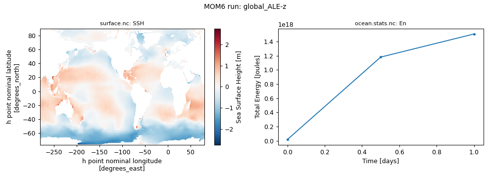

# global_ALE / z

360 x 210 x 50 mosaic grid, `Z*` coordinate, topography `file`, wind `file`, buoyancy `file`, 1 days ([upstream](https://github.com/NOAA-GFDL/MOM6-examples/tree/c1730b8efe16cf7f12fc8db588115cae50f3e802/ocean_only/global_ALE/z))

Upstream configuration: [`ocean_only/global_ALE/z`](https://github.com/NOAA-GFDL/MOM6-examples/tree/c1730b8efe16cf7f12fc8db588115cae50f3e802/ocean_only/global_ALE/z) (MOM6-examples commit [`c1730b8e`](https://github.com/NOAA-GFDL/MOM6-examples/commit/c1730b8efe16cf7f12fc8db588115cae50f3e802)).

!!! success "Tested: this example runs"
    Ran on Gadi on 2026-11-04 with `access-om3/2026.05.004` (`mom6-solo`) and `payu/1.3.6_1` on 64 Sapphire Rapids core(s); walltime used 00:00:37, 1.32 SU.

!!! note "Generated with Claude Code"
    This page, the script and the figure were generated automatically by [`tested-configs/regenerate_all.sh`](https://github.com/ACCESS-Community-Hub/mom6-idealised-configs/tree/main/tested-configs) (written with Claude Code). See [How these pages were made](../mom6examples.md#how-these-pages-were-made).

## Run it yourself

From a Gadi **login node** (membership of NCI project `vk83` needed, and `ol01` for the input data):

```bash
PROJECT=<your-project> bash global_ALE-z.sh
```

where `global_ALE-z.sh` is the script below (click to expand; copy button top-right). It is exactly the script that produced the results on this page.

??? example "global_ALE-z.sh"
    ```bash
    --8<-- "tested-configs/run_scripts/global_ALE-z.sh"
    ```

## What we got



*Left: `SSH` at the last output time; right: total energy (`En`) from `ocean.stats.nc`.*

Last lines of `ocean.stats`:

```text
            [days]                 [m2 s-2]           [Nondim]       [m]             [kg]         [PSU]      [degC]       [Nondim]        [PSU]        [degC]
     0,       0.000,     0, En 1.3459527249849935E-05, CFL  0.00000, SL  6.2440E-11, M 1.37953E+21, S 34.7202, T  3.6184, Me  0.00E+00, Se  0.00E+00, Te  0.00E+00
    12,       0.500,     0, En 8.5611312068650000E-04, CFL  0.08906, SL  7.8461E-04, M 1.37953E+21, S 34.7202, T  3.6185, Me -1.54E-19, Se  5.82E-17, Te -1.08E-17
    24,       1.000,     0, En 1.0920699840118843E-03, CFL  0.10383, SL  1.5929E-03, M 1.37953E+21, S 34.7202, T  3.6185, Me -2.20E-19, Se -1.07E-17, Te  1.82E-17
```

Key parameters of this run (from `MOM_parameter_doc.all`):

| Parameter | Value |
|---|---|
| `NIGLOBAL` | `360` |
| `NJGLOBAL` | `210` |
| `NK` | `50` |
| `GRID_CONFIG` | `"mosaic"` |
| `TOPO_CONFIG` | `"file"` |
| `REENTRANT_X` | `True` |
| `REENTRANT_Y` | `False` |
| `USE_REGRIDDING` | `True` |
| `REGRIDDING_COORDINATE_MODE` | `"Z*"` |
| `BOUSSINESQ` | `True` |
| `ENABLE_THERMODYNAMICS` | `True` |
| `EQN_OF_STATE` | `"WRIGHT"` |
| `WIND_CONFIG` | `"file"` |
| `BUOY_CONFIG` | `"file"` |
| `ICE_SHELF` | `False` |
| `DT` | `3600.0` |
| `DT_THERM` | `7200.0` |
| `DAYMAX` | `1.0` |
| `TIMEUNIT` | `8.64E+04` |

## Provenance

| What | Value |
|---|---|
| MOM6-examples | [`c1730b8efe16cf7f12fc8db588115cae50f3e802`](https://github.com/NOAA-GFDL/MOM6-examples/commit/c1730b8efe16cf7f12fc8db588115cae50f3e802) |
| ACCESS-OM3 module | `access-om3/2026.05.004` |
| MOM6 source code | `ACCESS-NRI/MOM6 2026.05.003 d11a149ccba676d524312328f7eb62560a156dc3` |
| Executable | `/g/data/vk83/apps/spack/1.1/release/linux-x86_64_v4/access-mom6-2026.05.003-ld7hklzo5ajizx5u4yl74i4ijberrpv6/bin/mom6-solo` |
| Executable md5 | `4785d157c76c30d8d01baf7d0f69d218` |
| payu | `1.3.6_1` (module `payu/1.3.6_1`) |
| Date tested | 2026-11-04 |
| PBS Job Id | `183115246.gadi-pbs` |
| PBS Exit Status | `0` |
| PBS Service Units | `1.32` |
| PBS NCPUs Requested | `64` |
| PBS Walltime Used | `00:00:37` |
| PBS Memory Used | `24.98GB` |

??? info "Input files and md5 hashes (from payu `manifests/input.yaml`)"
    | File | md5 | Path |
    |---|---|---|
    | `INPUT/31Layer_zgrid.nc` | `2d1b8673dc763a835081ab6d0e13d6d2` | `/g/data/tm70/cyb561/repos/claude/mom6-idealised-configs/runs/MOM6-examples/ocean_only/global_ALE/common/INPUT/31Layer_zgrid.nc` |
    | `INPUT/GOLD_IC.2010.11.15.nc` | `bf6ba441e98ff5c1b04b635b0ad84dac` | `/g/data/tm70/cyb561/repos/claude/mom6-idealised-configs/runs/MOM6-examples/ocean_only/global_ALE/common/INPUT/GOLD_IC.2010.11.15.nc` |
    | `INPUT/Layer_coord.cdl` | `db3247a6fa0db236260ed2baf3ec0225` | `/g/data/tm70/cyb561/repos/claude/mom6-idealised-configs/runs/MOM6-examples/ocean_only/global_ALE/common/INPUT/Layer_coord.cdl` |
    | `INPUT/Layer_coord.nc` | `1d91bdff8a01fe461ecbc3dc1804b2a6` | `/g/data/tm70/cyb561/repos/claude/mom6-idealised-configs/runs/MOM6-examples/ocean_only/global_ALE/common/INPUT/Layer_coord.nc` |
    | `INPUT/Layer_coord50.cdl` | `0281af583b85dd773581c0c5244a0a84` | `/g/data/tm70/cyb561/repos/claude/mom6-idealised-configs/runs/MOM6-examples/ocean_only/global_ALE/common/INPUT/Layer_coord50.cdl` |
    | `INPUT/Layer_coord50.nc` | `696fbfcf664b79c14815e678a9107f71` | `/g/data/tm70/cyb561/repos/claude/mom6-idealised-configs/runs/MOM6-examples/ocean_only/global_ALE/common/INPUT/Layer_coord50.nc` |
    | `INPUT/OM3_zgrid.nc` | `0830d67f80834fe2796b219a84b3ba8d` | `/g/data/tm70/cyb561/repos/claude/mom6-idealised-configs/runs/MOM6-examples/ocean_only/global_ALE/common/INPUT/OM3_zgrid.nc` |
    | `INPUT/WOA05_pottemp_salt.nc` | `46803f1e1595e29ea527086438a58391` | `/g/data/tm70/cyb561/repos/claude/mom6-idealised-configs/runs/MOM6-examples/ocean_only/global_ALE/common/INPUT/WOA05_pottemp_salt.nc` |
    | `INPUT/analysis_vgrid_lev35.v1.cdl` | `777b45acea071ca1a147760a2b850e41` | `/g/data/tm70/cyb561/repos/claude/mom6-idealised-configs/runs/MOM6-examples/ocean_only/global_ALE/common/INPUT/analysis_vgrid_lev35.v1.cdl` |
    | `INPUT/analysis_vgrid_lev35.v1.nc` | `cdfdc287b327daa2be262a67e57519fd` | `/g/data/tm70/cyb561/repos/claude/mom6-idealised-configs/runs/MOM6-examples/ocean_only/global_ALE/common/INPUT/analysis_vgrid_lev35.v1.nc` |
    | `INPUT/atmos_hgrid.nc` | `a4d8a2cc7554b265f53da1f91a48fee1` | `/g/data/tm70/cyb561/repos/claude/mom6-idealised-configs/runs/MOM6-examples/ocean_only/global_ALE/common/INPUT/atmos_hgrid.nc` |
    | `INPUT/atmos_mosaic.nc` | `ed209f7d19cc856ec1a257c0ca63af90` | `/g/data/tm70/cyb561/repos/claude/mom6-idealised-configs/runs/MOM6-examples/ocean_only/global_ALE/common/INPUT/atmos_mosaic.nc` |
    | `INPUT/atmos_mosaic_tile1Xland_mosaic_tile1.nc` | `6025fff17ee89d0ef6f4ac530c4a833b` | `/g/data/tm70/cyb561/repos/claude/mom6-idealised-configs/runs/MOM6-examples/ocean_only/global_ALE/common/INPUT/atmos_mosaic_tile1Xland_mosaic_tile1.nc` |
    | `INPUT/atmos_mosaic_tile1Xocean_mosaic_tile1.nc` | `c4ee9d91f1b2146d8e0c60827670fee6` | `/g/data/tm70/cyb561/repos/claude/mom6-idealised-configs/runs/MOM6-examples/ocean_only/global_ALE/common/INPUT/atmos_mosaic_tile1Xocean_mosaic_tile1.nc` |
    | `INPUT/geothermal_heating_cm2g.nc` | `2604459298a435e292be908e6059a89f` | `/g/data/tm70/cyb561/repos/claude/mom6-idealised-configs/runs/MOM6-examples/ocean_only/global_ALE/common/INPUT/geothermal_heating_cm2g.nc` |
    | `INPUT/grid_spec.nc` | `a2d3b842655c6ee2e0213db46154dc22` | `/g/data/tm70/cyb561/repos/claude/mom6-idealised-configs/runs/MOM6-examples/ocean_only/global_ALE/common/INPUT/grid_spec.nc` |
    | `INPUT/gustiness_qscat.nc` | `2fbcc31e266329ddb4dd1cd8c8d221f7` | `/g/data/tm70/cyb561/repos/claude/mom6-idealised-configs/runs/MOM6-examples/ocean_only/global_ALE/common/INPUT/gustiness_qscat.nc` |
    | `INPUT/hycom1_50.cdl` | `bb6a8c90545b7511de61b93c4f44c01a` | `/g/data/tm70/cyb561/repos/claude/mom6-idealised-configs/runs/MOM6-examples/ocean_only/global_ALE/common/INPUT/hycom1_50.cdl` |
    | `INPUT/hycom1_50.nc` | `bbd1cf56686a11a342d61d9db3286b0d` | `/g/data/tm70/cyb561/repos/claude/mom6-idealised-configs/runs/MOM6-examples/ocean_only/global_ALE/common/INPUT/hycom1_50.nc` |
    | `INPUT/land_hgrid.nc` | `a4d8a2cc7554b265f53da1f91a48fee1` | `/g/data/tm70/cyb561/repos/claude/mom6-idealised-configs/runs/MOM6-examples/ocean_only/global_ALE/common/INPUT/land_hgrid.nc` |
    | `INPUT/land_mask.nc` | `d5caa6ffe6379a31e692f10ec65af033` | `/g/data/tm70/cyb561/repos/claude/mom6-idealised-configs/runs/MOM6-examples/ocean_only/global_ALE/common/INPUT/land_mask.nc` |
    | `INPUT/land_mosaic.nc` | `5aeb9c82ad3a1c2ecc3d7988aa641ad2` | `/g/data/tm70/cyb561/repos/claude/mom6-idealised-configs/runs/MOM6-examples/ocean_only/global_ALE/common/INPUT/land_mosaic.nc` |
    | `INPUT/land_mosaic_tile1Xocean_mosaic_tile1.nc` | `56c455a11d61a23e19f056bf6c99cb7c` | `/g/data/tm70/cyb561/repos/claude/mom6-idealised-configs/runs/MOM6-examples/ocean_only/global_ALE/common/INPUT/land_mosaic_tile1Xocean_mosaic_tile1.nc` |
    | `INPUT/mosaic.nc` | `a2d3b842655c6ee2e0213db46154dc22` | `/g/data/tm70/cyb561/repos/claude/mom6-idealised-configs/runs/MOM6-examples/ocean_only/global_ALE/common/INPUT/mosaic.nc` |
    | `INPUT/ocean_forcing_daily.nc` | `7065687a13038c404173d8c19525794b` | `/g/data/tm70/cyb561/repos/claude/mom6-idealised-configs/runs/MOM6-examples/ocean_only/global_ALE/common/INPUT/ocean_forcing_daily.nc` |
    | `INPUT/ocean_forcing_monthly.nc` | `b26fd7fb52928bbfea285f87479c15f0` | `/g/data/tm70/cyb561/repos/claude/mom6-idealised-configs/runs/MOM6-examples/ocean_only/global_ALE/common/INPUT/ocean_forcing_monthly.nc` |
    | `INPUT/ocean_hgrid.nc` | `c4782f49333b46f9ea53322ac1eff53a` | `/g/data/tm70/cyb561/repos/claude/mom6-idealised-configs/runs/MOM6-examples/ocean_only/global_ALE/common/INPUT/ocean_hgrid.nc` |
    | `INPUT/ocean_mask.nc` | `b49dce31f5a9cd53a8ebbb47518e238c` | `/g/data/tm70/cyb561/repos/claude/mom6-idealised-configs/runs/MOM6-examples/ocean_only/global_ALE/common/INPUT/ocean_mask.nc` |
    | `INPUT/ocean_mosaic.nc` | `1263df68b94e7a256be52283df611e94` | `/g/data/tm70/cyb561/repos/claude/mom6-idealised-configs/runs/MOM6-examples/ocean_only/global_ALE/common/INPUT/ocean_mosaic.nc` |
    | `INPUT/ocean_precip_monthly.nc` | `12031a11fbcd3ca1a0534d7feb9193fc` | `/g/data/tm70/cyb561/repos/claude/mom6-idealised-configs/runs/MOM6-examples/ocean_only/global_ALE/common/INPUT/ocean_precip_monthly.nc` |
    | `INPUT/ocean_vgrid.nc` | `34d06772f261d0ef502b4e3998109c28` | `/g/data/tm70/cyb561/repos/claude/mom6-idealised-configs/runs/MOM6-examples/ocean_only/global_ALE/common/INPUT/ocean_vgrid.nc` |
    | `INPUT/seawifs_1998-2006_GOLD_smoothed_2X.nc` | `7217a6bb87ebdf4570bbf8940e8b3c72` | `/g/data/tm70/cyb561/repos/claude/mom6-idealised-configs/runs/MOM6-examples/ocean_only/global_ALE/common/INPUT/seawifs_1998-2006_GOLD_smoothed_2X.nc` |
    | `INPUT/sgs_h2.nc` | `5f3897a97a4366edba744f35cea97d7d` | `/g/data/tm70/cyb561/repos/claude/mom6-idealised-configs/runs/MOM6-examples/ocean_only/global_ALE/common/INPUT/sgs_h2.nc` |
    | `INPUT/tideamp.nc` | `8136b3e8b8f587734fc5b0abcb338702` | `/g/data/tm70/cyb561/repos/claude/mom6-idealised-configs/runs/MOM6-examples/ocean_only/global_ALE/common/INPUT/tideamp.nc` |
    | `INPUT/topog.nc` | `bd19baefec0f42e89e90870fbee5a7e3` | `/g/data/tm70/cyb561/repos/claude/mom6-idealised-configs/runs/MOM6-examples/ocean_only/global_ALE/common/INPUT/topog.nc` |
    | `INPUT/vgrid.cdl` | `5a93ca59f7f4d4807eeaef83ebce0297` | `/g/data/tm70/cyb561/repos/claude/mom6-idealised-configs/runs/MOM6-examples/ocean_only/global_ALE/common/INPUT/vgrid.cdl` |
    | `INPUT/vgrid.nc` | `36555c9866ffd1f20b9d1954f3dd24b4` | `/g/data/tm70/cyb561/repos/claude/mom6-idealised-configs/runs/MOM6-examples/ocean_only/global_ALE/common/INPUT/vgrid.nc` |

??? info "Parameters differing from the upstream MOM_parameter_doc.all (19)"
    Comparison of this run's `MOM_parameter_doc.all` with the upstream MOM_parameter_doc.all.
    Differences show where the ACCESS-OM3 MOM6 version adds, drops or changes default parameters.

    | Parameter | reference | this run |
    |---|---|---|
    | `SET_VISC_ANSWER_DATE` | `20260703` | `99991231` |

    New in this run: `ADVECTION_SCHEME_VARIANCE_UNDERFLOW`, `NONBLOCKING_P_SURF_BUG`, `RHO_PGF_REF_BUG`, `USE_FILE_DYES`, `USE_UH_PARTICLES`

    Only upstream: `CDRAG_MAP`, `CHANNEL_DRAG_SHELFBREAK_DEPTH`, `CONT_USE_H_MARG_MIN`, `DTBT_RESTART_BUG`, `ENSEMBLE_APPENDIX_PREFIX`, `GEOTHERMAL_MIN_COLUMN_THICKNESS`, `NUM_DIAG_DOWNSAMP_LEV`, `READ_MEAN_SEA_LEVEL`, `REGRID_USE_DEPTH_BASED_TIME_FILTER`, `STOCHASTICS_ANSWER_DATE`, `SYMMETRIC_DOWNSAMPLE_SUMS`, `USE_ADJUST_INTERFACE_MOTION`, `USE_THICKNESS_DIFFUSE_ANN`

??? info "Run-time environment (selected variables from payu's `env.yaml`)"
    | Variable | Value |
    |---|---|
    | `LD_LIBRARY_PATH` | `/apps/openmpi/4.1.7/lib:/apps/openmpi/4.1.7/lib/profilers` |
    | `LOADEDMODULES` | `access3-share/2026.03.002-eale5gm:access-cice/CICE6.6.3-2-huasrvo:access-mocsy/2025.07.002-saj7rvh:access-generic-tracers/2026.09.000-e3zb3ez:access-mom6/2026.05.003-ld7hklz:access-ww3/2026.03.001-bjzidie:access3/2026.03.002-26wbxup:access-om3/2026.05.004:pbs:openmpi/4.1.7` |
    | `OMPI_MCA_orte_tmpdir_base` | `/jobfs/183115246.gadi-pbs` |
    | `PAYU_TELEMETRY_ENV_VERSION` | `1.3.6_1` |
    | `PBS_NCI_NCPUS_PER_NODE` | `104` |
    | `PBS_NCPUS` | `64` |
    | `PBS_QUEUE` | `normalsr-exec` |

??? info "payu config.yaml written by the script"
    ```yaml
    # payu configuration for MOM6-examples/ocean_only/global_ALE/z (written by global_ALE-z.sh)
    project: tm70
    queue: normalsr          # mom6-solo is compiled for Sapphire Rapids nodes
    ncpus: 64
    walltime: 01:00:00
    jobname: global_ALE-z
    experiment: global_ALE-z
    laboratory: /g/data/tm70/cyb561/repos/claude/mom6-idealised-configs/runs/lab

    model: mom6
    exe: mom6-solo           # found on PATH once the module below is loaded
    input: /g/data/tm70/cyb561/repos/claude/mom6-idealised-configs/runs/MOM6-examples/ocean_only/global_ALE/z/INPUT

    modules:
      use:
        - /g/data/vk83/modules
      load:
        - access-om3/2026.05.004

    storage:                 # vk83: executable, ol01: input data
      gdata:
        - vk83
        - ol01

    collate: false           # mom6 writes un-split netCDF files when IO_LAYOUT = 1,1
    runlog: false            # don't commit run logs into the MOM6-examples clone
    metadata:
      enable: false
    ```

??? info "Output files"
    | File | Size |
    |---|---|
    | `MOM_IC.nc` | 461.20 MB |
    | `Vertical_coordinate.nc` | 0.00 MB |
    | `ave_prog.nc` | 76.05 MB |
    | `cmor.nc` | 159.83 MB |
    | `cmor2.nc` | 3.66 MB |
    | `cmor_scalar.nc` | 0.02 MB |
    | `cmor_z.nc` | 61.88 MB |
    | `cont.nc` | 229.95 MB |
    | `forcing.nc` | 36.34 MB |
    | `layer.nc` | 0.02 MB |
    | `ocean.stats.nc` | 0.01 MB |
    | `ocean_geometry.nc` | 11.56 MB |
    | `ocean_static.nc` | 5.79 MB |
    | `ocean_static_cmor.nc` | 0.32 MB |
    | `prog.nc` | 106.29 MB |
    | `prog_z.nc` | 41.23 MB |
    | `scalar.nc` | 0.02 MB |
    | `sfc_ave.nc` | 3.66 MB |
    | `surface.nc` | 7.90 MB |
    | `tracer.nc` | 243.92 MB |
    | `visc.nc` | 78.35 MB |

