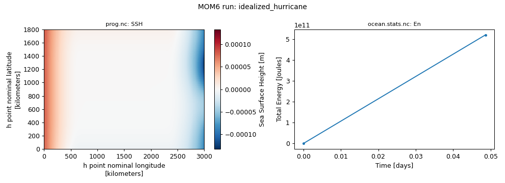
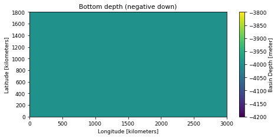
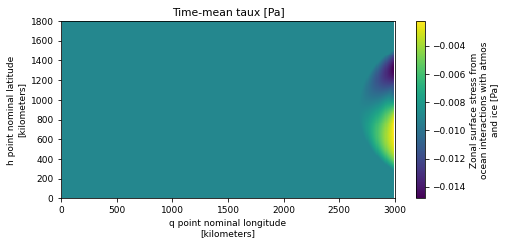
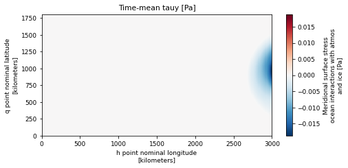
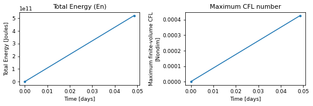
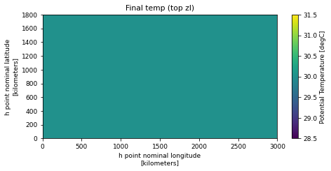

# idealized_hurricane

!!! success ":white_check_mark: This configuration ran successfully"
    Tested on 2026-11-04 with `access-om3/2026.05.004` (`mom6-solo`): 32 cores, walltime used 00:00:32, 0.57 SU. Details further down this page.


!!! abstract "Description (as on the Overview)"
    - **Grid:** 300 x 180 points, 80 layers/levels (`GRID_CONFIG = cartesian`)
    - **Vertical coordinate:** `Z*`
    - **Topography:** `TOPO_CONFIG = flat`
    - **Surface forcing:** `WIND_CONFIG = ideal_hurr`, `BUOY_CONFIG = const`
    - **Run length:** 0.05 days

    Read from this run's `MOM_parameter_doc.all`. Source: [upstream](https://github.com/NOAA-GFDL/MOM6-examples/tree/c1730b8efe16cf7f12fc8db588115cae50f3e802/ocean_only/idealized_hurricane).

Configuration files: [`ocean_only/idealized_hurricane`](https://github.com/NOAA-GFDL/MOM6-examples/tree/c1730b8efe16cf7f12fc8db588115cae50f3e802/ocean_only/idealized_hurricane) in NOAA-GFDL/MOM6-examples, at commit [`c1730b8e`](https://github.com/NOAA-GFDL/MOM6-examples/commit/c1730b8efe16cf7f12fc8db588115cae50f3e802): the version this run used. (The model itself is the `mom6-solo` listed under Provenance.)

GFDL excludes this example from its own automated test suite (`EXCLUDE` in [`ocean_only/Makefile`](https://github.com/NOAA-GFDL/MOM6-examples/blob/c1730b8efe16cf7f12fc8db588115cae50f3e802/ocean_only/Makefile)).

## Run it yourself

From a Gadi **login node** (membership of NCI project `vk83` needed):

```bash
PROJECT=<your-project> bash idealized_hurricane.sh
```

where `idealized_hurricane.sh` is the script below (click to expand; copy button top-right). It is exactly the script that produced the results on this page.

??? example "idealized_hurricane.sh"
    ```bash
    --8<-- "tested-configs/run_scripts/idealized_hurricane.sh"
    ```

## What we got



*Left: `SSH` at the last output time; right: total energy (`En`) from `ocean.stats.nc`.*

Last lines of `ocean.stats`:

```text
  Step,       Day,  Truncs,      Energy/Mass,      Maximum CFL,  Mean Sea Level,  Total Mass,  Mean Salin, Mean Temp, Frac Mass Err,   Salin Err,    Temp Err
            [days]                 [m2 s-2]           [Nondim]       [m]             [kg]         [PSU]      [degC]       [Nondim]        [PSU]        [degC]
     0,       0.000,     0, En 0.0000000000000000E+00, CFL  0.00000, SL  0.0000E+00, M 2.23560E+19, S 35.0000, T  6.2974, Me  0.00E+00, Se  0.00E+00, Te  0.00E+00
    14,       0.049,     0, En 2.3304007189865622E-08, CFL  0.00043, SL  0.0000E+00, M 2.23560E+19, S 35.0000, T  6.2974, Me -7.90E-19, Se  1.74E-15, Te -2.11E-15
```

## Domain, forcing and output

Made by running the notebook [`explore_run.ipynb`](https://github.com/ACCESS-Community-Hub/mom6-idealised-configs/blob/main/tested-configs/notebooks/explore_run.ipynb) on this run's output folder; it only plots files MOM6 wrote during the run. **[See the notebook with its code](../notebooks/idealized_hurricane.md)**.

### Set-up


Values from this run's `MOM_parameter_doc.all`:

| Parameter | Value |
|---|---|
| `NIGLOBAL` | `300` |
| `NJGLOBAL` | `180` |
| `NK` | `80` |
| `GRID_CONFIG` | `cartesian` |
| `TOPO_CONFIG` | `flat` |
| `REENTRANT_X` | `False` |
| `REENTRANT_Y` | `False` |
| `USE_REGRIDDING` | `True` |
| `REGRIDDING_COORDINATE_MODE` | `Z*` |
| `ENABLE_THERMODYNAMICS` | `True` |
| `EQN_OF_STATE` | `LINEAR` |
| `THICKNESS_CONFIG` | `coord` |
| `TS_CONFIG` | `SCM_CVMix_tests` |
| `WIND_CONFIG` | `ideal_hurr` |
| `BUOY_CONFIG` | `const` |
| `ICE_SHELF` | `False` |
| `DT` | `300.0` |
| `DT_THERM` | `300.0` |
| `DAYMAX` | `0.05` |


### Domain and bottom depth


Grid: 300 x 180 points (`GRID_CONFIG = cartesian`), x from 5 to 2995 kilometers, y from 5 to 1795 kilometers. Bottom depth `D` from 4000 to 4000 m (`TOPO_CONFIG = flat`).


    

    


### Initial state


MOM6 did not write an initial-state file for this run (it does when `SAVE_INITIAL_CONDS = True`), so the initial state is not shown here; see the run's `MOM_parameter_doc.all` (`THICKNESS_CONFIG = coord`, `TS_CONFIG = SCM_CVMix_tests`).


### Surface forcing


Time-mean of the surface forcing saved in the diagnostics: `taux` (Zonal surface stress from ocean interactions with atmos and ice, from `surffluxes.nc`), `tauy` (Meridional surface stress ocean interactions with atmos and ice, from `surffluxes.nc`).


    

    


    

    


### Energy and stability through the run


    

    


From `ocean.stats.nc`: 2 records; time axis in days.


### Final state


`temp` at the last record of `prog.nc` (average over the last output interval).


    


## Provenance

| What | Value |
|---|---|
| MOM6-examples | [`c1730b8efe16cf7f12fc8db588115cae50f3e802`](https://github.com/NOAA-GFDL/MOM6-examples/commit/c1730b8efe16cf7f12fc8db588115cae50f3e802) |
| ACCESS-OM3 module | `access-om3/2026.05.004` |
| MOM6 source code | `ACCESS-NRI/MOM6 2026.05.003 d11a149ccba676d524312328f7eb62560a156dc3` |
| Executable | `/g/data/vk83/apps/spack/1.1/release/linux-x86_64_v4/access-mom6-2026.05.003-ld7hklzo5ajizx5u4yl74i4ijberrpv6/bin/mom6-solo` |
| Executable md5 | `4785d157c76c30d8d01baf7d0f69d218` |
| payu | `1.3.6_1` (module `payu/1.3.6_1`) |
| Date tested | 2026-11-04 |
| PBS Job Id | `183115142.gadi-pbs` |
| PBS Exit Status | `0` |
| PBS Service Units | `0.57` |
| PBS NCPUs Requested | `32` |
| PBS Walltime Used | `00:00:32` |
| PBS Memory Used | `13.07GB` |

??? info "Input files and md5 hashes (from payu `manifests/input.yaml`)"
    | File | md5 | Comes from |
    |---|---|---|
    | `INPUT/vgrid.cdl` | `09773fe41d7e20a6377b0c4465c4ca0f` | MOM6-examples: `ocean_only/idealized_hurricane/INPUT/vgrid.cdl` |
    | `INPUT/vgrid.nc` | `8d9fc501755b30f6c6619055834ba8e6` | MOM6-examples: `ocean_only/idealized_hurricane/INPUT/vgrid.nc` |

??? info "Parameters differing from the upstream MOM_parameter_doc.all (88)"
    Comparison of this run's `MOM_parameter_doc.all` with the upstream MOM_parameter_doc.all.
    Differences show where the ACCESS-OM3 MOM6 version adds, drops or changes default parameters.

    | Parameter | reference | this run |
    |---|---|---|
    | `MLD_EN_VALS` | `3*0.0` | `25.0, 2500.0, 2.5E+05` |
    | `USE_POROUS_BARRIER` | `True` | `False` |

    New in this run: `ADVECTION_SCHEME_VARIANCE_UNDERFLOW`, `ANSWER_DATE`, `BACKSCATTER_UNDERBOUND`, `BACKSCAT_EBT_POWER`, `BMLD_EN_VALS`, `BS_USE_SQG_STRUCT`, `BT_ADJ_CORR_MASS_SRC`, `BT_LINEAR_FREQ_DRAG`, `CORRECTION_INTXPA`, `DIAG_REMAPPING_USE_OM4_SUBCELLS`, `DO_SKEB`, `DRAG_DIFFUSIVITY_ANSWER_DATE`, `DRHO_DP`, `DT_TRACER_ADVECT`, `ENABLE_BUGS_BY_DEFAULT`, `EY24_EBT_BS`, `FRICTWORK_BUG`, `GEOM_FILE`, `IDL_HURR_ASYM_INFLOW_0`, `IDL_HURR_ASYM_INFLOW_RNORM`, `IDL_HURR_ASYM_INFLOW_TR_SPEED`, `IDL_HURR_AXI_INFLOW_0`, `IDL_HURR_AXI_INFLOW_MAX_SPEED`, `IDL_HURR_AXI_INFLOW_RNORM`, `IDL_HURR_CD_CALM`, `IDL_HURR_CD_CALM_SPEED`, `IDL_HURR_CD_CONTINUOUS`, `IDL_HURR_CD_DCD_DU10`, `IDL_HURR_CD_INTERCEPT`, `IDL_HURR_CD_WINDY`, `IDL_HURR_CD_WINDY_SPEED`, `IDL_HURR_INFLOW_DANGLE_0`, `IDL_HURR_INFLOW_DANGLE_RNORM`, `IDL_HURR_INFLOW_DANGLE_TR_SPEED`, `IDL_HURR_RAD_AMBIENT`, `IDL_HURR_RAD_EDGE`, `INIT_BOUNDARY_EXTRAP`, `INTWAVE_REMAPPING_USE_OM4_SUBCELLS`, `ISO_DATE_STAMPED_STDOUT`, `KD_GL90_USE_SQG_STRUCT`, `KHTH_USE_SQG_STRUCT`, `KHTR_USE_SQG_STRUCT`, `LZ_RESCALE`, `MASK_COASTAL_PRESSURE_FORCE`, `MASS_WEIGHT_IN_PGF_VANISHED_ONLY`, `MASS_WEIGHT_IN_PRESSURE_GRADIENT_TOP`, `NONBLOCKING_P_SURF_BUG`, `P_REF_LINEAR_EOS`, `REMAPPING_USE_OM4_SUBCELLS`, `REMAP_VEL_CONSERVE_KE`, `RESET_INTXPA_INTEGRAL`, `RESET_INTXPA_INTEGRAL_FLATTEST`, `RESTART_SYMMETRIC_CHECKSUMS`, `RESTART_UNSIGNED_ZEROS`, `RHO_PGF_REF_BUG`, `RHO_REF_LINEAR_EOS`, `SET_DTBT_USE_BT_CONT`, `SSH_IN_EOS_PRESSURE_FOR_PGF`, `STOKES_MOST`, `S_REF_LINEAR_EOS`, `TFREEZE_S_IS_PRACS`, `TFREEZE_T_IS_POTT`, `TRADV_SPANS_COUPLING`, `T_REF_LINEAR_EOS`, `USE_CIRCULATION_IN_HORVISC`, `USE_FILE_DYES`, `USE_FILTER`, `USE_HA`, `USE_INDEX_DIAGNOSTIC_AXES`, `USE_MARBL_TRACERS`, `VERTEX_SHEAR_GEOMETRIC_MEAN`, `VERTEX_SHEAR_THICKNESS_MEAN`, `VERTEX_SHEAR_VISCOSITY_BUG`, `VISC_REM_BT_WEIGHT_BUG`, `VISC_REM_BUG`, `VISC_REM_TIMESTEP_BUG`

    Only upstream: `BETTER_BOUND_AH`, `BETTER_BOUND_KH`, `CFL_BASED_TRUNCATIONS`, `HOR_VISC_ANSWER_DATE`, `PORBAR_ANSWER_DATE`, `PORBAR_ETA_INTERP`, `PORBAR_MASKING_DEPTH`, `USE_DIABATIC_TIME_BUG`, `USE_GRID_SPACE_DIAGNOSTIC_AXES`, `USE_KH_IN_MEKE`

??? info "Run-time environment (selected variables from payu's `env.yaml`)"
    | Variable | Value |
    |---|---|
    | `LD_LIBRARY_PATH` | `/apps/openmpi/4.1.7/lib:/apps/openmpi/4.1.7/lib/profilers` |
    | `LOADEDMODULES` | `access3-share/2026.03.002-eale5gm:access-cice/CICE6.6.3-2-huasrvo:access-mocsy/2025.07.002-saj7rvh:access-generic-tracers/2026.09.000-e3zb3ez:access-mom6/2026.05.003-ld7hklz:access-ww3/2026.03.001-bjzidie:access3/2026.03.002-26wbxup:access-om3/2026.05.004:pbs:openmpi/4.1.7` |
    | `OMPI_MCA_orte_tmpdir_base` | `/jobfs/183115142.gadi-pbs` |
    | `PAYU_TELEMETRY_ENV_VERSION` | `1.3.6_1` |
    | `PBS_NCI_NCPUS_PER_NODE` | `104` |
    | `PBS_NCPUS` | `32` |
    | `PBS_QUEUE` | `normalsr-exec` |

??? info "payu config.yaml written by the script"
    ```yaml
    # payu configuration for MOM6-examples/ocean_only/idealized_hurricane (written by idealized_hurricane.sh)
    project: tm70
    queue: normalsr          # mom6-solo is compiled for Sapphire Rapids nodes
    ncpus: 32
    walltime: 00:30:00
    jobname: idealized_hurricane
    experiment: idealized_hurricane
    laboratory: /g/data/tm70/cyb561/repos/claude/mom6-idealised-configs/runs/lab

    model: mom6
    exe: mom6-solo           # found on PATH once the module below is loaded
    input: /g/data/tm70/cyb561/repos/claude/mom6-idealised-configs/runs/MOM6-examples/ocean_only/idealized_hurricane/INPUT
    modules:
      use:
        - /g/data/vk83/modules
      load:
        - access-om3/2026.05.004

    storage:                 # vk83: executable, ol01: input data
      gdata:
        - vk83
        - ol01

    collate: false           # mom6 writes un-split netCDF files when IO_LAYOUT = 1,1
    runlog: false            # don't commit run logs into the MOM6-examples clone
    metadata:
      enable: false
    ```

??? info "Output files"
    | File | Size |
    |---|---|
    | `Vertical_coordinate.nc` | 0.00 MB |
    | `ocean.stats.nc` | 0.01 MB |
    | `ocean_geometry.nc` | 8.27 MB |
    | `prog.nc` | 139.66 MB |
    | `surffluxes.nc` | 0.89 MB |
    | `visc.nc` | 52.24 MB |

