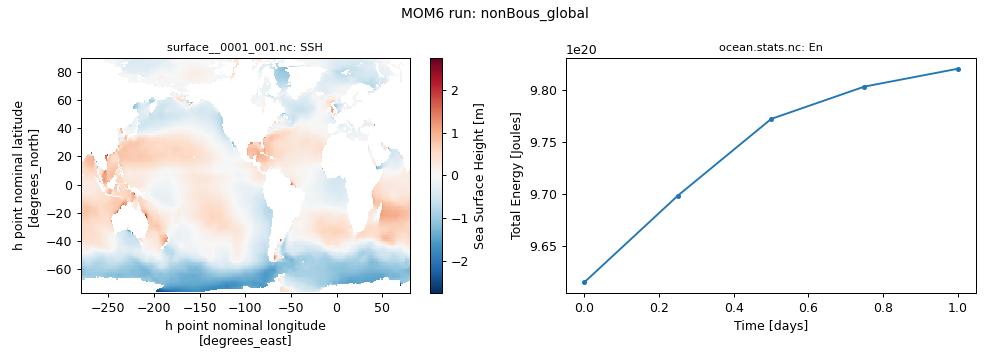
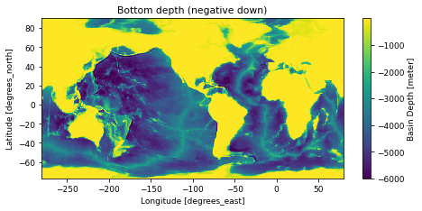
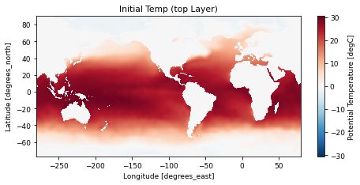
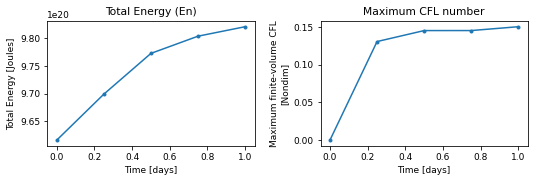
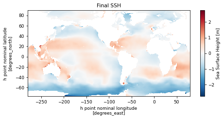

# nonBous_global

!!! success ":white_check_mark: This configuration ran successfully"
    Tested on 2026-11-04 with `access-om3/2026.05.004` (`mom6-solo`): 60 cores, walltime used 00:00:34, 1.13 SU. Details further down this page.


360 x 210 x 63 mosaic grid, layer mode (no regridding), topography `file`, wind `file`, buoyancy `file`, 1 days ([upstream](https://github.com/NOAA-GFDL/MOM6-examples/tree/c1730b8efe16cf7f12fc8db588115cae50f3e802/ocean_only/nonBous_global))

Configuration files: [`ocean_only/nonBous_global`](https://github.com/NOAA-GFDL/MOM6-examples/tree/c1730b8efe16cf7f12fc8db588115cae50f3e802/ocean_only/nonBous_global) in NOAA-GFDL/MOM6-examples, at commit [`c1730b8e`](https://github.com/NOAA-GFDL/MOM6-examples/commit/c1730b8efe16cf7f12fc8db588115cae50f3e802): the version this run used. (The model itself is the `mom6-solo` listed under Provenance.)

## Run it yourself

From a Gadi **login node** (membership of NCI project `vk83` needed, and `ol01` for the input data):

```bash
PROJECT=<your-project> bash nonBous_global.sh
```

where `nonBous_global.sh` is the script below (click to expand; copy button top-right). It is exactly the script that produced the results on this page.

??? example "nonBous_global.sh"
    ```bash
    --8<-- "tested-configs/run_scripts/nonBous_global.sh"
    ```

## What we got



*Left: `SSH` at the last output time; right: total energy (`En`) from `ocean.stats.nc`.*

Last lines of `ocean.stats`:

```text
     6,       0.250,     0, En 7.0132140040849811E-01, CFL  0.13064, SL -2.3756E-04, M 1.38293E+21, S 34.7201, T  3.5937, Me  2.59E-16, Se  6.71E-15, Te  5.27E-15
    12,       0.500,     0, En 7.0665161605224003E-01, CFL  0.14519, SL -1.9595E-04, M 1.38293E+21, S 34.7201, T  3.5937, Me  2.30E-16, Se  7.76E-15, Te  1.62E-15
    18,       0.750,     0, En 7.0890130142364249E-01, CFL  0.14522, SL -5.1899E-04, M 1.38293E+21, S 34.7201, T  3.5937, Me  3.19E-16, Se  1.08E-14, Te  2.18E-15
    24,       1.000,     0, En 7.1013908980524310E-01, CFL  0.15031, SL -2.8818E-04, M 1.38293E+21, S 34.7201, T  3.5937, Me  4.04E-16, Se  1.37E-14, Te  2.70E-15
```

## Domain, forcing and output

Made by running the notebook [`explore_run.ipynb`](https://github.com/ACCESS-Community-Hub/mom6-idealised-configs/blob/main/tested-configs/notebooks/explore_run.ipynb) on this run's output folder (code hidden here). It only plots files MOM6 wrote during the run.

### Set-up


Values from this run's `MOM_parameter_doc.all`:

| Parameter | Value |
|---|---|
| `NIGLOBAL` | `360` |
| `NJGLOBAL` | `210` |
| `NK` | `63` |
| `GRID_CONFIG` | `mosaic` |
| `TOPO_CONFIG` | `file` |
| `REENTRANT_X` | `True` |
| `REENTRANT_Y` | `False` |
| `USE_REGRIDDING` | `False` |
| `ENABLE_THERMODYNAMICS` | `True` |
| `EQN_OF_STATE` | `WRIGHT` |
| `THICKNESS_CONFIG` | `file` |
| `TS_CONFIG` | `file` |
| `WIND_CONFIG` | `file` |
| `BUOY_CONFIG` | `file` |
| `ICE_SHELF` | `False` |
| `DT` | `3600.0` |
| `DT_THERM` | `7200.0` |
| `DAYMAX` | `1.0` |


### Domain and bottom depth


Grid: 360 x 210 points (`GRID_CONFIG = mosaic`), x from -279.5 to 79.5 degrees_east, y from -76.75 to 89.75 degrees_north. Bottom depth `D` from 0.25 to 6000 m (`TOPO_CONFIG = file`).


    

    


### Initial state


`Temp` from `GOLD_IC.nc`, which MOM6 writes with the initial state.


    

    


### Surface forcing


No surface forcing is saved in this run's diagnostics. The forcing is set by `WIND_CONFIG = file` and `BUOY_CONFIG = file` (see the MOM6 documentation for these options).


### Energy and stability through the run


    

    


From `ocean.stats.nc`: 5 records; time axis in days.


### Final state


`SSH` at the last record of `surface__0001_001.nc` (snapshot).


    


## Provenance

| What | Value |
|---|---|
| MOM6-examples | [`c1730b8efe16cf7f12fc8db588115cae50f3e802`](https://github.com/NOAA-GFDL/MOM6-examples/commit/c1730b8efe16cf7f12fc8db588115cae50f3e802) |
| ACCESS-OM3 module | `access-om3/2026.05.004` |
| MOM6 source code | `ACCESS-NRI/MOM6 2026.05.003 d11a149ccba676d524312328f7eb62560a156dc3` |
| Executable | `/g/data/vk83/apps/spack/1.1/release/linux-x86_64_v4/access-mom6-2026.05.003-ld7hklzo5ajizx5u4yl74i4ijberrpv6/bin/mom6-solo` |
| Executable md5 | `4785d157c76c30d8d01baf7d0f69d218` |
| payu | `1.3.6_1` (module `payu/1.3.6_1`) |
| Date tested | 2026-11-04 |
| PBS Job Id | `183115243.gadi-pbs` |
| PBS Exit Status | `0` |
| PBS Service Units | `1.13` |
| PBS NCPUs Requested | `60` |
| PBS Walltime Used | `00:00:34` |
| PBS Memory Used | `21.73GB` |

??? info "Input files and md5 hashes (from payu `manifests/input.yaml`)"
    | File | md5 | Comes from |
    |---|---|---|
    | `INPUT/31Layer_zgrid.nc` | `2d1b8673dc763a835081ab6d0e13d6d2` | `ol01` data: `global/siena_201204/INPUT/31Layer_zgrid.nc` |
    | `INPUT/GOLD_IC.2010.11.15.nc` | `bf6ba441e98ff5c1b04b635b0ad84dac` | `ol01` data: `global/siena_201204/INPUT/GOLD_IC.2010.11.15.nc` |
    | `INPUT/OM3_zgrid.nc` | `0830d67f80834fe2796b219a84b3ba8d` | `ol01` data: `global/siena_201204/INPUT/OM3_zgrid.nc` |
    | `INPUT/README` | `da6049145ac9dd6aa8c4fd19da61a98f` | `ol01` data: `global/siena_201204/mosaic.unpacked/README` |
    | `INPUT/atmos_hgrid.nc` | `a4d8a2cc7554b265f53da1f91a48fee1` | `ol01` data: `global/siena_201204/mosaic.unpacked/atmos_hgrid.nc` |
    | `INPUT/atmos_mosaic.nc` | `ed209f7d19cc856ec1a257c0ca63af90` | `ol01` data: `global/siena_201204/mosaic.unpacked/atmos_mosaic.nc` |
    | `INPUT/atmos_mosaic_tile1Xland_mosaic_tile1.nc` | `6025fff17ee89d0ef6f4ac530c4a833b` | `ol01` data: `global/siena_201204/mosaic.unpacked/atmos_mosaic_tile1Xland_mosaic_tile1.nc` |
    | `INPUT/atmos_mosaic_tile1Xocean_mosaic_tile1.nc` | `c4ee9d91f1b2146d8e0c60827670fee6` | `ol01` data: `global/siena_201204/mosaic.unpacked/atmos_mosaic_tile1Xocean_mosaic_tile1.nc` |
    | `INPUT/geothermal_heating_cm2g.nc` | `2604459298a435e292be908e6059a89f` | `ol01` data: `global/siena_201204/INPUT/geothermal_heating_cm2g.nc` |
    | `INPUT/grid_spec.nc` | `a2d3b842655c6ee2e0213db46154dc22` | `ol01` data: `global/siena_201204/mosaic.unpacked/grid_spec.nc` |
    | `INPUT/gustiness_qscat.nc` | `2fbcc31e266329ddb4dd1cd8c8d221f7` | `ol01` data: `global/siena_201204/INPUT/gustiness_qscat.nc` |
    | `INPUT/land_hgrid.nc` | `a4d8a2cc7554b265f53da1f91a48fee1` | `ol01` data: `global/siena_201204/mosaic.unpacked/land_hgrid.nc` |
    | `INPUT/land_mask.nc` | `d5caa6ffe6379a31e692f10ec65af033` | `ol01` data: `global/siena_201204/mosaic.unpacked/land_mask.nc` |
    | `INPUT/land_mosaic.nc` | `5aeb9c82ad3a1c2ecc3d7988aa641ad2` | `ol01` data: `global/siena_201204/mosaic.unpacked/land_mosaic.nc` |
    | `INPUT/land_mosaic_tile1Xocean_mosaic_tile1.nc` | `56c455a11d61a23e19f056bf6c99cb7c` | `ol01` data: `global/siena_201204/mosaic.unpacked/land_mosaic_tile1Xocean_mosaic_tile1.nc` |
    | `INPUT/mosaic.nc` | `a2d3b842655c6ee2e0213db46154dc22` | `ol01` data: `global/siena_201204/mosaic.unpacked/mosaic.nc` |
    | `INPUT/ocean_forcing_daily.nc` | `7065687a13038c404173d8c19525794b` | `ol01` data: `global/siena_201204/INPUT/ocean_forcing_daily.nc` |
    | `INPUT/ocean_forcing_monthly.nc` | `b26fd7fb52928bbfea285f87479c15f0` | `ol01` data: `global/siena_201204/INPUT/ocean_forcing_monthly.nc` |
    | `INPUT/ocean_hgrid.nc` | `c4782f49333b46f9ea53322ac1eff53a` | `ol01` data: `global/siena_201204/mosaic.unpacked/ocean_hgrid.nc` |
    | `INPUT/ocean_mask.nc` | `b49dce31f5a9cd53a8ebbb47518e238c` | `ol01` data: `global/siena_201204/mosaic.unpacked/ocean_mask.nc` |
    | `INPUT/ocean_mosaic.nc` | `1263df68b94e7a256be52283df611e94` | `ol01` data: `global/siena_201204/mosaic.unpacked/ocean_mosaic.nc` |
    | `INPUT/ocean_precip_monthly.nc` | `12031a11fbcd3ca1a0534d7feb9193fc` | `ol01` data: `global/siena_201204/INPUT/ocean_precip_monthly.nc` |
    | `INPUT/ocean_vgrid.nc` | `34d06772f261d0ef502b4e3998109c28` | `ol01` data: `global/siena_201204/mosaic.unpacked/ocean_vgrid.nc` |
    | `INPUT/seawifs_1998-2006_GOLD_smoothed_2X.nc` | `7217a6bb87ebdf4570bbf8940e8b3c72` | `ol01` data: `global/siena_201204/INPUT/seawifs_1998-2006_GOLD_smoothed_2X.nc` |
    | `INPUT/sgs_h2.nc` | `5f3897a97a4366edba744f35cea97d7d` | `ol01` data: `global/siena_201204/INPUT/sgs_h2.nc` |
    | `INPUT/tideamp.nc` | `8136b3e8b8f587734fc5b0abcb338702` | `ol01` data: `global/siena_201204/INPUT/tideamp.nc` |
    | `INPUT/topog.nc` | `bd19baefec0f42e89e90870fbee5a7e3` | `ol01` data: `global/siena_201204/mosaic.unpacked/topog.nc` |

??? info "Parameters differing from the upstream MOM_parameter_doc.all (17)"
    Comparison of this run's `MOM_parameter_doc.all` with the upstream MOM_parameter_doc.all.
    Differences show where the ACCESS-OM3 MOM6 version adds, drops or changes default parameters.

    New in this run: `ADVECTION_SCHEME_VARIANCE_UNDERFLOW`, `NONBLOCKING_P_SURF_BUG`, `RHO_PGF_REF_BUG`, `USE_FILE_DYES`, `USE_UH_PARTICLES`

    Only upstream: `ACCURATE_NONBOUS_THICK_CELLO`, `CDRAG_MAP`, `CHANNEL_DRAG_SHELFBREAK_DEPTH`, `CONT_USE_H_MARG_MIN`, `DTBT_RESTART_BUG`, `ENSEMBLE_APPENDIX_PREFIX`, `GEOTHERMAL_MIN_COLUMN_THICKNESS`, `NUM_DIAG_DOWNSAMP_LEV`, `READ_MEAN_SEA_LEVEL`, `STOCHASTICS_ANSWER_DATE`, `SYMMETRIC_DOWNSAMPLE_SUMS`, `USE_THICKNESS_DIFFUSE_ANN`

??? info "Run-time environment (selected variables from payu's `env.yaml`)"
    | Variable | Value |
    |---|---|
    | `LD_LIBRARY_PATH` | `/apps/openmpi/4.1.7/lib:/apps/openmpi/4.1.7/lib/profilers` |
    | `LOADEDMODULES` | `access3-share/2026.03.002-eale5gm:access-cice/CICE6.6.3-2-huasrvo:access-mocsy/2025.07.002-saj7rvh:access-generic-tracers/2026.09.000-e3zb3ez:access-mom6/2026.05.003-ld7hklz:access-ww3/2026.03.001-bjzidie:access3/2026.03.002-26wbxup:access-om3/2026.05.004:pbs:openmpi/4.1.7` |
    | `OMPI_MCA_orte_tmpdir_base` | `/jobfs/183115243.gadi-pbs` |
    | `PAYU_TELEMETRY_ENV_VERSION` | `1.3.6_1` |
    | `PBS_NCI_NCPUS_PER_NODE` | `104` |
    | `PBS_NCPUS` | `60` |
    | `PBS_QUEUE` | `normalsr-exec` |

??? info "payu config.yaml written by the script"
    ```yaml
    # payu configuration for MOM6-examples/ocean_only/nonBous_global (written by nonBous_global.sh)
    project: tm70
    queue: normalsr          # mom6-solo is compiled for Sapphire Rapids nodes
    ncpus: 60
    walltime: 01:00:00
    jobname: nonBous_global
    experiment: nonBous_global
    laboratory: /g/data/tm70/cyb561/repos/claude/mom6-idealised-configs/runs/lab

    model: mom6
    exe: mom6-solo           # found on PATH once the module below is loaded
    input: /g/data/tm70/cyb561/repos/claude/mom6-idealised-configs/runs/MOM6-examples/ocean_only/nonBous_global/INPUT
    modules:
      use:
        - /g/data/vk83/modules
      load:
        - access-om3/2026.05.004

    storage:                 # vk83: executable, ol01: input data
      gdata:
        - vk83
        - ol01

    collate: false           # mom6 writes un-split netCDF files when IO_LAYOUT = 1,1
    runlog: false            # don't commit run logs into the MOM6-examples clone
    metadata:
      enable: false
    ```

??? info "Output files"
    | File | Size |
    |---|---|
    | `GOLD_IC.nc` | 578.16 MB |
    | `Vertical_coordinate.nc` | 0.00 MB |
    | `ave_prog__0001_002.nc` | 95.73 MB |
    | `cont__0001_002.nc` | 153.17 MB |
    | `ocean.stats.nc` | 0.01 MB |
    | `ocean_geometry.nc` | 11.56 MB |
    | `ocean_static.nc` | 4.58 MB |
    | `prog__0001_002.nc` | 152.89 MB |
    | `sfc_ave__0001_001.nc` | 3.66 MB |
    | `surface__0001_001.nc` | 3.66 MB |

