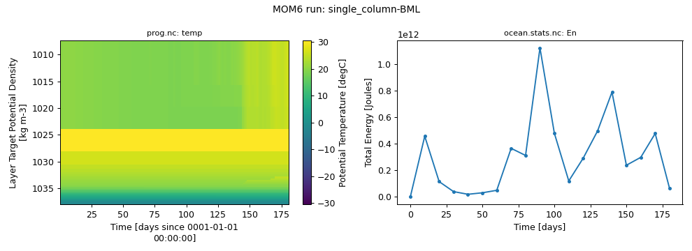

# single_column / BML

Single column at BATS with the bulk mixed layer (BML) scheme.

Upstream configuration: [`ocean_only/single_column/BML`](https://github.com/NOAA-GFDL/MOM6-examples/tree/c1730b8efe16cf7f12fc8db588115cae50f3e802/ocean_only/single_column/BML) (MOM6-examples commit [`c1730b8e`](https://github.com/NOAA-GFDL/MOM6-examples/commit/c1730b8efe16cf7f12fc8db588115cae50f3e802)).

!!! success "Tested: this example runs"
    Ran on Gadi on 2026-11-04 with `access-om3/2026.05.004` (`mom6-solo`) and `payu/1.3.6_1` on 1 Sapphire Rapids core(s); walltime used 00:00:21, 0.01 SU.

!!! note "Generated with Claude Code"
    This page, the script and the figure were generated automatically by [`tested-configs/regenerate_all.sh`](https://github.com/ACCESS-Community-Hub/mom6-idealised-configs/tree/main/tested-configs) (written with Claude Code). See [How these pages were made](../mom6examples.md#how-these-pages-were-made).

## Run it yourself

From a Gadi **login node** (membership of NCI project `vk83` needed, and `ol01` for the input data):

```bash
PROJECT=<your-project> bash single_column-BML.sh
```

where `single_column-BML.sh` is the script below (click to expand; copy button top-right). It is exactly the script that produced the results on this page.

??? example "single_column-BML.sh"
    ```bash
    --8<-- "tested-configs/run_scripts/single_column-BML.sh"
    ```

## What we got



*Left: `temp` time-depth evolution; right: total energy (`En`) from `ocean.stats.nc`.*

Last lines of `ocean.stats`:

```text
  3600,     150.000,     0, En 3.0943254077369666E-06, CFL  0.00538, SL -1.8852E-01, M 7.69488E+16, S 35.1325, T  4.8038, Me -4.44E-17, Se  0.00E+00, Te  1.69E-15
  3840,     160.000,     0, En 3.8703376425670538E-06, CFL  0.00467, SL -1.9602E-01, M 7.69487E+16, S 35.1325, T  4.8085, Me  8.34E-17, Se  6.65E-15, Te -6.75E-16
  4080,     170.000,     0, En 6.2026542499781675E-06, CFL  0.00770, SL -1.9808E-01, M 7.69487E+16, S 35.1325, T  4.8142, Me  3.32E-16, Se  2.00E-14, Te  5.55E-15
  4320,     180.000,     0, En 8.0638174204996400E-07, CFL  0.00315, SL -1.6672E-01, M 7.69491E+16, S 35.1323, T  4.8176, Me  5.21E-16, Se  0.00E+00, Te  2.37E-15
```

Key parameters of this run (from `MOM_parameter_doc.all`):

| Parameter | Value |
|---|---|
| `NIGLOBAL` | `2` |
| `NJGLOBAL` | `2` |
| `NK` | `63` |
| `GRID_CONFIG` | `"cartesian"` |
| `TOPO_CONFIG` | `"flat"` |
| `REENTRANT_X` | `True` |
| `REENTRANT_Y` | `True` |
| `USE_REGRIDDING` | `False` |
| `BOUSSINESQ` | `True` |
| `ENABLE_THERMODYNAMICS` | `True` |
| `EQN_OF_STATE` | `"WRIGHT"` |
| `WIND_CONFIG` | `"data_override"` |
| `BUOY_CONFIG` | `"data_override"` |
| `ICE_SHELF` | `False` |
| `DT` | `3600.0` |
| `DT_THERM` | `3600.0` |
| `DAYMAX` | `180.0` |
| `TIMEUNIT` | `8.64E+04` |

## Provenance

| What | Value |
|---|---|
| MOM6-examples | [`c1730b8efe16cf7f12fc8db588115cae50f3e802`](https://github.com/NOAA-GFDL/MOM6-examples/commit/c1730b8efe16cf7f12fc8db588115cae50f3e802) |
| ACCESS-OM3 module | `access-om3/2026.05.004` |
| MOM6 source code | `ACCESS-NRI/MOM6 2026.05.003 d11a149ccba676d524312328f7eb62560a156dc3` |
| Executable | `/g/data/vk83/apps/spack/1.1/release/linux-x86_64_v4/access-mom6-2026.05.003-ld7hklzo5ajizx5u4yl74i4ijberrpv6/bin/mom6-solo` |
| Executable md5 | `4785d157c76c30d8d01baf7d0f69d218` |
| payu | `1.3.6_1` (module `payu/1.3.6_1`) |
| Date tested | 2026-11-04 |
| PBS Job Id | `183115147.gadi-pbs` |
| PBS Exit Status | `0` |
| PBS Service Units | `0.01` |
| PBS NCPUs Requested | `1` |
| PBS Walltime Used | `00:00:21` |
| PBS Memory Used | `1.24GB` |

??? info "Input files and md5 hashes (from payu `manifests/input.yaml`)"
    | File | md5 | Path |
    |---|---|---|
    | `INPUT/Arabian/ICs.nc` | `5c30403a521bfc3981b5f32f56b4e447` | `/g/data/tm70/cyb561/repos/claude/mom6-idealised-configs/runs/MOM6-examples/ocean_only/single_column/INPUT/Arabian/ICs.nc` |
    | `INPUT/Arabian/MOM_override` | `4a6041dcdf6a36b1a809232a1b3f0f4c` | `/g/data/tm70/cyb561/repos/claude/mom6-idealised-configs/runs/MOM6-examples/ocean_only/single_column/INPUT/Arabian/MOM_override` |
    | `INPUT/Arabian/WOA_column.nc` | `41cd873ca158830f0a5a3f43e0b64367` | `/g/data/tm70/cyb561/repos/claude/mom6-idealised-configs/runs/MOM6-examples/ocean_only/single_column/INPUT/Arabian/WOA_column.nc` |
    | `INPUT/Arabian/forcing.nc` | `c22a2506e3e96ca7960cc5a82be32503` | `/g/data/tm70/cyb561/repos/claude/mom6-idealised-configs/runs/MOM6-examples/ocean_only/single_column/INPUT/Arabian/forcing.nc` |
    | `INPUT/Arabian/forcing_monthly.nc` | `d60dcaf3115cf27b8cefd59787785267` | `/g/data/tm70/cyb561/repos/claude/mom6-idealised-configs/runs/MOM6-examples/ocean_only/single_column/INPUT/Arabian/forcing_monthly.nc` |
    | `INPUT/Arabian/itides.nc` | `96cefc0a8a324987792b7146ae4df1d4` | `/g/data/tm70/cyb561/repos/claude/mom6-idealised-configs/runs/MOM6-examples/ocean_only/single_column/INPUT/Arabian/itides.nc` |
    | `INPUT/BATS/ICs.nc` | `07f56934c9ebe522de33fa82b0735801` | `/g/data/tm70/cyb561/repos/claude/mom6-idealised-configs/runs/MOM6-examples/ocean_only/single_column/INPUT/BATS/ICs.nc` |
    | `INPUT/BATS/MOM_override` | `9759fc5888150416a0e54614840a2054` | `/g/data/tm70/cyb561/repos/claude/mom6-idealised-configs/runs/MOM6-examples/ocean_only/single_column/INPUT/BATS/MOM_override` |
    | `INPUT/BATS/WOA_column.nc` | `2c6272a72144372d6201765dbd00bdad` | `/g/data/tm70/cyb561/repos/claude/mom6-idealised-configs/runs/MOM6-examples/ocean_only/single_column/INPUT/BATS/WOA_column.nc` |
    | `INPUT/BATS/forcing.nc` | `4b153f1b8cfdecacf951a7c3245b1fde` | `/g/data/tm70/cyb561/repos/claude/mom6-idealised-configs/runs/MOM6-examples/ocean_only/single_column/INPUT/BATS/forcing.nc` |
    | `INPUT/BATS/forcing_monthly.nc` | `aff544bf84620d941b523ae2055511e0` | `/g/data/tm70/cyb561/repos/claude/mom6-idealised-configs/runs/MOM6-examples/ocean_only/single_column/INPUT/BATS/forcing_monthly.nc` |
    | `INPUT/BATS/itides.nc` | `0e54160b2b25005b709332ec069a8eec` | `/g/data/tm70/cyb561/repos/claude/mom6-idealised-configs/runs/MOM6-examples/ocean_only/single_column/INPUT/BATS/itides.nc` |
    | `INPUT/COARE/ICs.nc` | `f64b8fb6dc9c1654179810b55ebbade8` | `/g/data/tm70/cyb561/repos/claude/mom6-idealised-configs/runs/MOM6-examples/ocean_only/single_column/INPUT/COARE/ICs.nc` |
    | `INPUT/COARE/MOM_override` | `9e02623544050aba8d1e84ff6a183165` | `/g/data/tm70/cyb561/repos/claude/mom6-idealised-configs/runs/MOM6-examples/ocean_only/single_column/INPUT/COARE/MOM_override` |
    | `INPUT/COARE/WOA_column.nc` | `9faa07cf6b0f8615738f33289e68d499` | `/g/data/tm70/cyb561/repos/claude/mom6-idealised-configs/runs/MOM6-examples/ocean_only/single_column/INPUT/COARE/WOA_column.nc` |
    | `INPUT/COARE/forcing.nc` | `4adc2c73646197e29941522da9e32e6f` | `/g/data/tm70/cyb561/repos/claude/mom6-idealised-configs/runs/MOM6-examples/ocean_only/single_column/INPUT/COARE/forcing.nc` |
    | `INPUT/COARE/forcing_monthly.nc` | `e3f4498d4cfe762439951065f580b44e` | `/g/data/tm70/cyb561/repos/claude/mom6-idealised-configs/runs/MOM6-examples/ocean_only/single_column/INPUT/COARE/forcing_monthly.nc` |
    | `INPUT/COARE/itides.nc` | `b161921c28d3b8b9b9a6962fea2bf413` | `/g/data/tm70/cyb561/repos/claude/mom6-idealised-configs/runs/MOM6-examples/ocean_only/single_column/INPUT/COARE/itides.nc` |
    | `INPUT/Chagos/ICs.nc` | `c54bbbfd8865ac4df724a69bb7049cdb` | `/g/data/tm70/cyb561/repos/claude/mom6-idealised-configs/runs/MOM6-examples/ocean_only/single_column/INPUT/Chagos/ICs.nc` |
    | `INPUT/Chagos/MOM_override` | `ba86fca3bce540ebaab0f030aa93b099` | `/g/data/tm70/cyb561/repos/claude/mom6-idealised-configs/runs/MOM6-examples/ocean_only/single_column/INPUT/Chagos/MOM_override` |
    | `INPUT/Chagos/WOA_column.nc` | `a061b0f37b6404791fb0a40cce5b17df` | `/g/data/tm70/cyb561/repos/claude/mom6-idealised-configs/runs/MOM6-examples/ocean_only/single_column/INPUT/Chagos/WOA_column.nc` |
    | `INPUT/Chagos/forcing.nc` | `6c4cd8cb5ff818c028f5f0dd7bc7fd96` | `/g/data/tm70/cyb561/repos/claude/mom6-idealised-configs/runs/MOM6-examples/ocean_only/single_column/INPUT/Chagos/forcing.nc` |
    | `INPUT/Chagos/forcing_monthly.nc` | `4f0228143ac74ef9bc2ee7189b4a0a8b` | `/g/data/tm70/cyb561/repos/claude/mom6-idealised-configs/runs/MOM6-examples/ocean_only/single_column/INPUT/Chagos/forcing_monthly.nc` |
    | `INPUT/Chagos/itides.nc` | `3d123af9f19130bd028a7f966763980a` | `/g/data/tm70/cyb561/repos/claude/mom6-idealised-configs/runs/MOM6-examples/ocean_only/single_column/INPUT/Chagos/itides.nc` |
    | `INPUT/Kerguelen/ICs.nc` | `e7afe0a7a5670c958cc39ef795732526` | `/g/data/tm70/cyb561/repos/claude/mom6-idealised-configs/runs/MOM6-examples/ocean_only/single_column/INPUT/Kerguelen/ICs.nc` |
    | `INPUT/Kerguelen/MOM_override` | `d1d73ba43f7c322390931e6eb4ca1eb4` | `/g/data/tm70/cyb561/repos/claude/mom6-idealised-configs/runs/MOM6-examples/ocean_only/single_column/INPUT/Kerguelen/MOM_override` |
    | `INPUT/Kerguelen/WOA_column.nc` | `0ed72d87f6bc605cfaaee7f19b3f3446` | `/g/data/tm70/cyb561/repos/claude/mom6-idealised-configs/runs/MOM6-examples/ocean_only/single_column/INPUT/Kerguelen/WOA_column.nc` |
    | `INPUT/Kerguelen/forcing.nc` | `782952668c31f80a00542a571237dfbf` | `/g/data/tm70/cyb561/repos/claude/mom6-idealised-configs/runs/MOM6-examples/ocean_only/single_column/INPUT/Kerguelen/forcing.nc` |
    | `INPUT/Kerguelen/forcing_monthly.nc` | `30d59875654847d8175884913bfccc0f` | `/g/data/tm70/cyb561/repos/claude/mom6-idealised-configs/runs/MOM6-examples/ocean_only/single_column/INPUT/Kerguelen/forcing_monthly.nc` |
    | `INPUT/Kerguelen/itides.nc` | `8a56dd0e7ce2faef183a0f71e9044975` | `/g/data/tm70/cyb561/repos/claude/mom6-idealised-configs/runs/MOM6-examples/ocean_only/single_column/INPUT/Kerguelen/itides.nc` |
    | `INPUT/Kuroshio/ICs.nc` | `e6758babb3b05b7e78017ff5ec348428` | `/g/data/tm70/cyb561/repos/claude/mom6-idealised-configs/runs/MOM6-examples/ocean_only/single_column/INPUT/Kuroshio/ICs.nc` |
    | `INPUT/Kuroshio/MOM_override` | `f1d2ebe4ac4a700fa277a6c991e48b74` | `/g/data/tm70/cyb561/repos/claude/mom6-idealised-configs/runs/MOM6-examples/ocean_only/single_column/INPUT/Kuroshio/MOM_override` |
    | `INPUT/Kuroshio/WOA_column.nc` | `cde33540dbaad4eb2facb72079028c5b` | `/g/data/tm70/cyb561/repos/claude/mom6-idealised-configs/runs/MOM6-examples/ocean_only/single_column/INPUT/Kuroshio/WOA_column.nc` |
    | `INPUT/Kuroshio/forcing.nc` | `6b93c7acca11476f463b7592a525acfa` | `/g/data/tm70/cyb561/repos/claude/mom6-idealised-configs/runs/MOM6-examples/ocean_only/single_column/INPUT/Kuroshio/forcing.nc` |
    | `INPUT/Kuroshio/forcing_monthly.nc` | `b48143c780d74c2c31c872be333cff5e` | `/g/data/tm70/cyb561/repos/claude/mom6-idealised-configs/runs/MOM6-examples/ocean_only/single_column/INPUT/Kuroshio/forcing_monthly.nc` |
    | `INPUT/Kuroshio/itides.nc` | `fedff06a5cea1b8ee0836ebe2770d6f2` | `/g/data/tm70/cyb561/repos/claude/mom6-idealised-configs/runs/MOM6-examples/ocean_only/single_column/INPUT/Kuroshio/itides.nc` |
    | `INPUT/Labrador/ICs.nc` | `f079a22dd2e613f75a27874ddbc5c980` | `/g/data/tm70/cyb561/repos/claude/mom6-idealised-configs/runs/MOM6-examples/ocean_only/single_column/INPUT/Labrador/ICs.nc` |
    | `INPUT/Labrador/MOM_override` | `9af099a5a7a6c1db4a2e2c065744911c` | `/g/data/tm70/cyb561/repos/claude/mom6-idealised-configs/runs/MOM6-examples/ocean_only/single_column/INPUT/Labrador/MOM_override` |
    | `INPUT/Labrador/WOA_column.nc` | `dcda3f7f03c5ed2060650f2a221403bb` | `/g/data/tm70/cyb561/repos/claude/mom6-idealised-configs/runs/MOM6-examples/ocean_only/single_column/INPUT/Labrador/WOA_column.nc` |
    | `INPUT/Labrador/forcing.nc` | `8bef0408995047bcf070afcdb288b2fd` | `/g/data/tm70/cyb561/repos/claude/mom6-idealised-configs/runs/MOM6-examples/ocean_only/single_column/INPUT/Labrador/forcing.nc` |
    | `INPUT/Labrador/forcing_monthly.nc` | `cae6b41d4104e2d8a8a4dbbb3faa66c9` | `/g/data/tm70/cyb561/repos/claude/mom6-idealised-configs/runs/MOM6-examples/ocean_only/single_column/INPUT/Labrador/forcing_monthly.nc` |
    | `INPUT/Labrador/itides.nc` | `9e982a1a910c041c3c2700299ce01231` | `/g/data/tm70/cyb561/repos/claude/mom6-idealised-configs/runs/MOM6-examples/ocean_only/single_column/INPUT/Labrador/itides.nc` |
    | `INPUT/Mariana/ICs.nc` | `219b47a73f9e72776a06cb538c8a94dc` | `/g/data/tm70/cyb561/repos/claude/mom6-idealised-configs/runs/MOM6-examples/ocean_only/single_column/INPUT/Mariana/ICs.nc` |
    | `INPUT/Mariana/MOM_override` | `6da42eb070f46c8e7fb28056afc42c98` | `/g/data/tm70/cyb561/repos/claude/mom6-idealised-configs/runs/MOM6-examples/ocean_only/single_column/INPUT/Mariana/MOM_override` |
    | `INPUT/Mariana/WOA_column.nc` | `f2e3c6784bf9e3dd64f584e02c19b97a` | `/g/data/tm70/cyb561/repos/claude/mom6-idealised-configs/runs/MOM6-examples/ocean_only/single_column/INPUT/Mariana/WOA_column.nc` |
    | `INPUT/Mariana/forcing.nc` | `9b30e3dbef67bee5e0e7db89a8ab33bc` | `/g/data/tm70/cyb561/repos/claude/mom6-idealised-configs/runs/MOM6-examples/ocean_only/single_column/INPUT/Mariana/forcing.nc` |
    | `INPUT/Mariana/forcing_monthly.nc` | `065c93001e3a30bbeb3482a3ee643eee` | `/g/data/tm70/cyb561/repos/claude/mom6-idealised-configs/runs/MOM6-examples/ocean_only/single_column/INPUT/Mariana/forcing_monthly.nc` |
    | `INPUT/Mariana/itides.nc` | `bfceff4ed8c43defe7506f659d16ecb6` | `/g/data/tm70/cyb561/repos/claude/mom6-idealised-configs/runs/MOM6-examples/ocean_only/single_column/INPUT/Mariana/itides.nc` |
    | `INPUT/Nazca/ICs.nc` | `5d90f2ab0edc1dd5e8d6e88aa5c1902c` | `/g/data/tm70/cyb561/repos/claude/mom6-idealised-configs/runs/MOM6-examples/ocean_only/single_column/INPUT/Nazca/ICs.nc` |
    | `INPUT/Nazca/MOM_override` | `721c554dc398535bcfe122bcb5e0b9e3` | `/g/data/tm70/cyb561/repos/claude/mom6-idealised-configs/runs/MOM6-examples/ocean_only/single_column/INPUT/Nazca/MOM_override` |
    | `INPUT/Nazca/WOA_column.nc` | `01f1a44ebd5ab4a123dc975a9d23c93e` | `/g/data/tm70/cyb561/repos/claude/mom6-idealised-configs/runs/MOM6-examples/ocean_only/single_column/INPUT/Nazca/WOA_column.nc` |
    | `INPUT/Nazca/forcing.nc` | `34b0b4c26303f30681bebfb26ded9128` | `/g/data/tm70/cyb561/repos/claude/mom6-idealised-configs/runs/MOM6-examples/ocean_only/single_column/INPUT/Nazca/forcing.nc` |
    | `INPUT/Nazca/forcing_monthly.nc` | `115641dcc05f43e3440bec9557cf9e9b` | `/g/data/tm70/cyb561/repos/claude/mom6-idealised-configs/runs/MOM6-examples/ocean_only/single_column/INPUT/Nazca/forcing_monthly.nc` |
    | `INPUT/Nazca/itides.nc` | `e29fe210114421f767e46a13b6cf3643` | `/g/data/tm70/cyb561/repos/claude/mom6-idealised-configs/runs/MOM6-examples/ocean_only/single_column/INPUT/Nazca/itides.nc` |
    | `INPUT/Nino/ICs.nc` | `9e0bb99cc1b6fdad5e0faf05d22d26b3` | `/g/data/tm70/cyb561/repos/claude/mom6-idealised-configs/runs/MOM6-examples/ocean_only/single_column/INPUT/Nino/ICs.nc` |
    | `INPUT/Nino/MOM_override` | `a28a9e657a988c2a91f616bc9ae2adf7` | `/g/data/tm70/cyb561/repos/claude/mom6-idealised-configs/runs/MOM6-examples/ocean_only/single_column/INPUT/Nino/MOM_override` |
    | `INPUT/Nino/WOA_column.nc` | `6c95778a662b6410a4941a838eb02e6d` | `/g/data/tm70/cyb561/repos/claude/mom6-idealised-configs/runs/MOM6-examples/ocean_only/single_column/INPUT/Nino/WOA_column.nc` |
    | `INPUT/Nino/forcing.nc` | `af69fc27a9f679497282cc6636c4ac67` | `/g/data/tm70/cyb561/repos/claude/mom6-idealised-configs/runs/MOM6-examples/ocean_only/single_column/INPUT/Nino/forcing.nc` |
    | `INPUT/Nino/forcing_monthly.nc` | `4359aab9ca1049d59fc85a65cfcaca06` | `/g/data/tm70/cyb561/repos/claude/mom6-idealised-configs/runs/MOM6-examples/ocean_only/single_column/INPUT/Nino/forcing_monthly.nc` |
    | `INPUT/Nino/itides.nc` | `af09e90ee79318ffd59b0e58790557fe` | `/g/data/tm70/cyb561/repos/claude/mom6-idealised-configs/runs/MOM6-examples/ocean_only/single_column/INPUT/Nino/itides.nc` |
    | `INPUT/Norwegian/ICs.nc` | `3fed59f2dee08a8d79a0545bf369c060` | `/g/data/tm70/cyb561/repos/claude/mom6-idealised-configs/runs/MOM6-examples/ocean_only/single_column/INPUT/Norwegian/ICs.nc` |
    | `INPUT/Norwegian/MOM_override` | `d454cb17f2bc8818139ab11c60ec72ed` | `/g/data/tm70/cyb561/repos/claude/mom6-idealised-configs/runs/MOM6-examples/ocean_only/single_column/INPUT/Norwegian/MOM_override` |
    | `INPUT/Norwegian/WOA_column.nc` | `2dcb415ff2f825286f134f438e697349` | `/g/data/tm70/cyb561/repos/claude/mom6-idealised-configs/runs/MOM6-examples/ocean_only/single_column/INPUT/Norwegian/WOA_column.nc` |
    | `INPUT/Norwegian/forcing.nc` | `f0fd8ed93cb361ce3bf4c937725ac93b` | `/g/data/tm70/cyb561/repos/claude/mom6-idealised-configs/runs/MOM6-examples/ocean_only/single_column/INPUT/Norwegian/forcing.nc` |
    | `INPUT/Norwegian/forcing_monthly.nc` | `1500793644cc96fe7cbe6b603c8b90cf` | `/g/data/tm70/cyb561/repos/claude/mom6-idealised-configs/runs/MOM6-examples/ocean_only/single_column/INPUT/Norwegian/forcing_monthly.nc` |
    | `INPUT/Norwegian/itides.nc` | `f62e52bbb78e12bf134aea70c8cb0004` | `/g/data/tm70/cyb561/repos/claude/mom6-idealised-configs/runs/MOM6-examples/ocean_only/single_column/INPUT/Norwegian/itides.nc` |
    | `INPUT/PAPA/ICs.nc` | `72f64896ca9b53645b94b0566559c506` | `/g/data/tm70/cyb561/repos/claude/mom6-idealised-configs/runs/MOM6-examples/ocean_only/single_column/INPUT/PAPA/ICs.nc` |
    | `INPUT/PAPA/MOM_override` | `8e1c42f2f98219489992585e431a54d8` | `/g/data/tm70/cyb561/repos/claude/mom6-idealised-configs/runs/MOM6-examples/ocean_only/single_column/INPUT/PAPA/MOM_override` |
    | `INPUT/PAPA/WOA_column.nc` | `0e2871948cf6a63a7407995752071499` | `/g/data/tm70/cyb561/repos/claude/mom6-idealised-configs/runs/MOM6-examples/ocean_only/single_column/INPUT/PAPA/WOA_column.nc` |
    | `INPUT/PAPA/forcing.nc` | `3e7e46fee6d7a45ae040aa7763240a0c` | `/g/data/tm70/cyb561/repos/claude/mom6-idealised-configs/runs/MOM6-examples/ocean_only/single_column/INPUT/PAPA/forcing.nc` |
    | `INPUT/PAPA/forcing_monthly.nc` | `08c6f8d294f149a53256928d84f17bfc` | `/g/data/tm70/cyb561/repos/claude/mom6-idealised-configs/runs/MOM6-examples/ocean_only/single_column/INPUT/PAPA/forcing_monthly.nc` |
    | `INPUT/PAPA/itides.nc` | `cf5a78970e9cb5761310b03fbfc54fec` | `/g/data/tm70/cyb561/repos/claude/mom6-idealised-configs/runs/MOM6-examples/ocean_only/single_column/INPUT/PAPA/itides.nc` |
    | `INPUT/St_Peter_Rock/ICs.nc` | `098c9d11316ce5475e9aee16d1ca153e` | `/g/data/tm70/cyb561/repos/claude/mom6-idealised-configs/runs/MOM6-examples/ocean_only/single_column/INPUT/St_Peter_Rock/ICs.nc` |
    | `INPUT/St_Peter_Rock/MOM_override` | `9bf12cfee709060d49f027766939963f` | `/g/data/tm70/cyb561/repos/claude/mom6-idealised-configs/runs/MOM6-examples/ocean_only/single_column/INPUT/St_Peter_Rock/MOM_override` |
    | `INPUT/St_Peter_Rock/WOA_column.nc` | `c9ed33533968ed91f44e94989372b18b` | `/g/data/tm70/cyb561/repos/claude/mom6-idealised-configs/runs/MOM6-examples/ocean_only/single_column/INPUT/St_Peter_Rock/WOA_column.nc` |
    | `INPUT/St_Peter_Rock/forcing.nc` | `c0742cedb3b90f37b709f43ee7a4b490` | `/g/data/tm70/cyb561/repos/claude/mom6-idealised-configs/runs/MOM6-examples/ocean_only/single_column/INPUT/St_Peter_Rock/forcing.nc` |
    | `INPUT/St_Peter_Rock/forcing_monthly.nc` | `c3bb4404f9a4ebef027697238f644970` | `/g/data/tm70/cyb561/repos/claude/mom6-idealised-configs/runs/MOM6-examples/ocean_only/single_column/INPUT/St_Peter_Rock/forcing_monthly.nc` |
    | `INPUT/St_Peter_Rock/itides.nc` | `a5145125b9a181835ec13f9593b08c61` | `/g/data/tm70/cyb561/repos/claude/mom6-idealised-configs/runs/MOM6-examples/ocean_only/single_column/INPUT/St_Peter_Rock/itides.nc` |
    | `INPUT/Walvis/ICs.nc` | `1bcb5b9b62ec4e5470172aedb8b1a9db` | `/g/data/tm70/cyb561/repos/claude/mom6-idealised-configs/runs/MOM6-examples/ocean_only/single_column/INPUT/Walvis/ICs.nc` |
    | `INPUT/Walvis/MOM_override` | `bbdbc6bcbb2c82d8675e9996fe1586ab` | `/g/data/tm70/cyb561/repos/claude/mom6-idealised-configs/runs/MOM6-examples/ocean_only/single_column/INPUT/Walvis/MOM_override` |
    | `INPUT/Walvis/WOA_column.nc` | `7223550a7c1928aa1d16374d872512c2` | `/g/data/tm70/cyb561/repos/claude/mom6-idealised-configs/runs/MOM6-examples/ocean_only/single_column/INPUT/Walvis/WOA_column.nc` |
    | `INPUT/Walvis/forcing.nc` | `d8d857e37be439bf305e898641cc2564` | `/g/data/tm70/cyb561/repos/claude/mom6-idealised-configs/runs/MOM6-examples/ocean_only/single_column/INPUT/Walvis/forcing.nc` |
    | `INPUT/Walvis/forcing_monthly.nc` | `20bb45262ad32c5f4e59ac262bce6e37` | `/g/data/tm70/cyb561/repos/claude/mom6-idealised-configs/runs/MOM6-examples/ocean_only/single_column/INPUT/Walvis/forcing_monthly.nc` |
    | `INPUT/Walvis/itides.nc` | `88eb9574cc0ea88bc17d61092ac9d1c2` | `/g/data/tm70/cyb561/repos/claude/mom6-idealised-configs/runs/MOM6-examples/ocean_only/single_column/INPUT/Walvis/itides.nc` |
    | `INPUT/Weddell/ICs.nc` | `cef642acf6111ed4f059a8dc2f11a481` | `/g/data/tm70/cyb561/repos/claude/mom6-idealised-configs/runs/MOM6-examples/ocean_only/single_column/INPUT/Weddell/ICs.nc` |
    | `INPUT/Weddell/MOM_override` | `1522588ace43b88bf85aa0ddb82e189d` | `/g/data/tm70/cyb561/repos/claude/mom6-idealised-configs/runs/MOM6-examples/ocean_only/single_column/INPUT/Weddell/MOM_override` |
    | `INPUT/Weddell/WOA_column.nc` | `88f27ffd536a5b787fbe4624d44e5519` | `/g/data/tm70/cyb561/repos/claude/mom6-idealised-configs/runs/MOM6-examples/ocean_only/single_column/INPUT/Weddell/WOA_column.nc` |
    | `INPUT/Weddell/forcing.nc` | `4fc06b0ec5b7fe524ef16fd69aaa4c6d` | `/g/data/tm70/cyb561/repos/claude/mom6-idealised-configs/runs/MOM6-examples/ocean_only/single_column/INPUT/Weddell/forcing.nc` |
    | `INPUT/Weddell/forcing_monthly.nc` | `e8ce21c793622d39617dc2d8e17c5978` | `/g/data/tm70/cyb561/repos/claude/mom6-idealised-configs/runs/MOM6-examples/ocean_only/single_column/INPUT/Weddell/forcing_monthly.nc` |
    | `INPUT/Weddell/itides.nc` | `0f0cc753e734002070033a108ea51e7b` | `/g/data/tm70/cyb561/repos/claude/mom6-idealised-configs/runs/MOM6-examples/ocean_only/single_column/INPUT/Weddell/itides.nc` |
    | `INPUT/create_data.m` | `6c5a113b1da0049e97927bd2b75957f2` | `/g/data/tm70/cyb561/repos/claude/mom6-idealised-configs/runs/MOM6-examples/ocean_only/single_column/INPUT/create_data.m` |
    | `INPUT/grid_spec.nc` | `7f005e9ec614baa3bb428d91dcc4e2d1` | `/g/data/tm70/cyb561/repos/claude/mom6-idealised-configs/runs/MOM6-examples/ocean_only/single_column/INPUT/grid_spec.nc` |
    | `INPUT/isopyc_coords.nc` | `1aa5b64c107e22ee69d6f3a84646db9c` | `/g/data/tm70/cyb561/repos/claude/mom6-idealised-configs/runs/MOM6-examples/ocean_only/single_column/INPUT/isopyc_coords.nc` |
    | `INPUT/vgrid_cm4.nc` | `7bc58519c59fe2ac0d32ef420ef3b28a` | `/g/data/tm70/cyb561/repos/claude/mom6-idealised-configs/runs/MOM6-examples/ocean_only/single_column/INPUT/vgrid_cm4.nc` |
    | `INPUT/vgrid_cm4_10.nc` | `6c8598994152d29e831ef3873666873d` | `/g/data/tm70/cyb561/repos/claude/mom6-idealised-configs/runs/MOM6-examples/ocean_only/single_column/INPUT/vgrid_cm4_10.nc` |
    | `INPUT/vgrid_cm4_4.nc` | `35caf8a476ec8820ea28b43ade9c90db` | `/g/data/tm70/cyb561/repos/claude/mom6-idealised-configs/runs/MOM6-examples/ocean_only/single_column/INPUT/vgrid_cm4_4.nc` |
    | `INPUT/zgrid.cdl` | `2a68a25c3a7804a06698e7039ff078c1` | `/g/data/tm70/cyb561/repos/claude/mom6-idealised-configs/runs/MOM6-examples/ocean_only/single_column/INPUT/zgrid.cdl` |
    | `INPUT/zgrid.nc` | `371557be6295512406966c36ecd03cc2` | `/g/data/tm70/cyb561/repos/claude/mom6-idealised-configs/runs/MOM6-examples/ocean_only/single_column/INPUT/zgrid.nc` |

??? info "Parameters differing from the upstream MOM_parameter_doc.all (14)"
    Comparison of this run's `MOM_parameter_doc.all` with the upstream MOM_parameter_doc.all.
    Differences show where the ACCESS-OM3 MOM6 version adds, drops or changes default parameters.

    | Parameter | reference | this run |
    |---|---|---|
    | `SET_VISC_ANSWER_DATE` | `20260703` | `99991231` |

    New in this run: `ADVECTION_SCHEME_VARIANCE_UNDERFLOW`, `NONBLOCKING_P_SURF_BUG`, `RHO_PGF_REF_BUG`, `USE_FILE_DYES`, `USE_UH_PARTICLES`

    Only upstream: `CDRAG_MAP`, `CONT_USE_H_MARG_MIN`, `ENSEMBLE_APPENDIX_PREFIX`, `NUM_DIAG_DOWNSAMP_LEV`, `READ_MEAN_SEA_LEVEL`, `STOCHASTICS_ANSWER_DATE`, `SYMMETRIC_DOWNSAMPLE_SUMS`, `USE_THICKNESS_DIFFUSE_ANN`

??? info "Run-time environment (selected variables from payu's `env.yaml`)"
    | Variable | Value |
    |---|---|
    | `LD_LIBRARY_PATH` | `/apps/openmpi/4.1.7/lib:/apps/openmpi/4.1.7/lib/profilers` |
    | `LOADEDMODULES` | `access3-share/2026.03.002-eale5gm:access-cice/CICE6.6.3-2-huasrvo:access-mocsy/2025.07.002-saj7rvh:access-generic-tracers/2026.09.000-e3zb3ez:access-mom6/2026.05.003-ld7hklz:access-ww3/2026.03.001-bjzidie:access3/2026.03.002-26wbxup:access-om3/2026.05.004:pbs:openmpi/4.1.7` |
    | `OMPI_MCA_orte_tmpdir_base` | `/jobfs/183115147.gadi-pbs` |
    | `PAYU_TELEMETRY_ENV_VERSION` | `1.3.6_1` |
    | `PBS_NCI_NCPUS_PER_NODE` | `104` |
    | `PBS_NCPUS` | `1` |
    | `PBS_QUEUE` | `normalsr-exec` |

??? info "payu config.yaml written by the script"
    ```yaml
    # payu configuration for MOM6-examples/ocean_only/single_column/BML (written by single_column-BML.sh)
    project: tm70
    queue: normalsr          # mom6-solo is compiled for Sapphire Rapids nodes
    ncpus: 1
    walltime: 00:30:00
    jobname: single_column-BML
    experiment: single_column-BML
    laboratory: /g/data/tm70/cyb561/repos/claude/mom6-idealised-configs/runs/lab

    model: mom6
    exe: mom6-solo           # found on PATH once the module below is loaded
    input: /g/data/tm70/cyb561/repos/claude/mom6-idealised-configs/runs/MOM6-examples/ocean_only/single_column/BML/INPUT
    modules:
      use:
        - /g/data/vk83/modules
      load:
        - access-om3/2026.05.004

    storage:                 # vk83: executable, ol01: input data
      gdata:
        - vk83
        - ol01

    collate: false           # mom6 writes un-split netCDF files when IO_LAYOUT = 1,1
    runlog: false            # don't commit run logs into the MOM6-examples clone
    metadata:
      enable: false
    ```

??? info "Output files"
    | File | Size |
    |---|---|
    | `MOM_IC.nc` | 0.04 MB |
    | `Vertical_coordinate.nc` | 0.00 MB |
    | `ave_prog.nc` | 1.12 MB |
    | `ocean.stats.nc` | 0.04 MB |
    | `ocean_geometry.nc` | 0.02 MB |
    | `prog.nc` | 1.66 MB |
    | `prog_z.nc` | 0.51 MB |
    | `surffluxes.nc` | 0.07 MB |
    | `visc.nc` | 0.39 MB |

