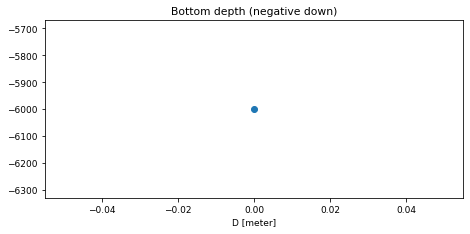
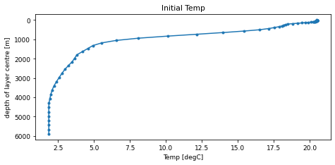
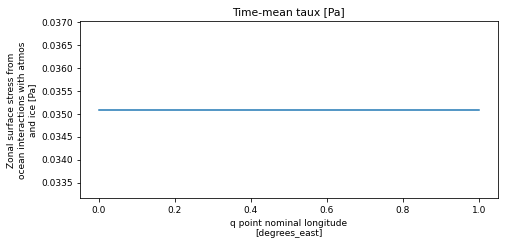
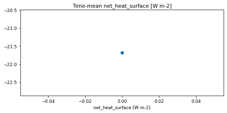
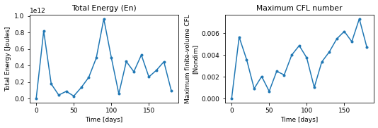
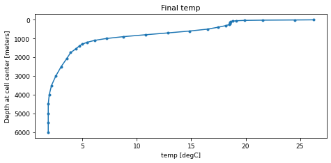

# single_column / EPBL

!!! success "Run status: :white_check_mark: ran successfully"
    Tested on 2026-11-04 with `access-om3/2026.05.004` (`mom6-solo`): 1 cores, walltime used 00:00:25, 0.01 SU. Details further down this page.


!!! abstract "Description (as on the Overview)"
    - **Grid:** 2 x 2 points, 75 layers/levels (`GRID_CONFIG = cartesian`)
    - **Vertical coordinate:** `Z*`
    - **Topography:** `TOPO_CONFIG = flat`
    - **Surface forcing:** `WIND_CONFIG = data_override`, `BUOY_CONFIG = data_override`
    - **Run length:** 180 days

    Read from this run's `MOM_parameter_doc.all`. Source: [upstream](https://github.com/NOAA-GFDL/MOM6-examples/tree/c1730b8efe16cf7f12fc8db588115cae50f3e802/ocean_only/single_column/EPBL).

Configuration files: [`ocean_only/single_column/EPBL`](https://github.com/NOAA-GFDL/MOM6-examples/tree/c1730b8efe16cf7f12fc8db588115cae50f3e802/ocean_only/single_column/EPBL) in NOAA-GFDL/MOM6-examples, at commit [`c1730b8e`](https://github.com/NOAA-GFDL/MOM6-examples/commit/c1730b8efe16cf7f12fc8db588115cae50f3e802): the version this run used. (The model itself is the `mom6-solo` listed under [Provenance](#provenance).)

## Run it yourself

From a Gadi **login node** (membership of NCI project `vk83` needed):

```bash
PROJECT=<your-project> bash single_column-EPBL.sh
```

where `single_column-EPBL.sh` is the script below (click to expand; copy button top-right). It is exactly the script that produced the results on this page.

??? example "single_column-EPBL.sh"
    ```bash
    --8<-- "tested-configs/run_scripts/single_column-EPBL.sh"
    ```

## What we got

Last lines of `ocean.stats`:

```text
  3600,     150.000,     0, En 3.4086296005962549E-06, CFL  0.00617, SL -1.8852E-01, M 7.69488E+16, S 35.1304, T  4.7789, Me -2.00E-17, Se -6.65E-15, Te -3.78E-15
  3840,     160.000,     0, En 4.4451403192764337E-06, CFL  0.00523, SL -1.9602E-01, M 7.69487E+16, S 35.1305, T  4.7836, Me  1.73E-17, Se  6.65E-15, Te  1.24E-15
  4080,     170.000,     0, En 5.7938919167910936E-06, CFL  0.00733, SL -1.9808E-01, M 7.69487E+16, S 35.1305, T  4.7893, Me  2.45E-17, Se  6.65E-15, Te  2.79E-16
  4320,     180.000,     0, En 1.1784173707117642E-06, CFL  0.00472, SL -1.6672E-01, M 7.69491E+16, S 35.1303, T  4.7927, Me -1.06E-17, Se -3.33E-14, Te -2.80E-15
```

## Domain, forcing and output

Made by running the notebook [`explore_run.ipynb`](https://github.com/ACCESS-Community-Hub/access-idealised-configs/blob/main/tested-configs/notebooks/explore_run.ipynb) on this run's output folder; it only plots files MOM6 wrote during the run. **[See the notebook with its code](../notebooks/single_column-EPBL.md)**.

### Set-up


Values from this run's `MOM_parameter_doc.all`:

| Parameter | Value |
|---|---|
| `NIGLOBAL` | `2` |
| `NJGLOBAL` | `2` |
| `NK` | `75` |
| `GRID_CONFIG` | `cartesian` |
| `TOPO_CONFIG` | `flat` |
| `REENTRANT_X` | `True` |
| `REENTRANT_Y` | `True` |
| `USE_REGRIDDING` | `True` |
| `REGRIDDING_COORDINATE_MODE` | `Z*` |
| `ENABLE_THERMODYNAMICS` | `True` |
| `EQN_OF_STATE` | `WRIGHT` |
| `WIND_CONFIG` | `data_override` |
| `BUOY_CONFIG` | `data_override` |
| `ICE_SHELF` | `False` |
| `DT` | `3600.0` |
| `DT_THERM` | `3600.0` |
| `DAYMAX` | `180.0` |


### Domain and bottom depth


Grid: 2 x 2 points (`GRID_CONFIG = cartesian`), x from 0.25 to 0.75 degrees_east, y from 30.25 to 30.75 degrees_north. Bottom depth `D` from 6000 to 6000 m (`TOPO_CONFIG = flat`).


    

    


### Initial state


`Temp` from `MOM_IC.nc`, which MOM6 writes with the initial state.


    

    


### Surface forcing


Time-mean of the surface forcing saved in the diagnostics: `taux` (Zonal surface stress from ocean interactions with atmos and ice, from `surffluxes.nc`), `net_heat_surface` (Surface ocean heat flux from SW+LW+lat+sens+mass transfer+frazil+restore+seaice_melt_heat or flux adjustments, from `surffluxes.nc`).


    

    


    

    


### Energy and stability through the run


    

    


From `ocean.stats.nc`: 19 records; time axis in days.


### Final state


`temp` at the last record of `prog_z.nc` (snapshot).


    


## Parameters compared with the reference

<span class="chip a">A</span> GFDL's file in MOM6-examples (`c1730b8e`): [`MOM_parameter_doc.all`](https://github.com/NOAA-GFDL/MOM6-examples/blob/c1730b8efe16cf7f12fc8db588115cae50f3e802/ocean_only/single_column/EPBL/MOM_parameter_doc.all)  
<span class="chip b">B</span> this run: `MOM_parameter_doc.all` in the run's output, `/scratch/<your-project>/$USER/mom6-examples/archive/single_column-EPBL/output000/MOM_parameter_doc.all` when you run the script

**1** parameter values differ; **5** parameters exist only in this run's MOM6 version and **14** only in the reference (new, removed or renamed parameters). Values are compared ignoring quotes, case and number formatting. Parameter names link to a search of the MOM6 source; reference values link to their line on GitHub.

<table class="diff"><thead><tr><th>Parameter</th><th>Units</th><th>A: reference</th><th>B: this run</th></tr></thead><tbody><tr class="mod"><td colspan="4">MOM_set_visc</td></tr><tr class="param"><td><a href="https://github.com/mom-ocean/MOM6/search?q=SET_VISC_ANSWER_DATE" target="_blank" rel="noopener">SET_VISC_ANSWER_DATE</a></td><td class="units"></td><td class="val a" data-label="A: reference"><a href="https://github.com/NOAA-GFDL/MOM6-examples/blob/c1730b8efe16cf7f12fc8db588115cae50f3e802/ocean_only/single_column/EPBL/MOM_parameter_doc.all#L818" target="_blank" rel="noopener">20260703</a></td><td class="val b" data-label="B: this run">99991231<span class="ln"> line 809</span></td></tr></tbody></table>

??? note "Parameters in only one of the two files (19)"
    <table class="diff"><thead><tr><th>Parameter</th><th>Units</th><th>A: reference</th><th>B: this run</th></tr></thead><tbody><tr class="mod"><td colspan="4">MOM</td></tr><tr class="param"><td><a href="https://github.com/mom-ocean/MOM6/search?q=NONBLOCKING_P_SURF_BUG" target="_blank" rel="noopener">NONBLOCKING_P_SURF_BUG</a></td><td class="units">Boolean</td><td class="val a unset" data-label="A: reference">(not in this version)</td><td class="val b" data-label="B: this run">True<span class="ln"> line 140</span></td></tr><tr class="param"><td><a href="https://github.com/mom-ocean/MOM6/search?q=USE_UH_PARTICLES" target="_blank" rel="noopener">USE_UH_PARTICLES</a></td><td class="units">Boolean</td><td class="val a unset" data-label="A: reference">(not in this version)</td><td class="val b" data-label="B: this run">False<span class="ln"> line 180</span></td></tr><tr class="mod"><td colspan="4">MOM_continuity_PPM</td></tr><tr class="param"><td><a href="https://github.com/mom-ocean/MOM6/search?q=CONT_USE_H_MARG_MIN" target="_blank" rel="noopener">CONT_USE_H_MARG_MIN</a></td><td class="units">Boolean</td><td class="val a" data-label="A: reference"><a href="https://github.com/NOAA-GFDL/MOM6-examples/blob/c1730b8efe16cf7f12fc8db588115cae50f3e802/ocean_only/single_column/EPBL/MOM_parameter_doc.all#L999" target="_blank" rel="noopener">False</a></td><td class="val b unset" data-label="B: this run">(not in this version)</td></tr><tr class="mod"><td colspan="4">MOM_coord_initialization</td></tr><tr class="param"><td><a href="https://github.com/mom-ocean/MOM6/search?q=REGRID_USE_DEPTH_BASED_TIME_FILTER" target="_blank" rel="noopener">REGRID_USE_DEPTH_BASED_TIME_FILTER</a></td><td class="units">Boolean</td><td class="val a" data-label="A: reference"><a href="https://github.com/NOAA-GFDL/MOM6-examples/blob/c1730b8efe16cf7f12fc8db588115cae50f3e802/ocean_only/single_column/EPBL/MOM_parameter_doc.all#L563" target="_blank" rel="noopener">True</a></td><td class="val b unset" data-label="B: this run">(not in this version)</td></tr><tr class="param"><td><a href="https://github.com/mom-ocean/MOM6/search?q=USE_ADJUST_INTERFACE_MOTION" target="_blank" rel="noopener">USE_ADJUST_INTERFACE_MOTION</a></td><td class="units">Boolean</td><td class="val a" data-label="A: reference"><a href="https://github.com/NOAA-GFDL/MOM6-examples/blob/c1730b8efe16cf7f12fc8db588115cae50f3e802/ocean_only/single_column/EPBL/MOM_parameter_doc.all#L501" target="_blank" rel="noopener">True</a></td><td class="val b unset" data-label="B: this run">(not in this version)</td></tr><tr class="mod"><td colspan="4">MOM_CVMix_KPP</td></tr><tr class="param"><td><a href="https://github.com/mom-ocean/MOM6/search?q=KPP_ER_Cb" target="_blank" rel="noopener">KPP_ER_Cb</a></td><td class="units">nondim</td><td class="val a" data-label="A: reference"><a href="https://github.com/NOAA-GFDL/MOM6-examples/blob/c1730b8efe16cf7f12fc8db588115cae50f3e802/ocean_only/single_column/EPBL/MOM_parameter_doc.all#L1373" target="_blank" rel="noopener">0.96</a></td><td class="val b unset" data-label="B: this run">(not in this version)</td></tr><tr class="param"><td><a href="https://github.com/mom-ocean/MOM6/search?q=KPP_ER_Cs" target="_blank" rel="noopener">KPP_ER_Cs</a></td><td class="units">nondim</td><td class="val a" data-label="A: reference"><a href="https://github.com/NOAA-GFDL/MOM6-examples/blob/c1730b8efe16cf7f12fc8db588115cae50f3e802/ocean_only/single_column/EPBL/MOM_parameter_doc.all#L1375" target="_blank" rel="noopener">0.038</a></td><td class="val b unset" data-label="B: this run">(not in this version)</td></tr><tr class="param"><td><a href="https://github.com/mom-ocean/MOM6/search?q=KPP_ER_Cu" target="_blank" rel="noopener">KPP_ER_Cu</a></td><td class="units">nondim</td><td class="val a" data-label="A: reference"><a href="https://github.com/NOAA-GFDL/MOM6-examples/blob/c1730b8efe16cf7f12fc8db588115cae50f3e802/ocean_only/single_column/EPBL/MOM_parameter_doc.all#L1377" target="_blank" rel="noopener">0.023</a></td><td class="val b unset" data-label="B: this run">(not in this version)</td></tr><tr class="param"><td><a href="https://github.com/mom-ocean/MOM6/search?q=KPP_OBL_DEPTH_BOUNDS_BUG" target="_blank" rel="noopener">KPP_OBL_DEPTH_BOUNDS_BUG</a></td><td class="units">Boolean</td><td class="val a" data-label="A: reference"><a href="https://github.com/NOAA-GFDL/MOM6-examples/blob/c1730b8efe16cf7f12fc8db588115cae50f3e802/ocean_only/single_column/EPBL/MOM_parameter_doc.all#L1379" target="_blank" rel="noopener">False</a></td><td class="val b unset" data-label="B: this run">(not in this version)</td></tr><tr class="mod"><td colspan="4">MOM_diag_mediator</td></tr><tr class="param"><td><a href="https://github.com/mom-ocean/MOM6/search?q=NUM_DIAG_DOWNSAMP_LEV" target="_blank" rel="noopener">NUM_DIAG_DOWNSAMP_LEV</a></td><td class="units"></td><td class="val a" data-label="A: reference"><a href="https://github.com/NOAA-GFDL/MOM6-examples/blob/c1730b8efe16cf7f12fc8db588115cae50f3e802/ocean_only/single_column/EPBL/MOM_parameter_doc.all#L702" target="_blank" rel="noopener">0</a></td><td class="val b unset" data-label="B: this run">(not in this version)</td></tr><tr class="param"><td><a href="https://github.com/mom-ocean/MOM6/search?q=SYMMETRIC_DOWNSAMPLE_SUMS" target="_blank" rel="noopener">SYMMETRIC_DOWNSAMPLE_SUMS</a></td><td class="units">Boolean</td><td class="val a" data-label="A: reference"><a href="https://github.com/NOAA-GFDL/MOM6-examples/blob/c1730b8efe16cf7f12fc8db588115cae50f3e802/ocean_only/single_column/EPBL/MOM_parameter_doc.all#L691" target="_blank" rel="noopener">False</a></td><td class="val b unset" data-label="B: this run">(not in this version)</td></tr><tr class="mod"><td colspan="4">MOM_grid_init</td></tr><tr class="param"><td><a href="https://github.com/mom-ocean/MOM6/search?q=READ_MEAN_SEA_LEVEL" target="_blank" rel="noopener">READ_MEAN_SEA_LEVEL</a></td><td class="units">Boolean</td><td class="val a" data-label="A: reference"><a href="https://github.com/NOAA-GFDL/MOM6-examples/blob/c1730b8efe16cf7f12fc8db588115cae50f3e802/ocean_only/single_column/EPBL/MOM_parameter_doc.all#L237" target="_blank" rel="noopener">False</a></td><td class="val b unset" data-label="B: this run">(not in this version)</td></tr><tr class="mod"><td colspan="4">MOM_PressureForce_FV</td></tr><tr class="param"><td><a href="https://github.com/mom-ocean/MOM6/search?q=RHO_PGF_REF_BUG" target="_blank" rel="noopener">RHO_PGF_REF_BUG</a></td><td class="units">Boolean</td><td class="val a unset" data-label="A: reference">(not in this version)</td><td class="val b" data-label="B: this run">True<span class="ln"> line 1028</span></td></tr><tr class="mod"><td colspan="4">MOM_restart</td></tr><tr class="param"><td><a href="https://github.com/mom-ocean/MOM6/search?q=ENSEMBLE_APPENDIX_PREFIX" target="_blank" rel="noopener">ENSEMBLE_APPENDIX_PREFIX</a></td><td class="units"></td><td class="val a" data-label="A: reference"><a href="https://github.com/NOAA-GFDL/MOM6-examples/blob/c1730b8efe16cf7f12fc8db588115cae50f3e802/ocean_only/single_column/EPBL/MOM_parameter_doc.all#L379" target="_blank" rel="noopener">&quot;&quot;</a></td><td class="val b unset" data-label="B: this run">(not in this version)</td></tr><tr class="mod"><td colspan="4">MOM_set_visc</td></tr><tr class="param"><td><a href="https://github.com/mom-ocean/MOM6/search?q=CDRAG_MAP" target="_blank" rel="noopener">CDRAG_MAP</a></td><td class="units">Boolean</td><td class="val a" data-label="A: reference"><a href="https://github.com/NOAA-GFDL/MOM6-examples/blob/c1730b8efe16cf7f12fc8db588115cae50f3e802/ocean_only/single_column/EPBL/MOM_parameter_doc.all#L852" target="_blank" rel="noopener">False</a></td><td class="val b unset" data-label="B: this run">(not in this version)</td></tr><tr class="mod"><td colspan="4">MOM_thickness_diffuse</td></tr><tr class="param"><td><a href="https://github.com/mom-ocean/MOM6/search?q=USE_THICKNESS_DIFFUSE_ANN" target="_blank" rel="noopener">USE_THICKNESS_DIFFUSE_ANN</a></td><td class="units">Boolean</td><td class="val a" data-label="A: reference"><a href="https://github.com/NOAA-GFDL/MOM6-examples/blob/c1730b8efe16cf7f12fc8db588115cae50f3e802/ocean_only/single_column/EPBL/MOM_parameter_doc.all#L891" target="_blank" rel="noopener">False</a></td><td class="val b unset" data-label="B: this run">(not in this version)</td></tr><tr class="mod"><td colspan="4">MOM_tracer_flow_control</td></tr><tr class="param"><td><a href="https://github.com/mom-ocean/MOM6/search?q=USE_FILE_DYES" target="_blank" rel="noopener">USE_FILE_DYES</a></td><td class="units">Boolean</td><td class="val a unset" data-label="A: reference">(not in this version)</td><td class="val b" data-label="B: this run">False<span class="ln"> line 412</span></td></tr><tr class="mod"><td colspan="4">MOM_verticalGrid</td></tr><tr class="param"><td><a href="https://github.com/mom-ocean/MOM6/search?q=ADVECTION_SCHEME_VARIANCE_UNDERFLOW" target="_blank" rel="noopener">ADVECTION_SCHEME_VARIANCE_UNDERFLOW</a></td><td class="units">Conc2 (tracer dependent)</td><td class="val a unset" data-label="A: reference">(not in this version)</td><td class="val b" data-label="B: this run">1.0E-23<span class="ln"> line 335</span></td></tr><tr class="mod"><td colspan="4">ocean_stochastics_init</td></tr><tr class="param"><td><a href="https://github.com/mom-ocean/MOM6/search?q=STOCHASTICS_ANSWER_DATE" target="_blank" rel="noopener">STOCHASTICS_ANSWER_DATE</a></td><td class="units"></td><td class="val a" data-label="A: reference"><a href="https://github.com/NOAA-GFDL/MOM6-examples/blob/c1730b8efe16cf7f12fc8db588115cae50f3e802/ocean_only/single_column/EPBL/MOM_parameter_doc.all#L1896" target="_blank" rel="noopener">20250101</a></td><td class="val b unset" data-label="B: this run">(not in this version)</td></tr></tbody></table>

## Provenance

| What | Value |
|---|---|
| MOM6-examples | [`c1730b8efe16cf7f12fc8db588115cae50f3e802`](https://github.com/NOAA-GFDL/MOM6-examples/commit/c1730b8efe16cf7f12fc8db588115cae50f3e802) |
| ACCESS-OM3 module | `access-om3/2026.05.004` |
| MOM6 source code | `ACCESS-NRI/MOM6 2026.05.003 d11a149ccba676d524312328f7eb62560a156dc3` |
| Executable | `/g/data/vk83/apps/spack/1.1/release/linux-x86_64_v4/access-mom6-2026.05.003-ld7hklzo5ajizx5u4yl74i4ijberrpv6/bin/mom6-solo` |
| Executable md5 | `4785d157c76c30d8d01baf7d0f69d218` |
| payu | `1.3.6_1` (module `payu/1.3.6_1`) |
| Date tested | 2026-11-04 |
| PBS Job Id | `183115153.gadi-pbs` |
| PBS Exit Status | `0` |
| PBS Service Units | `0.01` |
| PBS NCPUs Requested | `1` |
| PBS Walltime Used | `00:00:25` |
| PBS Memory Used | `1.13GB` |

??? info "Input files and md5 hashes (from payu `manifests/input.yaml`)"
    | File | md5 | Comes from |
    |---|---|---|
    | `INPUT/Arabian/ICs.nc` | `5c30403a521bfc3981b5f32f56b4e447` | MOM6-examples: `ocean_only/single_column/INPUT/Arabian/ICs.nc` |
    | `INPUT/Arabian/MOM_override` | `4a6041dcdf6a36b1a809232a1b3f0f4c` | MOM6-examples: `ocean_only/single_column/INPUT/Arabian/MOM_override` |
    | `INPUT/Arabian/WOA_column.nc` | `41cd873ca158830f0a5a3f43e0b64367` | MOM6-examples: `ocean_only/single_column/INPUT/Arabian/WOA_column.nc` |
    | `INPUT/Arabian/forcing.nc` | `c22a2506e3e96ca7960cc5a82be32503` | MOM6-examples: `ocean_only/single_column/INPUT/Arabian/forcing.nc` |
    | `INPUT/Arabian/forcing_monthly.nc` | `d60dcaf3115cf27b8cefd59787785267` | MOM6-examples: `ocean_only/single_column/INPUT/Arabian/forcing_monthly.nc` |
    | `INPUT/Arabian/itides.nc` | `96cefc0a8a324987792b7146ae4df1d4` | MOM6-examples: `ocean_only/single_column/INPUT/Arabian/itides.nc` |
    | `INPUT/BATS/ICs.nc` | `07f56934c9ebe522de33fa82b0735801` | MOM6-examples: `ocean_only/single_column/INPUT/BATS/ICs.nc` |
    | `INPUT/BATS/MOM_override` | `9759fc5888150416a0e54614840a2054` | MOM6-examples: `ocean_only/single_column/INPUT/BATS/MOM_override` |
    | `INPUT/BATS/WOA_column.nc` | `2c6272a72144372d6201765dbd00bdad` | MOM6-examples: `ocean_only/single_column/INPUT/BATS/WOA_column.nc` |
    | `INPUT/BATS/forcing.nc` | `4b153f1b8cfdecacf951a7c3245b1fde` | MOM6-examples: `ocean_only/single_column/INPUT/BATS/forcing.nc` |
    | `INPUT/BATS/forcing_monthly.nc` | `aff544bf84620d941b523ae2055511e0` | MOM6-examples: `ocean_only/single_column/INPUT/BATS/forcing_monthly.nc` |
    | `INPUT/BATS/itides.nc` | `0e54160b2b25005b709332ec069a8eec` | MOM6-examples: `ocean_only/single_column/INPUT/BATS/itides.nc` |
    | `INPUT/COARE/ICs.nc` | `f64b8fb6dc9c1654179810b55ebbade8` | MOM6-examples: `ocean_only/single_column/INPUT/COARE/ICs.nc` |
    | `INPUT/COARE/MOM_override` | `9e02623544050aba8d1e84ff6a183165` | MOM6-examples: `ocean_only/single_column/INPUT/COARE/MOM_override` |
    | `INPUT/COARE/WOA_column.nc` | `9faa07cf6b0f8615738f33289e68d499` | MOM6-examples: `ocean_only/single_column/INPUT/COARE/WOA_column.nc` |
    | `INPUT/COARE/forcing.nc` | `4adc2c73646197e29941522da9e32e6f` | MOM6-examples: `ocean_only/single_column/INPUT/COARE/forcing.nc` |
    | `INPUT/COARE/forcing_monthly.nc` | `e3f4498d4cfe762439951065f580b44e` | MOM6-examples: `ocean_only/single_column/INPUT/COARE/forcing_monthly.nc` |
    | `INPUT/COARE/itides.nc` | `b161921c28d3b8b9b9a6962fea2bf413` | MOM6-examples: `ocean_only/single_column/INPUT/COARE/itides.nc` |
    | `INPUT/Chagos/ICs.nc` | `c54bbbfd8865ac4df724a69bb7049cdb` | MOM6-examples: `ocean_only/single_column/INPUT/Chagos/ICs.nc` |
    | `INPUT/Chagos/MOM_override` | `ba86fca3bce540ebaab0f030aa93b099` | MOM6-examples: `ocean_only/single_column/INPUT/Chagos/MOM_override` |
    | `INPUT/Chagos/WOA_column.nc` | `a061b0f37b6404791fb0a40cce5b17df` | MOM6-examples: `ocean_only/single_column/INPUT/Chagos/WOA_column.nc` |
    | `INPUT/Chagos/forcing.nc` | `6c4cd8cb5ff818c028f5f0dd7bc7fd96` | MOM6-examples: `ocean_only/single_column/INPUT/Chagos/forcing.nc` |
    | `INPUT/Chagos/forcing_monthly.nc` | `4f0228143ac74ef9bc2ee7189b4a0a8b` | MOM6-examples: `ocean_only/single_column/INPUT/Chagos/forcing_monthly.nc` |
    | `INPUT/Chagos/itides.nc` | `3d123af9f19130bd028a7f966763980a` | MOM6-examples: `ocean_only/single_column/INPUT/Chagos/itides.nc` |
    | `INPUT/Kerguelen/ICs.nc` | `e7afe0a7a5670c958cc39ef795732526` | MOM6-examples: `ocean_only/single_column/INPUT/Kerguelen/ICs.nc` |
    | `INPUT/Kerguelen/MOM_override` | `d1d73ba43f7c322390931e6eb4ca1eb4` | MOM6-examples: `ocean_only/single_column/INPUT/Kerguelen/MOM_override` |
    | `INPUT/Kerguelen/WOA_column.nc` | `0ed72d87f6bc605cfaaee7f19b3f3446` | MOM6-examples: `ocean_only/single_column/INPUT/Kerguelen/WOA_column.nc` |
    | `INPUT/Kerguelen/forcing.nc` | `782952668c31f80a00542a571237dfbf` | MOM6-examples: `ocean_only/single_column/INPUT/Kerguelen/forcing.nc` |
    | `INPUT/Kerguelen/forcing_monthly.nc` | `30d59875654847d8175884913bfccc0f` | MOM6-examples: `ocean_only/single_column/INPUT/Kerguelen/forcing_monthly.nc` |
    | `INPUT/Kerguelen/itides.nc` | `8a56dd0e7ce2faef183a0f71e9044975` | MOM6-examples: `ocean_only/single_column/INPUT/Kerguelen/itides.nc` |
    | `INPUT/Kuroshio/ICs.nc` | `e6758babb3b05b7e78017ff5ec348428` | MOM6-examples: `ocean_only/single_column/INPUT/Kuroshio/ICs.nc` |
    | `INPUT/Kuroshio/MOM_override` | `f1d2ebe4ac4a700fa277a6c991e48b74` | MOM6-examples: `ocean_only/single_column/INPUT/Kuroshio/MOM_override` |
    | `INPUT/Kuroshio/WOA_column.nc` | `cde33540dbaad4eb2facb72079028c5b` | MOM6-examples: `ocean_only/single_column/INPUT/Kuroshio/WOA_column.nc` |
    | `INPUT/Kuroshio/forcing.nc` | `6b93c7acca11476f463b7592a525acfa` | MOM6-examples: `ocean_only/single_column/INPUT/Kuroshio/forcing.nc` |
    | `INPUT/Kuroshio/forcing_monthly.nc` | `b48143c780d74c2c31c872be333cff5e` | MOM6-examples: `ocean_only/single_column/INPUT/Kuroshio/forcing_monthly.nc` |
    | `INPUT/Kuroshio/itides.nc` | `fedff06a5cea1b8ee0836ebe2770d6f2` | MOM6-examples: `ocean_only/single_column/INPUT/Kuroshio/itides.nc` |
    | `INPUT/Labrador/ICs.nc` | `f079a22dd2e613f75a27874ddbc5c980` | MOM6-examples: `ocean_only/single_column/INPUT/Labrador/ICs.nc` |
    | `INPUT/Labrador/MOM_override` | `9af099a5a7a6c1db4a2e2c065744911c` | MOM6-examples: `ocean_only/single_column/INPUT/Labrador/MOM_override` |
    | `INPUT/Labrador/WOA_column.nc` | `dcda3f7f03c5ed2060650f2a221403bb` | MOM6-examples: `ocean_only/single_column/INPUT/Labrador/WOA_column.nc` |
    | `INPUT/Labrador/forcing.nc` | `8bef0408995047bcf070afcdb288b2fd` | MOM6-examples: `ocean_only/single_column/INPUT/Labrador/forcing.nc` |
    | `INPUT/Labrador/forcing_monthly.nc` | `cae6b41d4104e2d8a8a4dbbb3faa66c9` | MOM6-examples: `ocean_only/single_column/INPUT/Labrador/forcing_monthly.nc` |
    | `INPUT/Labrador/itides.nc` | `9e982a1a910c041c3c2700299ce01231` | MOM6-examples: `ocean_only/single_column/INPUT/Labrador/itides.nc` |
    | `INPUT/Mariana/ICs.nc` | `219b47a73f9e72776a06cb538c8a94dc` | MOM6-examples: `ocean_only/single_column/INPUT/Mariana/ICs.nc` |
    | `INPUT/Mariana/MOM_override` | `6da42eb070f46c8e7fb28056afc42c98` | MOM6-examples: `ocean_only/single_column/INPUT/Mariana/MOM_override` |
    | `INPUT/Mariana/WOA_column.nc` | `f2e3c6784bf9e3dd64f584e02c19b97a` | MOM6-examples: `ocean_only/single_column/INPUT/Mariana/WOA_column.nc` |
    | `INPUT/Mariana/forcing.nc` | `9b30e3dbef67bee5e0e7db89a8ab33bc` | MOM6-examples: `ocean_only/single_column/INPUT/Mariana/forcing.nc` |
    | `INPUT/Mariana/forcing_monthly.nc` | `065c93001e3a30bbeb3482a3ee643eee` | MOM6-examples: `ocean_only/single_column/INPUT/Mariana/forcing_monthly.nc` |
    | `INPUT/Mariana/itides.nc` | `bfceff4ed8c43defe7506f659d16ecb6` | MOM6-examples: `ocean_only/single_column/INPUT/Mariana/itides.nc` |
    | `INPUT/Nazca/ICs.nc` | `5d90f2ab0edc1dd5e8d6e88aa5c1902c` | MOM6-examples: `ocean_only/single_column/INPUT/Nazca/ICs.nc` |
    | `INPUT/Nazca/MOM_override` | `721c554dc398535bcfe122bcb5e0b9e3` | MOM6-examples: `ocean_only/single_column/INPUT/Nazca/MOM_override` |
    | `INPUT/Nazca/WOA_column.nc` | `01f1a44ebd5ab4a123dc975a9d23c93e` | MOM6-examples: `ocean_only/single_column/INPUT/Nazca/WOA_column.nc` |
    | `INPUT/Nazca/forcing.nc` | `34b0b4c26303f30681bebfb26ded9128` | MOM6-examples: `ocean_only/single_column/INPUT/Nazca/forcing.nc` |
    | `INPUT/Nazca/forcing_monthly.nc` | `115641dcc05f43e3440bec9557cf9e9b` | MOM6-examples: `ocean_only/single_column/INPUT/Nazca/forcing_monthly.nc` |
    | `INPUT/Nazca/itides.nc` | `e29fe210114421f767e46a13b6cf3643` | MOM6-examples: `ocean_only/single_column/INPUT/Nazca/itides.nc` |
    | `INPUT/Nino/ICs.nc` | `9e0bb99cc1b6fdad5e0faf05d22d26b3` | MOM6-examples: `ocean_only/single_column/INPUT/Nino/ICs.nc` |
    | `INPUT/Nino/MOM_override` | `a28a9e657a988c2a91f616bc9ae2adf7` | MOM6-examples: `ocean_only/single_column/INPUT/Nino/MOM_override` |
    | `INPUT/Nino/WOA_column.nc` | `6c95778a662b6410a4941a838eb02e6d` | MOM6-examples: `ocean_only/single_column/INPUT/Nino/WOA_column.nc` |
    | `INPUT/Nino/forcing.nc` | `af69fc27a9f679497282cc6636c4ac67` | MOM6-examples: `ocean_only/single_column/INPUT/Nino/forcing.nc` |
    | `INPUT/Nino/forcing_monthly.nc` | `4359aab9ca1049d59fc85a65cfcaca06` | MOM6-examples: `ocean_only/single_column/INPUT/Nino/forcing_monthly.nc` |
    | `INPUT/Nino/itides.nc` | `af09e90ee79318ffd59b0e58790557fe` | MOM6-examples: `ocean_only/single_column/INPUT/Nino/itides.nc` |
    | `INPUT/Norwegian/ICs.nc` | `3fed59f2dee08a8d79a0545bf369c060` | MOM6-examples: `ocean_only/single_column/INPUT/Norwegian/ICs.nc` |
    | `INPUT/Norwegian/MOM_override` | `d454cb17f2bc8818139ab11c60ec72ed` | MOM6-examples: `ocean_only/single_column/INPUT/Norwegian/MOM_override` |
    | `INPUT/Norwegian/WOA_column.nc` | `2dcb415ff2f825286f134f438e697349` | MOM6-examples: `ocean_only/single_column/INPUT/Norwegian/WOA_column.nc` |
    | `INPUT/Norwegian/forcing.nc` | `f0fd8ed93cb361ce3bf4c937725ac93b` | MOM6-examples: `ocean_only/single_column/INPUT/Norwegian/forcing.nc` |
    | `INPUT/Norwegian/forcing_monthly.nc` | `1500793644cc96fe7cbe6b603c8b90cf` | MOM6-examples: `ocean_only/single_column/INPUT/Norwegian/forcing_monthly.nc` |
    | `INPUT/Norwegian/itides.nc` | `f62e52bbb78e12bf134aea70c8cb0004` | MOM6-examples: `ocean_only/single_column/INPUT/Norwegian/itides.nc` |
    | `INPUT/PAPA/ICs.nc` | `72f64896ca9b53645b94b0566559c506` | MOM6-examples: `ocean_only/single_column/INPUT/PAPA/ICs.nc` |
    | `INPUT/PAPA/MOM_override` | `8e1c42f2f98219489992585e431a54d8` | MOM6-examples: `ocean_only/single_column/INPUT/PAPA/MOM_override` |
    | `INPUT/PAPA/WOA_column.nc` | `0e2871948cf6a63a7407995752071499` | MOM6-examples: `ocean_only/single_column/INPUT/PAPA/WOA_column.nc` |
    | `INPUT/PAPA/forcing.nc` | `3e7e46fee6d7a45ae040aa7763240a0c` | MOM6-examples: `ocean_only/single_column/INPUT/PAPA/forcing.nc` |
    | `INPUT/PAPA/forcing_monthly.nc` | `08c6f8d294f149a53256928d84f17bfc` | MOM6-examples: `ocean_only/single_column/INPUT/PAPA/forcing_monthly.nc` |
    | `INPUT/PAPA/itides.nc` | `cf5a78970e9cb5761310b03fbfc54fec` | MOM6-examples: `ocean_only/single_column/INPUT/PAPA/itides.nc` |
    | `INPUT/St_Peter_Rock/ICs.nc` | `098c9d11316ce5475e9aee16d1ca153e` | MOM6-examples: `ocean_only/single_column/INPUT/St_Peter_Rock/ICs.nc` |
    | `INPUT/St_Peter_Rock/MOM_override` | `9bf12cfee709060d49f027766939963f` | MOM6-examples: `ocean_only/single_column/INPUT/St_Peter_Rock/MOM_override` |
    | `INPUT/St_Peter_Rock/WOA_column.nc` | `c9ed33533968ed91f44e94989372b18b` | MOM6-examples: `ocean_only/single_column/INPUT/St_Peter_Rock/WOA_column.nc` |
    | `INPUT/St_Peter_Rock/forcing.nc` | `c0742cedb3b90f37b709f43ee7a4b490` | MOM6-examples: `ocean_only/single_column/INPUT/St_Peter_Rock/forcing.nc` |
    | `INPUT/St_Peter_Rock/forcing_monthly.nc` | `c3bb4404f9a4ebef027697238f644970` | MOM6-examples: `ocean_only/single_column/INPUT/St_Peter_Rock/forcing_monthly.nc` |
    | `INPUT/St_Peter_Rock/itides.nc` | `a5145125b9a181835ec13f9593b08c61` | MOM6-examples: `ocean_only/single_column/INPUT/St_Peter_Rock/itides.nc` |
    | `INPUT/Walvis/ICs.nc` | `1bcb5b9b62ec4e5470172aedb8b1a9db` | MOM6-examples: `ocean_only/single_column/INPUT/Walvis/ICs.nc` |
    | `INPUT/Walvis/MOM_override` | `bbdbc6bcbb2c82d8675e9996fe1586ab` | MOM6-examples: `ocean_only/single_column/INPUT/Walvis/MOM_override` |
    | `INPUT/Walvis/WOA_column.nc` | `7223550a7c1928aa1d16374d872512c2` | MOM6-examples: `ocean_only/single_column/INPUT/Walvis/WOA_column.nc` |
    | `INPUT/Walvis/forcing.nc` | `d8d857e37be439bf305e898641cc2564` | MOM6-examples: `ocean_only/single_column/INPUT/Walvis/forcing.nc` |
    | `INPUT/Walvis/forcing_monthly.nc` | `20bb45262ad32c5f4e59ac262bce6e37` | MOM6-examples: `ocean_only/single_column/INPUT/Walvis/forcing_monthly.nc` |
    | `INPUT/Walvis/itides.nc` | `88eb9574cc0ea88bc17d61092ac9d1c2` | MOM6-examples: `ocean_only/single_column/INPUT/Walvis/itides.nc` |
    | `INPUT/Weddell/ICs.nc` | `cef642acf6111ed4f059a8dc2f11a481` | MOM6-examples: `ocean_only/single_column/INPUT/Weddell/ICs.nc` |
    | `INPUT/Weddell/MOM_override` | `1522588ace43b88bf85aa0ddb82e189d` | MOM6-examples: `ocean_only/single_column/INPUT/Weddell/MOM_override` |
    | `INPUT/Weddell/WOA_column.nc` | `88f27ffd536a5b787fbe4624d44e5519` | MOM6-examples: `ocean_only/single_column/INPUT/Weddell/WOA_column.nc` |
    | `INPUT/Weddell/forcing.nc` | `4fc06b0ec5b7fe524ef16fd69aaa4c6d` | MOM6-examples: `ocean_only/single_column/INPUT/Weddell/forcing.nc` |
    | `INPUT/Weddell/forcing_monthly.nc` | `e8ce21c793622d39617dc2d8e17c5978` | MOM6-examples: `ocean_only/single_column/INPUT/Weddell/forcing_monthly.nc` |
    | `INPUT/Weddell/itides.nc` | `0f0cc753e734002070033a108ea51e7b` | MOM6-examples: `ocean_only/single_column/INPUT/Weddell/itides.nc` |
    | `INPUT/create_data.m` | `6c5a113b1da0049e97927bd2b75957f2` | MOM6-examples: `ocean_only/single_column/INPUT/create_data.m` |
    | `INPUT/grid_spec.nc` | `7f005e9ec614baa3bb428d91dcc4e2d1` | MOM6-examples: `ocean_only/single_column/INPUT/grid_spec.nc` |
    | `INPUT/isopyc_coords.nc` | `1aa5b64c107e22ee69d6f3a84646db9c` | MOM6-examples: `ocean_only/single_column/INPUT/isopyc_coords.nc` |
    | `INPUT/vgrid_cm4.nc` | `7bc58519c59fe2ac0d32ef420ef3b28a` | MOM6-examples: `ocean_only/single_column/INPUT/vgrid_cm4.nc` |
    | `INPUT/vgrid_cm4_10.nc` | `6c8598994152d29e831ef3873666873d` | MOM6-examples: `ocean_only/single_column/INPUT/vgrid_cm4_10.nc` |
    | `INPUT/vgrid_cm4_4.nc` | `35caf8a476ec8820ea28b43ade9c90db` | MOM6-examples: `ocean_only/single_column/INPUT/vgrid_cm4_4.nc` |
    | `INPUT/zgrid.cdl` | `2a68a25c3a7804a06698e7039ff078c1` | MOM6-examples: `ocean_only/single_column/INPUT/zgrid.cdl` |
    | `INPUT/zgrid.nc` | `371557be6295512406966c36ecd03cc2` | MOM6-examples: `ocean_only/single_column/INPUT/zgrid.nc` |

??? info "Run-time environment (selected variables from payu's `env.yaml`)"
    | Variable | Value |
    |---|---|
    | `LD_LIBRARY_PATH` | `/apps/openmpi/4.1.7/lib:/apps/openmpi/4.1.7/lib/profilers` |
    | `LOADEDMODULES` | `access3-share/2026.03.002-eale5gm:access-cice/CICE6.6.3-2-huasrvo:access-mocsy/2025.07.002-saj7rvh:access-generic-tracers/2026.09.000-e3zb3ez:access-mom6/2026.05.003-ld7hklz:access-ww3/2026.03.001-bjzidie:access3/2026.03.002-26wbxup:access-om3/2026.05.004:pbs:openmpi/4.1.7` |
    | `OMPI_MCA_orte_tmpdir_base` | `/jobfs/183115153.gadi-pbs` |
    | `PAYU_TELEMETRY_ENV_VERSION` | `1.3.6_1` |
    | `PBS_NCI_NCPUS_PER_NODE` | `104` |
    | `PBS_NCPUS` | `1` |
    | `PBS_QUEUE` | `normalsr-exec` |

??? info "payu config.yaml written by the script"
    ```yaml
    # payu configuration for MOM6-examples/ocean_only/single_column/EPBL (written by single_column-EPBL.sh)
    project: tm70
    queue: normalsr          # mom6-solo is compiled for Sapphire Rapids nodes
    ncpus: 1
    walltime: 00:30:00
    jobname: single_column-EPBL
    experiment: single_column-EPBL
    laboratory: /g/data/tm70/cyb561/repos/claude/mom6-idealised-configs/runs/lab

    model: mom6
    exe: mom6-solo           # found on PATH once the module below is loaded
    input: /g/data/tm70/cyb561/repos/claude/mom6-idealised-configs/runs/MOM6-examples/ocean_only/single_column/EPBL/INPUT
    modules:
      use:
        - /g/data/vk83/modules
      load:
        - access-om3/2026.05.004

    storage:                 # vk83: executable, ol01: input data
      gdata:
        - vk83
        - ol01

    collate: false           # mom6 writes un-split netCDF files when IO_LAYOUT = 1,1
    runlog: false            # don't commit run logs into the MOM6-examples clone
    metadata:
      enable: false
    ```

??? info "Output files"
    | File | Size | What it is |
    |---|---|---|
    | `MOM_IC.nc` | 0.04 MB | Initial state written by MOM6 at the start of the run |
    | `Vertical_coordinate.nc` | 0.00 MB | The vertical coordinate: target values of the layers or levels |
    | `ave_prog.nc` | 1.33 MB | Diagnostics set in `diag_table`: time averages of `u`, `v`, `e`, `temp`, `salt`, every 1 days |
    | `ocean.stats.nc` | 0.05 MB | Domain totals at each energy-save time (energy, mass, heat, salt, maximum CFL); the netCDF form of `ocean.stats` |
    | `ocean_geometry.nc` | 0.02 MB | Static grid: coordinates, cell sizes and areas, bottom depth `D`, Coriolis parameter, land mask |
    | `prog.nc` | 1.76 MB | Diagnostics set in `diag_table`: snapshots of `u`, `v`, `h`, `e`, `temp`, `salt`, `h_ML`, `wd`, every 1 days |
    | `prog_z.nc` | 0.51 MB | Diagnostics set in `diag_table`: snapshots of `u`, `v`, `temp`, `salt`, `N2`, every 1 days |
    | `surffluxes.nc` | 0.07 MB | Diagnostics set in `diag_table`: time averages of `taux`, `tauy`, `ustar`, `PRCmE`, `evap`, `precip`, `fprec`, `lprec` and 3 more, every 1 days |
    | `visc.nc` | 3.54 MB | Diagnostics set in `diag_table`: time averages of `Kd_effective`, `Kd_interface`, `KPP_uStar`, `KPP_buoyFlux`, `KPP_QminusSW`, `KPP_netSalt`, `KPP_OBLdepth`, `KPP_sigma` and 15 more, every 1 days |

