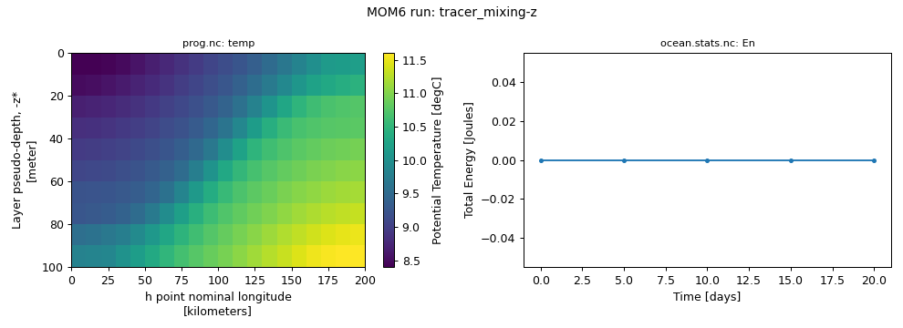
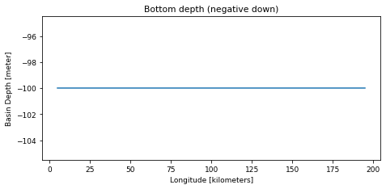
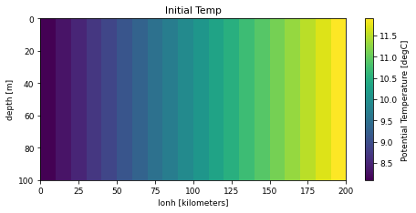
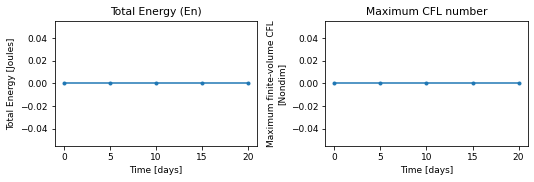
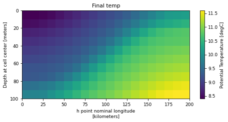

# tracer_mixing / z

!!! success ":white_check_mark: This configuration ran successfully"
    Tested on 2026-11-04 with `access-om3/2026.05.004` (`mom6-solo`): 2 cores, walltime used 00:00:10, 0.01 SU. Details further down this page.


20 x 4 x 10 cartesian grid, `Z*` coordinate, topography `flat`, wind `zero`, buoyancy `NONE`, 20 days ([upstream](https://github.com/NOAA-GFDL/MOM6-examples/tree/c1730b8efe16cf7f12fc8db588115cae50f3e802/ocean_only/tracer_mixing/z))

Configuration files: [`ocean_only/tracer_mixing/z`](https://github.com/NOAA-GFDL/MOM6-examples/tree/c1730b8efe16cf7f12fc8db588115cae50f3e802/ocean_only/tracer_mixing/z) in NOAA-GFDL/MOM6-examples, at commit [`c1730b8e`](https://github.com/NOAA-GFDL/MOM6-examples/commit/c1730b8efe16cf7f12fc8db588115cae50f3e802): the version this run used. (The model itself is the `mom6-solo` listed under Provenance.)

## Run it yourself

From a Gadi **login node** (membership of NCI project `vk83` needed):

```bash
PROJECT=<your-project> bash tracer_mixing-z.sh
```

where `tracer_mixing-z.sh` is the script below (click to expand; copy button top-right). It is exactly the script that produced the results on this page.

??? example "tracer_mixing-z.sh"
    ```bash
    --8<-- "tested-configs/run_scripts/tracer_mixing-z.sh"
    ```

## What we got



*Left: `temp` vertical section (model levels) at the last output time; right: total energy (`En`) from `ocean.stats.nc`.*

Last lines of `ocean.stats`:

```text
   120,       5.000,     0, En 0.0000000000000000E+00, CFL  0.00000, SL  0.0000E+00, M 8.00000E+14, S 35.0000, T 10.0000, Me  0.00E+00, Se  9.37E-16, Te  5.14E-14
   240,      10.000,     0, En 0.0000000000000000E+00, CFL  0.00000, SL  0.0000E+00, M 8.00000E+14, S 35.0000, T 10.0000, Me  0.00E+00, Se  0.00E+00, Te  4.66E-14
   360,      15.000,     0, En 0.0000000000000000E+00, CFL  0.00000, SL  0.0000E+00, M 8.00000E+14, S 35.0000, T 10.0000, Me  0.00E+00, Se  0.00E+00, Te  3.29E-14
   480,      20.000,     0, En 0.0000000000000000E+00, CFL  0.00000, SL  0.0000E+00, M 8.00000E+14, S 35.0000, T 10.0000, Me  0.00E+00, Se  0.00E+00, Te  3.25E-14
```

## Domain, forcing and output

Made by running the notebook [`explore_run.ipynb`](https://github.com/ACCESS-Community-Hub/mom6-idealised-configs/blob/main/tested-configs/notebooks/explore_run.ipynb) on this run's output folder (code hidden here). It only plots files MOM6 wrote during the run.

### Set-up


Values from this run's `MOM_parameter_doc.all`:

| Parameter | Value |
|---|---|
| `NIGLOBAL` | `20` |
| `NJGLOBAL` | `4` |
| `NK` | `10` |
| `GRID_CONFIG` | `cartesian` |
| `TOPO_CONFIG` | `flat` |
| `REENTRANT_X` | `False` |
| `REENTRANT_Y` | `True` |
| `USE_REGRIDDING` | `True` |
| `REGRIDDING_COORDINATE_MODE` | `Z*` |
| `ENABLE_THERMODYNAMICS` | `True` |
| `EQN_OF_STATE` | `LINEAR` |
| `THICKNESS_CONFIG` | `uniform` |
| `TS_CONFIG` | `baroclinic_zone` |
| `WIND_CONFIG` | `zero` |
| `BUOY_CONFIG` | `NONE` |
| `ICE_SHELF` | `False` |
| `DT` | `3600.0` |
| `DT_THERM` | `3600.0` |
| `DAYMAX` | `20.0` |


### Domain and bottom depth


Grid: 20 x 4 points (`GRID_CONFIG = cartesian`), x from 5 to 195 kilometers, y from 5 to 35 kilometers. Bottom depth `D` from 100 to 100 m (`TOPO_CONFIG = flat`).


    

    


### Initial state


`Temp` from `Initial_state.nc`, which MOM6 writes with the initial state.


    

    


### Surface forcing


No surface forcing is saved in this run's diagnostics. The forcing is set by `WIND_CONFIG = zero` and `BUOY_CONFIG = NONE` (see the MOM6 documentation for these options).


### Energy and stability through the run


    

    


From `ocean.stats.nc`: 5 records; time axis in days.


### Final state


`temp` at the last record of `prog_z.nc` (snapshot).


    


## Provenance

| What | Value |
|---|---|
| MOM6-examples | [`c1730b8efe16cf7f12fc8db588115cae50f3e802`](https://github.com/NOAA-GFDL/MOM6-examples/commit/c1730b8efe16cf7f12fc8db588115cae50f3e802) |
| ACCESS-OM3 module | `access-om3/2026.05.004` |
| MOM6 source code | `ACCESS-NRI/MOM6 2026.05.003 d11a149ccba676d524312328f7eb62560a156dc3` |
| Executable | `/g/data/vk83/apps/spack/1.1/release/linux-x86_64_v4/access-mom6-2026.05.003-ld7hklzo5ajizx5u4yl74i4ijberrpv6/bin/mom6-solo` |
| Executable md5 | `4785d157c76c30d8d01baf7d0f69d218` |
| payu | `1.3.6_1` (module `payu/1.3.6_1`) |
| Date tested | 2026-11-04 |
| PBS Job Id | `183115572.gadi-pbs` |
| PBS Exit Status | `0` |
| PBS Service Units | `0.01` |
| PBS NCPUs Requested | `2` |
| PBS Walltime Used | `00:00:10` |
| PBS Memory Used | `1.11GB` |

This example needs no input files: grid, bathymetry, initial state and forcing are all set analytically in `MOM_input`.

??? info "Parameters differing from the upstream MOM_parameter_doc.all (16)"
    Comparison of this run's `MOM_parameter_doc.all` with the upstream MOM_parameter_doc.all.
    Differences show where the ACCESS-OM3 MOM6 version adds, drops or changes default parameters.

    | Parameter | reference | this run |
    |---|---|---|
    | `SET_VISC_ANSWER_DATE` | `20260703` | `99991231` |

    New in this run: `ADVECTION_SCHEME_VARIANCE_UNDERFLOW`, `NONBLOCKING_P_SURF_BUG`, `RHO_PGF_REF_BUG`, `USE_FILE_DYES`, `USE_UH_PARTICLES`

    Only upstream: `CDRAG_MAP`, `CONT_USE_H_MARG_MIN`, `ENSEMBLE_APPENDIX_PREFIX`, `NUM_DIAG_DOWNSAMP_LEV`, `READ_MEAN_SEA_LEVEL`, `REGRID_USE_DEPTH_BASED_TIME_FILTER`, `STOCHASTICS_ANSWER_DATE`, `SYMMETRIC_DOWNSAMPLE_SUMS`, `USE_ADJUST_INTERFACE_MOTION`, `USE_THICKNESS_DIFFUSE_ANN`

??? info "Run-time environment (selected variables from payu's `env.yaml`)"
    | Variable | Value |
    |---|---|
    | `LD_LIBRARY_PATH` | `/apps/openmpi/4.1.7/lib:/apps/openmpi/4.1.7/lib/profilers` |
    | `LOADEDMODULES` | `access3-share/2026.03.002-eale5gm:access-cice/CICE6.6.3-2-huasrvo:access-mocsy/2025.07.002-saj7rvh:access-generic-tracers/2026.09.000-e3zb3ez:access-mom6/2026.05.003-ld7hklz:access-ww3/2026.03.001-bjzidie:access3/2026.03.002-26wbxup:access-om3/2026.05.004:pbs:openmpi/4.1.7` |
    | `OMPI_MCA_orte_tmpdir_base` | `/jobfs/183115572.gadi-pbs` |
    | `PAYU_TELEMETRY_ENV_VERSION` | `1.3.6_1` |
    | `PBS_NCI_NCPUS_PER_NODE` | `104` |
    | `PBS_NCPUS` | `2` |
    | `PBS_QUEUE` | `normalsr-exec` |

??? info "payu config.yaml written by the script"
    ```yaml
    # payu configuration for MOM6-examples/ocean_only/tracer_mixing/z (written by tracer_mixing-z.sh)
    project: tm70
    queue: normalsr          # mom6-solo is compiled for Sapphire Rapids nodes
    ncpus: 2
    walltime: 00:30:00
    jobname: tracer_mixing-z
    experiment: tracer_mixing-z
    laboratory: /g/data/tm70/cyb561/repos/claude/mom6-idealised-configs/runs/lab

    model: mom6
    exe: mom6-solo           # found on PATH once the module below is loaded


    modules:
      use:
        - /g/data/vk83/modules
      load:
        - access-om3/2026.05.004

    storage:                 # vk83: executable, ol01: input data
      gdata:
        - vk83
        - ol01

    collate: false           # mom6 writes un-split netCDF files when IO_LAYOUT = 1,1
    runlog: false            # don't commit run logs into the MOM6-examples clone
    metadata:
      enable: false
    ```

??? info "Output files"
    | File | Size |
    |---|---|
    | `Initial_state.nc` | 0.11 MB |
    | `Vertical_coordinate.nc` | 0.00 MB |
    | `ocean.stats.nc` | 0.00 MB |
    | `ocean_geometry.nc` | 0.03 MB |
    | `prog.nc` | 0.69 MB |
    | `prog_z.nc` | 0.42 MB |

