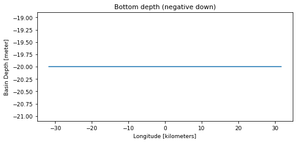
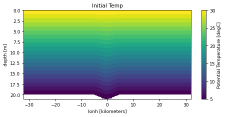
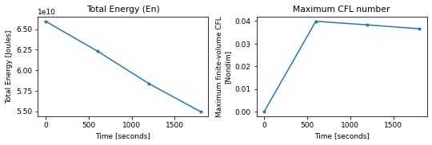
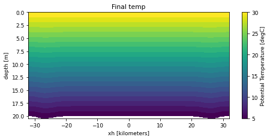

# external_gwave: notebook

The notebook [`explore_run.ipynb`](https://github.com/ACCESS-Community-Hub/access-idealised-configs/blob/main/tested-configs/notebooks/explore_run.ipynb) as it ran on the output folder of the tested run, with its code and output. It made every figure on the [external_gwave](../mom6examples/external_gwave.md) page.

## Explore one MOM6 run: domain, initial state, forcing and output

Generic notebook run by `tested-configs/lib/run_notebooks.sh` (papermill) on the output folder
of each tested configuration; the website shows its rendered output on each configuration's page.
It only reads files that MOM6 itself wrote into the run's output folder:

| File | Used for |
|---|---|
| `MOM_parameter_doc.all` | set-up parameters |
| `ocean_geometry.nc` | grid and bottom depth `D` |
| `MOM_IC.nc` / `GOLD_IC.nc` / `Initial_state.nc` (if written), else the first diagnostic record | initial state |
| diagnostic files (`*.nc` with a `Time` or `time` axis, not the initial-state files) | surface forcing (if saved) and final state |
| `ocean.stats.nc` (or the file named by `ENERGYFILE`) | energy and CFL time series |

Written with Claude Code for github.com/ACCESS-Community-Hub/access-idealised-configs.
To use it on your own run: set `run_dir` below to a payu `archive/outputNNN` folder.


```python
## Parameters (papermill replaces these)
name = "double_gyre"
run_dir = "/scratch/PROJECT/USER/mom6-examples/archive/double_gyre/output000"
```


```python
## Parameters
name = "external_gwave"
run_dir = "/g/data/tm70/cyb561/repos/claude/mom6-idealised-configs/runs/lab/archive/external_gwave/output000"

```


```python
%matplotlib inline
import glob
import os
import re
import warnings

import matplotlib.pyplot as plt
import numpy as np
import xarray as xr
from IPython.display import Markdown, display

plt.rcParams.update({"figure.dpi": 72, "figure.figsize": (7.5, 3.2), "font.size": 9})
## Some packages in conda/analysis3 warn about missing internet when xarray loads its plugins.
warnings.filterwarnings("ignore")


def say(text):
    """Show text as Markdown in the rendered notebook."""
    display(Markdown(text))


def read_params(path):
    """NAME = value pairs from MOM_parameter_doc.all (comments after '!' dropped)."""
    params = {}
    for line in open(path):
        m = re.match(r"^\s*([A-Za-z0-9_]+)\s*=\s*([^!]*)", line)
        if m:
            params[m.group(1)] = m.group(2).strip().strip('"')
    return params


def open_nc(path):
    ds = xr.open_dataset(path, decode_times=False)
    # mask MOM6/FMS fill values that survive decoding (e.g. 1e20, -1e34)
    return ds.map(lambda v: v.where(np.abs(v) < 1e19) if v.dtype.kind == "f" else v)


P = read_params(os.path.join(run_dir, "MOM_parameter_doc.all"))
geom = open_nc(os.path.join(run_dir, "ocean_geometry.nc"))
IC_FILES = ("MOM_IC.nc", "GOLD_IC.nc", "Initial_state.nc")


def tdim(ds):
    """Name of the time dimension ("Time" or "time", as set in diag_table), or None."""
    return next((d for d in ("Time", "time") if d in ds.dims), None)


diag_files = sorted(f for f in glob.glob(os.path.join(run_dir, "*.nc"))
                    if os.path.basename(f) not in ("ocean_geometry.nc", "Vertical_coordinate.nc") + IC_FILES
                    and not os.path.basename(f).endswith("stats.nc")
                    and tdim(xr.open_dataset(f, decode_times=False)))
```


```python
HORIZ = {"lath", "lonh", "latq", "lonq", "xh", "yh", "xq", "yq"}


def last_time(da):
    da = da.squeeze(drop=True)
    for d in list(da.dims):
        if d not in HORIZ and da.sizes[d] > 1 and d.lower().startswith("time"):
            da = da.isel({d: -1})
    return da


def plot_field(da, title, ax=None, h=None):
    """Plot a 2-D or 3-D field as a map, a section (thin domains) or a profile (single column).
    h: layer thicknesses (m) on the same grid; if given, sections and profiles are drawn against
    depth (from the cumulative thickness) instead of the vertical index or target coordinate, so
    layer/rho/sigma runs show where the water actually is."""
    da = last_time(da)
    if h is not None:
        h = last_time(h)
        if h.dims != da.dims or h.attrs.get("units") != "m":
            h = None
    ydim = next((d for d in da.dims if d in ("lath", "latq", "yh", "yq")), None)
    xdim = next((d for d in da.dims if d in ("lonh", "lonq", "xh", "xq")), None)
    zdim = next((d for d in da.dims if d not in HORIZ), None)
    nx = da.sizes.get(xdim, 1)
    ny = da.sizes.get(ydim, 1)
    if ax is None:
        _, ax = plt.subplots()
    # vertical axis label: the coordinate's own name and units if it has one, else the index
    if zdim and zdim in da.coords:
        zlabel = f"{da[zdim].attrs.get('long_name', zdim)} [{da[zdim].attrs.get('units', '')}]"
        zvals = da[zdim].values
    elif zdim:
        zlabel, zvals = f"{zdim} index (0 = top)", np.arange(da.sizes[zdim])
    if nx <= 2 and ny <= 2:                      # single column: profile
        prof = da.mean([d for d in (xdim, ydim) if d])
        if zdim and h is not None:
            hp = h.mean([d for d in (xdim, ydim) if d]).values
            ax.plot(prof.values, np.cumsum(hp) - hp / 2, ".-")
            ax.invert_yaxis()
            ax.set_ylabel("depth of layer centre [m]")
        elif zdim:
            ax.plot(prof.values, zvals, ".-")
            ax.invert_yaxis()
            ax.set_ylabel(zlabel)
        else:
            ax.plot([0], [float(prof)], "o")
        ax.set_xlabel(f"{da.name} [{da.attrs.get('units', '')}]")
    elif min(nx, ny) <= 8:                       # thin domain: section along the long axis
        short, long_ = (xdim, ydim) if nx < ny else (ydim, xdim)
        sec = da.mean(short) if short else da
        if zdim and h is not None:
            hs = (h.mean(short) if short else h).transpose(zdim, long_).values
            c = sec.transpose(zdim, long_).values
            # each layer is drawn between its top and bottom interface (depth = cumulative thickness),
            # so vanished layers take no space and there are no gaps
            zi = np.vstack([np.zeros((1, hs.shape[1])), np.cumsum(hs, axis=0)])
            xc = sec[long_].values
            xe = np.concatenate([[1.5 * xc[0] - 0.5 * xc[1]], (xc[1:] + xc[:-1]) / 2, [1.5 * xc[-1] - 0.5 * xc[-2]]])
            ye = np.concatenate([zi, zi[:, -1:]], axis=1)
            m = ax.pcolormesh(np.broadcast_to(xe, ye.shape), ye, np.ma.masked_invalid(c), shading="flat")
            ax.invert_yaxis()
            plt.colorbar(m, ax=ax, label=f"{da.attrs.get('long_name', da.name)} [{da.attrs.get('units', '')}]")
            ax.set_xlabel(f"{long_} [{sec[long_].attrs.get('units', '')}]")
            ax.set_ylabel("depth [m]")
        elif zdim:
            sec.transpose(zdim, long_).plot(ax=ax, yincrease=False)
            ax.set_ylabel(zlabel)
        else:
            sec.plot(ax=ax)
    else:                                        # map; top level of a 3-D field
        if zdim:
            da = da.isel({zdim: 0})
            title += f" (top {zdim})"
        da.plot(ax=ax, x=xdim, y=ydim)
    ax.set_title(title)
    return ax


def pick_field(ds):
    """The first of these that exists and is not constant."""
    # MOM6-examples names first, then the CMOR-style names ACCESS-OM3 writes (thetao, so, zos)
    for v in ("temp", "Temp", "thetao", "salt", "Salt", "so", "e", "h", "u", "SSH", "ave_ssh", "zos"):
        if v in ds and ds[v].size > 1 and float(ds[v].max() - ds[v].min()) > 0:
            return v
    return None
```

### Set-up


```python
keys = ["NIGLOBAL", "NJGLOBAL", "NK", "GRID_CONFIG", "TOPO_CONFIG", "REENTRANT_X", "REENTRANT_Y",
        "USE_REGRIDDING", "REGRIDDING_COORDINATE_MODE", "ENABLE_THERMODYNAMICS", "EQN_OF_STATE",
        "THICKNESS_CONFIG", "TS_CONFIG", "WIND_CONFIG", "BUOY_CONFIG", "ICE_SHELF", "DT", "DT_THERM", "DAYMAX"]
say("Values from this run's `MOM_parameter_doc.all`:\n\n| Parameter | Value |\n|---|---|\n"
    + "\n".join(f"| `{k}` | `{P[k]}` |" for k in keys if k in P))
```


Values from this run's `MOM_parameter_doc.all`:

| Parameter | Value |
|---|---|
| `NIGLOBAL` | `128` |
| `NJGLOBAL` | `4` |
| `NK` | `21` |
| `GRID_CONFIG` | `cartesian` |
| `TOPO_CONFIG` | `flat` |
| `REENTRANT_X` | `False` |
| `REENTRANT_Y` | `True` |
| `USE_REGRIDDING` | `False` |
| `ENABLE_THERMODYNAMICS` | `True` |
| `EQN_OF_STATE` | `LINEAR` |
| `THICKNESS_CONFIG` | `external_gwave` |
| `TS_CONFIG` | `fit` |
| `WIND_CONFIG` | `zero` |
| `BUOY_CONFIG` | `NONE` |
| `ICE_SHELF` | `False` |
| `DT` | `60.0` |
| `DT_THERM` | `120.0` |
| `DAYMAX` | `1800.0` |


### Domain and bottom depth


```python
D = geom["D"]
units = geom["lonh"].attrs.get("units", "")
say(f"Grid: {geom.sizes['lonh']} x {geom.sizes['lath']} points (`GRID_CONFIG = {P.get('GRID_CONFIG')}`), "
    f"x from {float(geom.lonh.min()):g} to {float(geom.lonh.max()):g} {units}, "
    f"y from {float(geom.lath.min()):g} to {float(geom.lath.max()):g} {geom['lath'].attrs.get('units', '')}. "
    f"Bottom depth `D` from {float(D.min()):g} to {float(D.max()):g} m (`TOPO_CONFIG = {P.get('TOPO_CONFIG')}`).")
D.name = "D"
plot_field(-D.where(D > 0), "Bottom depth (negative down)")
plt.show()
```


Grid: 128 x 4 points (`GRID_CONFIG = cartesian`), x from -31.75 to 31.75 kilometers, y from 0.5 to 3.5 kilometers. Bottom depth `D` from 20 to 20 m (`TOPO_CONFIG = flat`).


    

    


### Initial state


```python
ic_file = next((os.path.join(run_dir, f) for f in ("MOM_IC.nc", "GOLD_IC.nc", "Initial_state.nc")
                if os.path.exists(os.path.join(run_dir, f))), None)
if ic_file:
    ic = open_nc(ic_file)
    field = pick_field(ic)
    if field:
        say(f"`{field}` from `{os.path.basename(ic_file)}`, which MOM6 writes with the initial state.")
        plot_field(ic[field], f"Initial {field}", h=ic.get("h"))
        plt.show()
    else:
        say(f"`{os.path.basename(ic_file)}` has no field that varies in space (e.g. a uniform or resting start).")
else:
    field = None
    say("MOM6 did not write an initial-state file for this run (it does when `SAVE_INITIAL_CONDS = True`), "
        "so the initial state is not shown here; see the run's `MOM_parameter_doc.all` "
        f"(`THICKNESS_CONFIG = {P.get('THICKNESS_CONFIG', 'n/a')}`, `TS_CONFIG = {P.get('TS_CONFIG', 'n/a')}`).")
```


`Temp` from `GOLD_IC.nc`, which MOM6 writes with the initial state.


    

    


### Surface forcing


```python
FORCING = ["taux", "tauy", "ustar", "net_heat_surface", "SW", "LwLatSens", "PRCmE", "evap", "lprec",
           "tauuo", "tauvo", "hfds", "wfo"]      # last four: CMOR-style names written by ACCESS-OM3
found = {}
for f in diag_files:
    ds = open_nc(f)
    for v in FORCING:
        if v in ds and v not in found and float(np.abs(ds[v]).max()) > 0:
            found[v] = (f, ds[v])
if found:
    shown = [v for v in ("taux", "tauuo", "net_heat_surface", "hfds", "tauy", "PRCmE", "ustar", "SW") if v in found][:2]
    say("Time-mean of the surface forcing saved in the diagnostics: "
        + ", ".join(f"`{v}` ({found[v][1].attrs.get('long_name', '')}, from `{os.path.basename(found[v][0])}`)" for v in shown) + ".")
    for v in shown:
        da = found[v][1]
        td = next((d for d in ("Time", "time") if d in da.dims), None)
        plot_field(da.mean(td) if td and da.sizes[td] > 1 else da, f"Time-mean {v} [{da.attrs.get('units', '')}]")
        plt.show()
else:
    say(f"No surface forcing is saved in this run's diagnostics. The forcing is set by "
        f"`WIND_CONFIG = {P.get('WIND_CONFIG', 'n/a')}` and `BUOY_CONFIG = {P.get('BUOY_CONFIG', 'n/a')}` "
        "(see the MOM6 documentation for these options).")
```


No surface forcing is saved in this run's diagnostics. The forcing is set by `WIND_CONFIG = zero` and `BUOY_CONFIG = NONE` (see the MOM6 documentation for these options).


### Energy and stability through the run


```python
stats = next((os.path.join(run_dir, f) for f in (P.get("ENERGYFILE", "ocean.stats") + ".nc", "ocean.stats.nc")
              if os.path.exists(os.path.join(run_dir, f))), None)
if stats:
    st = xr.open_dataset(stats, decode_times=False)
    fig, axs = plt.subplots(1, 2, figsize=(7.5, 2.6))
    st["En"].plot(ax=axs[0], marker=".")
    axs[0].set_title(f"{st['En'].attrs.get('long_name', 'En')} (En)")
    cfl = "max_CFL_trans" if "max_CFL_trans" in st else None
    if cfl:
        st[cfl].plot(ax=axs[1], marker=".")
        axs[1].set_title("Maximum CFL number")
    fig.tight_layout()
    plt.show()
    say(f"From `{os.path.basename(stats)}`: {st.sizes['Time']} records; "
        f"time axis in {st['Time'].attrs.get('units', '?')}.")
else:
    say("No energy file (`ocean.stats.nc`) found.")
```


    

    


From `ocean.stats.nc`: 4 records; time axis in seconds.


### Final state


```python
last = None
for f in reversed(diag_files):
    ds = open_nc(f)
    v = field if (field and field in ds) else pick_field(ds)
    if v:
        last = (f, ds, v)
        break
if last:
    f, ds, v = last
    avg = "average over the last output interval" if "average_T1" in ds else "snapshot"
    say(f"`{v}` at the last record of `{os.path.basename(f)}` ({avg}).")
    td = tdim(ds)
    plot_field(ds[v].isel({td: -1}), f"Final {v}", h=ds["h"].isel({td: -1}) if "h" in ds else None)
    plt.show()
else:
    say("No diagnostic output with a varying field was written for this run.")
```


`temp` at the last record of `prog.nc` (snapshot).


    

